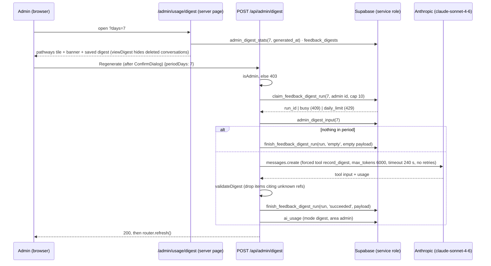

# Plan: Feedback Digest

> Status: **Approved 2026-11-18** (architecture-plan). Inputs: [requirement](requirement_feedback_digest.md), [business clarifications](business_clarifications_feedback_digest.md), [architecture clarifications](architecture_clarifications_feedback_digest.md). The user-facing flow charts are in [`requirement_feedback_digest.md`](requirement_feedback_digest.md) → "Flow charts"; this plan doesn't copy them. Next step: `task-creation`. **Revised 2026-11-19** after build: no cost anywhere (`lib/ai-pricing.ts` deleted, no cost or token columns on `feedback_digest_runs`); the digest page keeps only the "Most discussed pathways, till date" tile; `/admin/usage`'s "Reply feedback" block is replaced by Thumbs up / Thumbs down columns in its Activity table.

## Summary

An admin-only page at `/admin/usage/digest` shows two things:
- **The most discussed pathways, till date,** worked out on every page load with no AI call, plus a link to `/admin/usage` for users, conversations and 👍/👎.
- **A saved AI digest:** Summary, Most discussed topics, Unanswered questions and Terms, regenerated only when an admin asks. Its AI call is counted in `ai_usage` like every other Claude call; no cost is shown.

All reads across every user's data live in service-role SQL functions. One new admin route makes a single forced-tool Sonnet call. Code, not the model, checks every item against the real conversations behind it before it is saved.

## Scope

**In scope:**
- migration `0045` (three tables, four functions, the `ai_usage` area change, two indexes);
- `POST /api/admin/digest`;
- the page and two components;
- pure digest logic, text helpers and the prompt file;
- `at` timestamps on new chat messages;
- an "Admin (digest)" row and Digest links on the admin pages;
- on `/admin/usage`, Thumbs up / Thumbs down columns in the Activity table in place of the separate "Reply feedback" block;
- tests.

**Out of scope:**
- Everything under the requirement's "Deliberately not included": contributor-facing digest, schedule or email, export, history, per-pathway filter, signed-out Explore chats.
- Any change to the chat prompts or to `<grid_update>`.
- An admin conversation viewer.

## Assumptions

Every row marked **Waived — assumed** in [`architecture_clarifications_feedback_digest.md`](architecture_clarifications_feedback_digest.md): T3, T4, T5, T7–T16. Answered: T1 (`at` stamps with a fallback to the conversation's `updated_at`), T2 (the model judges "not covered" from the reply's start), T6 (admins' conversations count).

## Affected Areas

| Area | Component(s) | Nature of change |
|------|--------------|-------------------|
| Data | `supabase/migrations/0045_feedback_digest.sql` | **New.** Three tables, four `security definer` functions executable by `service_role` only, the `ai_usage.area` check widened to add `admin`, indexes on `designs(created_at)` and `library_conversations(updated_at)`. Its header states the one non-additive step (the constraint replacement). |
| Routes/API | `app/api/admin/digest/route.ts` | **New.** `export const POST = withErrorHandling('api/admin/digest', handlePOST)`, `export const maxDuration = 300`. |
| Domain logic | `lib/feedback-digest.ts` | **New, pure** (no React, no server imports): `toPeriod`, `buildDigestInput`, `DIGEST_TOOL`, `validateDigest`, `viewDigest`, payload types. |
| | `lib/digest-text.ts` | **New:** `scrubContact` (emails, phone numbers, URLs), `cap`, `oneLine`. |
| | `lib/ai-usage.ts` | `UsageArea` gains `'admin'`; `areaFor('digest')` → `'admin'`. |
| Content | `content/feedback-digest-prompt.md` | **New.** The digest system prompt, implementing the requirement's "How the assistant behaves". |
| Chat clients | `components/ChatPanel.tsx` (`Message.at`), `lib/adoption-conversation.ts`, `app/explore/ExploreLibrary.tsx` (`ChatMessage.at`) | Stamp `at` (ISO time) on every new user and assistant message. `toApiMessages` and the Explore request already send only `role`/`content`. Add a comment that the digest SQL reads these fields. |
| Frontend | `app/admin/usage/digest/page.tsx` (server), `components/digest/DigestScreen.tsx` (server), `components/digest/GenerateButton.tsx` (client) | **New.** Standalone admin layout (no `AppShell`). `isAdmin` → `redirect('/')`. The button uses `components/ConfirmDialog.tsx` and `router.refresh()`. |
| | `app/admin/usage/page.tsx`, `app/admin/page.tsx` | "Digest →" links; an "Admin (digest)" row in the AI usage table. On `/admin/usage`, the Activity table becomes Area \| Conversations \| Last 7 days \| Thumbs up \| Thumbs down (all-time, from `admin_feedback_stats().per_surface`, `0044`), and the separate "Reply feedback" block (two total tiles, the per-area table with Helpful % and 7-day columns, "Recent thumbs down") is removed. |
| Tests | `tests/db/migrations.test.ts` | `0045` is the latest; RLS on the three tables and no policies; functions revoked from clients and granted to `service_role`; the `ai_usage` check includes `admin`; `feedback_digest_runs` has no cost or token columns. |
| | `tests/unit/lib/feedback-digest.test.ts`, `tests/unit/lib/digest-text.test.ts` | Pure logic. |
| | `tests/api/admin/digest.test.ts` | The route, with `tests/helpers/supabase-mock.ts` and `tests/helpers/anthropic-mock.ts`. |
| | `tests/pages/server/admin-digest-page.test.tsx`, `tests/features/digest/GenerateButton.test.tsx` | Page (no Users, Conversations or Feedback tiles, no cost) and button. |
| | `tests/pages/server/admin-usage-page.test.tsx` | The "Admin (digest)" row; Thumbs up / Thumbs down columns in the Activity table; no "Reply feedback" section. |
| | `tests/client/use-adoption-conversation.test.tsx`, `tests/unit/server/ai-usage.test.ts` | `at` stamps; the `admin` area. |

## Architectural Approach

The feature sits inside the **admin monitoring boundary**, using the same pattern as `/admin/usage`: a server page reads through `createAdminClient()` from `security definer` SQL functions that clients can't execute. It adds one new kind of thing there: a write path (generate → save) behind an admin-only API route. It doesn't touch the chat route, retrieval, `<grid_update>`, the pathway store or the publish flow.



### Key decisions

**1. SQL builds the input; code checks the output.**
- `admin_digest_input(p_days)` returns up to the newest 400 questions, each `{key, area, person, at, question ≤300 chars, reply ≤300 chars}, at most 80 per person`, plus the period's 👎 rows `{key, area, pathway_slug, person, at, excerpt}`.
- It takes `displayContent` over `content`, so the full text of uploaded documents never leaves the database. Assistant notices aren't stored, so they're never read.
- A message's time is `coalesce(at, conversation.updated_at)`. People are numbered randomly per call; no user id is returned.
- Node turns these into `M1…` (questions), `F1…` (👎 votes) and `U1…` (people) labels for one run only. Contact details are scrubbed before the text goes to the model.
- `validateDigest` drops any item citing a ref that doesn't exist (or the wrong kind) and derives everything numeric or factual itself:
  - distinct conversations and users;
  - dates and areas;
  - the unanswered source tags: cited `M` → "Cube said not covered", cited `F` → "Marked not helpful";
  - the topic ranking, by distinct conversations.

  The model never supplies a number. This follows the Cube 2.0 pattern.

**2. A saved digest stores conversation keys, not bare ids.**
- Keys are `d:<designs.id>`, `l:<library_conversations.id>`, and `f:<message_feedback.id>` for a 👎 with no saved conversation.
- On page load, `admin_digest_stats` returns the keys that still exist (`live_keys`). `viewDigest` hides items left with none and recounts users.
- So deleted conversations, deleted accounts (their `designs`, `library_conversations` and `message_feedback` rows cascade) and withdrawn votes leave the page straight away, without regenerating.

**3. Lock, daily cap and attempt log are one atomic call.**
- `claim_feedback_digest_run`, in one statement:
  1. takes the one-row lease (5 minutes) if it's free or expired;
  2. counts today's attempts in the IST calendar day against the cap (10, passed by the route);
  3. inserts the `running` attempt row.

  Two admins can't both get past it.
- `finish_feedback_digest_run`:
  - writes `feedback_digests` only for a `succeeded`/`empty` run that still holds the lease;
  - records the status and finish time on the attempt row (`superseded` if the lease was lost);
  - releases the lease.
- A run that dies (tab closed, timeout) leaves its row `running`; the lease expires by itself after 5 minutes.

**4. Message `at` stamps are additive JSON fields.**
- They're written by the clients that already own conversation persistence. The "client persists, model never writes" rule is untouched.
- New messages get exact times; older ones fall back to their conversation's `updated_at`.

**5. Admins are not excluded** (T6). Their conversations count like anyone's, so no `ADMIN_EMAILS` handling is needed in SQL.

**6. Status copy lives in the button.** `withErrorHandling` replaces any 5xx body with the generic message, so `GenerateButton` maps statuses to the requirement's wording:
- 409: "A digest is already being generated. Try again in a few minutes."
- 429: "Today's digest limit is reached. It resets at midnight IST."
- other failures: "The digest couldn't be generated just now. The previous digest is unchanged; please try again."

## Alternatives Considered

1. **An eighth `/api/chat` mode.** Rejected: that route streams, gates by the adopter or contributor role, and is already about 440 lines. The digest is an admin batch job with a different shape.
2. **Unpack conversations in Node with the admin client.** Rejected: fetching every `messages` array would pull full uploaded documents over the wire. SQL trims them to 400 characters at the source (300 after scrubbing) and keeps all-users reads in one place.
3. **Scheduled or background generation.** Rejected: the requirement says on-demand only, and the repo has no job runner (only `after()`).
4. **Reuse `check_rate_limit` for the 10/day cap.** Rejected: its windows aren't IST calendar days, and the cap needs its own attempt log, counted in the same statement as the lease.
5. **Make Cube record a "gap" signal on every reply.** Rejected (T2): it would change every chat prompt and the `<grid_update>` contract for a reporting feature.
6. **Use the `adoption_queries` log for exact timestamps.** Rejected: it covers only Analyse and Contribute, has no reply text, and Explore isn't logged. The `at` stamps give exact times on every surface from now on.

## Key Tradeoffs

**Tradeoff: approximate periods for older messages**
- Decision made: a message's `at` when present, else its conversation's `updated_at`. Revised 2026-11-19: this only orders messages; a conversation is in the period when it was created in it, matching `/admin/usage`.
- What is gained: no backfill and no chat-route change.
- What is given up / deferred: messages sent before release are dated by their conversation's last activity, so a long conversation that continued this week can bring older questions into the 7-day digest.

**Tradeoff: the AI decides "not covered"**
- Decision made: the model reads the first 300 characters of Cube's reply, and the app confirms the "not covered" wording in that text before tagging.
- What is gained: no chat prompt or contract change.
- What is given up / deferred: code verifies that a cited question exists, not that the reply really said "not covered". The requirement presents these items as leads.

**Tradeoff: no retries on the digest call**
- Decision made: its own Anthropic client with `maxRetries: 0` and a 240-second timeout, a deliberate exception to TD-05.
- What is gained: bounded AI usage and run time within `maxDuration = 300`.
- What is given up / deferred: a transient 529/5xx fails the run; the admin presses Regenerate again.

**Tradeoff: logic lives in SQL**
- Decision made: stats and input are built in `security definer` functions.
- What is gained: minimal data leaves the database, and one auditable place reads all users' data.
- What is given up / deferred: Vitest only checks migration text, so correctness needs manual checks against the dev database.

**Tradeoff: coupling to the message JSON shape**
- Decision made: the SQL reads the shapes the chat clients write (`role`, `content`, `displayContent`, `pathwaysReferenced`, `at`).
- What is gained: no new storage, and history is usable immediately.
- What is given up / deferred: there are no types across that boundary, so a future change to the message shape could silently degrade the digest. Mitigated with a comment at both ends naming the other.

## Non-Functional Impact

- **Performance/scale:**
  - The page makes one stats call: the period figures use the new `created_at` indexes, and the "till date" pathways ranking unnests every conversation's messages on each load. That's fine at today's scale (128 conversations) but grows linearly; it gets a comment in the SQL and can be cached later.
  - No effect on chat latency or cost; the `at` stamp is a few bytes per message.
  - Digest AI usage: one call per run, reading at most 400 questions, at most 10 runs a day. Its tokens show in `/admin/usage`'s "Admin (digest)" row; no cost is computed (revised 2026-11-19).
- **Availability/failure modes:**
  - An AI failure, timeout, `max_tokens` stop or unusable output is a failed run: the previous digest is kept and the lease released.
  - A run that dies lets the lease expire in 5 minutes.
  - A database failure on page load shows the generic error page, like `/admin/usage`.
  - Nothing here can affect the chat surfaces.
- **Security:**
  - One new admin endpoint, gated by `isAdmin` in the route (the page check is UX). The functions are `service_role` only; the new tables have RLS on with no policies. The request body is a single enum.
  - User-written text flows into a prompt. It is fenced as data in the prompt, contact details are scrubbed first (there's no general PII screening, TD-15), and the model's only output is a forced tool call whose content is validated and can trigger no action.
  - Nothing new is readable through `published_pathways` (TD-18); the view is only joined for titles.
- **Consistency/coupling:**
  - The JSON-shape coupling above.
  - It reuses `ConfirmDialog`, `withErrorHandling`, `recordAiUsage` and the admin-page pattern. No new markdown renderer or chat UI (TD-14 unaffected).

## Data Model / API Changes

**Migration `0045_feedback_digest.sql`** (additive except the `ai_usage` check replacement, called out in its header):

**Tables**
- `feedback_digests`:
  - `period_days int primary key check (period_days in (7, 30))`
  - `payload jsonb not null check (jsonb_typeof(payload) = 'object')`
  - `generated_at timestamptz not null`
  - `run_id uuid references feedback_digest_runs`
- `feedback_digest_runs`:
  - `id uuid primary key`, `period_days int`
  - `admin_user_id uuid references auth.users on delete set null`
  - `started_at`, `finished_at`
  - `status text check in ('running','succeeded','empty','failed','superseded')`
  - No model, token or cost columns (revised 2026-11-19): tokens are recorded only in `ai_usage`. The table exists for the daily cap.
- `feedback_digest_lock`:
  - `id int primary key check (id = 1)`, `run_id uuid`, `locked_until timestamptz`
- All three: RLS enabled, no policies.

**`ai_usage`:** `drop constraint if exists ai_usage_area_check`, then re-add it as `check (area in ('explore','analyse','contribute','admin'))`. No data changes.

**Indexes:** `designs (created_at)`, `library_conversations (created_at)` (revised 2026-11-19: the period is counted by when a conversation was created, as `/admin/usage` does).

**Functions** (all `security definer`, `set search_path = public`, revoked from `public, anon, authenticated`, granted to `service_role`):
- `admin_digest_stats(p_days int, p_since timestamptz default null) returns jsonb`:
  - `users_period`, `conversations_period` (for the banner)
  - `pathways`: top 10 till date, `{slug, title, conversations}` (the page shows 5)
  - `live_keys`
  - `new_since`: conversations updated after `p_since`
- `admin_digest_input(p_days int) returns jsonb`: `{messages_total, messages[≤400], feedback[]}`.
- `claim_feedback_digest_run(p_period int, p_admin uuid, p_cap int) returns jsonb`: `{run_id}`, `{error: 'busy'}` or `{error: 'daily_limit'}`.
- `finish_feedback_digest_run(p_run uuid, p_status text, p_payload jsonb) returns boolean`: false when the run was superseded.

Revised 2026-11-19: `admin_digest_stats` no longer returns `users_total`, `conversations_total`, `conversations_by_area`, `thumbs_up` or `thumbs_down` (those counts are on `/admin/usage`), and `finish_feedback_digest_run` no longer takes model, tokens or cost.

**Stored payload (version 1):**
```
{ version: 1, period_days,
  basis: { messages_used, messages_total, feedback_used, keys[] },
  summary:    [{ text, refs: [{ section, index }] }],
  topics:     [{ title, summary, areas[], pathways[], keys[] }],
  unanswered: [{ question, sources: ('not_covered'|'not_helpful')[], areas[], dates[], keys[] }],
  terms:      [{ term, observation, keys[] }] }
```
`keys` entries carry the run-local person label too (`{k, p}`), so users can be recounted after deletions.

**API: `POST /api/admin/digest`**

Body: `{ periodDays: 7 | 30 }`.

| Status | Body / meaning |
|---|---|
| 200 | `{ ok: true }` |
| 400 | invalid period |
| 401 | not signed in |
| 403 | not an admin |
| 409 | `{ error: 'busy' }` or `{ error: 'superseded' }` |
| 429 | `{ error: 'daily_limit' }` |
| 502 / 503 | failed run (5xx body replaced by `withErrorHandling`; the button shows the requirement's copy) |

**Message JSON:** optional `at` (ISO string) on new user and assistant messages in `designs.messages` and `library_conversations.messages`.

## Risks & Open Items

- **Privacy notice** must cover admins seeing signed-in Explore chats before release. This is a release blocker from the requirement; the owner of legal sign-off decides.
- **TD-16:** the Anthropic account's recorded expiry (28-Oct-2026) has passed, and there is no fallback provider. Confirm the account. Until then Generate fails gracefully and the pathways tile and the saved digest still show.
- **TD-20:** one more hardcoded model ID (`claude-sonnet-4-6`).
- **TD-05:** this call site deliberately sets `maxRetries: 0` and a timeout.
- **`maxDuration = 300`** needs a Vercel plan that allows it. Under a lower cap, long runs are cut off and recorded as failed (the lease expires), and the previous digest is kept.
- **The till-date pathways scan** grows with all conversations. Flag it with a comment in the SQL; cache it later if the page slows.
- **"Not covered" judgement** isn't code-verifiable (see Key Tradeoffs).
- **The digest's user counts include admins** (T6). This matches the Usage page, which counts admins too.
- **No cost figure** (revised 2026-11-19). Spend is judged from the tokens in `/admin/usage`'s "Admin (digest)" row.
- **Wiki** (`docs/wiki/diffusion-cube/`) is stale on `0044`/`0045` and the new routes. Refresh with `llm-wiki` after merge.
- **JSON-shape coupling** between the chat clients and the digest SQL: comments at both ends.

## Sequencing

1. Migration `0045` and the `tests/db/migrations.test.ts` assertions. Everything else reads its functions.
2. `lib/digest-text.ts`, `lib/feedback-digest.ts`, with unit tests.
3. `at` stamps in both chat clients and the hook test. Independent of steps 1–2; can run in parallel.
4. `content/feedback-digest-prompt.md`, then `app/api/admin/digest/route.ts` and the `admin` area in `lib/ai-usage.ts`, with route tests.
5. Page, `DigestScreen`, `GenerateButton`, the admin links, the "Admin (digest)" row and the Activity table's Thumbs up / Thumbs down columns, with page and button tests.
6. Full `npm test`. Manual on dev:
   - apply `0045`;
   - call `admin_digest_stats` / `admin_digest_input` against real data and check the banner counts against the Usage page;
   - one paid Regenerate, then read the output and check the "Admin (digest)" row in `/admin/usage`;
   - delete a test conversation and confirm its items disappear.
