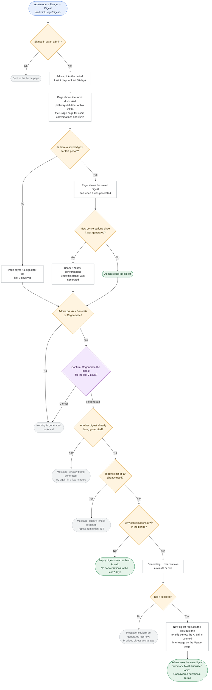
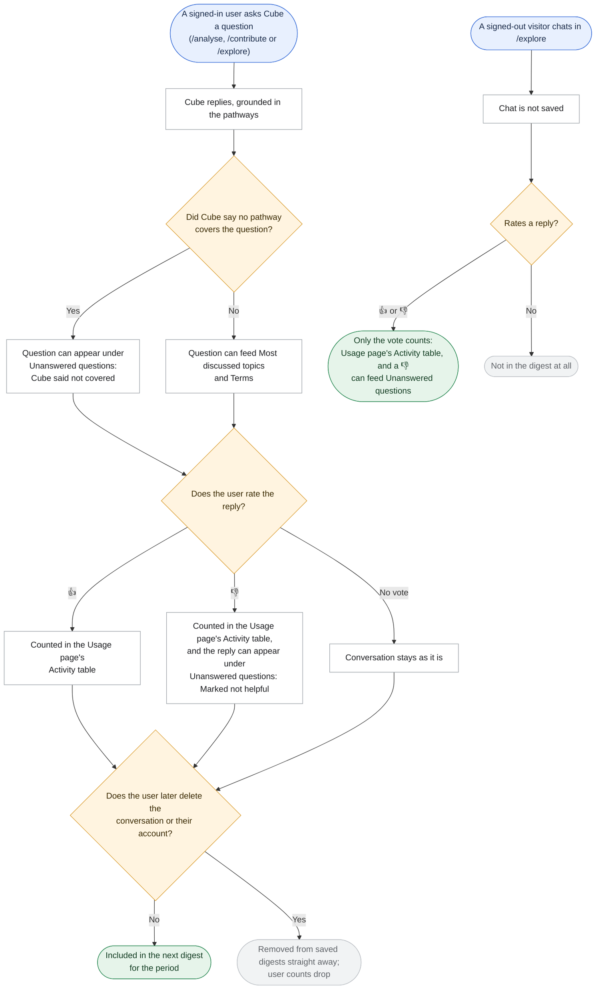
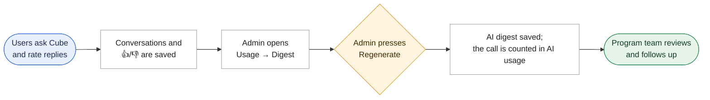

# Requirement: Feedback Digest

**Source:** Product Charter milestone **"Visibility into Pathway Usage & Reuse"** (target 15-Feb-27: conversations per week, likes/dislikes; partly in place as the admin Usage page). Adapted from the "Digest" tab a friend of the requester built for Cube 2.0 (a separate fork organised around playbooks). Requested by Anurag Goutam, 2026-11-17; scope settled 2026-11-18. Builds on the 👍/👎 reply feedback added on branch `feature/message-feedback`.

> Status: **Validated 2026-11-18** (business scope). **Revised 2026-11-19:** (1) cost is no longer shown anywhere; the digest's AI calls are counted in AI usage on the Usage page like every other Claude call; (2) the Users, Conversations and Feedback tiles are gone from the digest page, because the Usage page's Activity table already covers them; (3) the Usage page's separate "Reply feedback" block is replaced by Thumbs up / Thumbs down columns in its Activity table. **Final scope 2026-11-18** after the architecture plan: admins' own conversations now count too, and new messages record when they were sent so the period is exact for them. Earlier revision after the first review: Contribute conversations count; "Most discussed topics" is its own section, separate from "Most discussed pathways" (it replaces Themes); the Regenerate confirm doesn't mention cost. Business clarifications: [`business_clarifications_feedback_digest.md`](business_clarifications_feedback_digest.md). Technical decisions: [`architecture_clarifications_feedback_digest.md`](architecture_clarifications_feedback_digest.md). Engineering plan: [`plan_feedback_digest.md`](plan_feedback_digest.md). Next step: the `task-creation` skill.

## The problem today

Admins can see *how much* Cube is used (users, conversations, AI calls) and, with the new thumbs feature, how many replies were liked or disliked. They can't see *what* people are asking, which questions Cube couldn't answer, or which pathways keep coming up, without opening conversations one by one. So the program team has no quick way to spot gaps in the library or topics worth following up with contributors.

## What we are building

1. **A Digest page for admins.** A new page under the admin Usage page, **Usage → Digest**, opened from a link on the Usage page and on the admin home. Only admins can open it; anyone else is sent to the home page.
2. **A period toggle.** At the top: **Last 7 days** (default) or **Last 30 days**. Everything on the page follows the chosen period, except the "till date" figure.
3. **Most discussed pathways, always shown.** Worked out from the data when the page opens, with no AI involved: the top 5 *pathways* (named write-ups in the library) that Cube's answers drew on, till date, each with the number of conversations. A pathway counts once per conversation in which Cube's answers drew on it. This counts pathways, not subjects. What people talk *about* is "Most discussed topics" in the digest (point 5).

   A note under it says that users, conversations and 👍/👎 counts are on the Usage page, with a link. (Revised 2026-11-19: the digest page no longer has its own Users, Conversations and Feedback tiles; the Usage page shows users in its Users section, and its Activity table shows, per area, conversations, the last 7 days, and 👍 and 👎 till date. The table's note says each 👍/👎 is one vote per person per reply, a changed vote counts once, and Explore's include signed-out visitors. This replaces the Usage page's separate "Reply feedback" block.)

   All three areas count: **Analyse**, **Contribute** and signed-in **Explore**. Everyone's conversations count, admins' included (admins use Explore, Analyse and Contribute too). Signed-out Explore chats are never saved, so only their 👍/👎 votes count.
4. **A banner** with the period's live numbers, e.g. "In the last 7 days: 9 conversations from 4 users, counted as on the Usage page." (Revised 2026-11-19: a conversation is in the period when it was **started** in it, exactly as the Usage page's Activity table counts "Last 7 days", so the two pages always show the same number. The digest reads the messages of those same conversations.)
   - With fewer than 3 users it adds: "Too few users to see patterns."
   - When people have talked to Cube since the digest was made: "8 new conversations since this digest was generated."
5. **An AI-written digest**, made only when an admin asks for it (point 6). Four sections:
   - **Summary:** at most three bullets, each with how many users it rests on.
   - **Most discussed topics:** the subjects people talked about most in the period, ranked by how many conversations they came up in. Examples: "farmer advisory over WhatsApp", "getting language data". Each shows a short title, one or two sentences on what was asked, the areas, any pathways involved, and the number of conversations and users. A topic can span several pathways, or none, so this is a different list from "Most discussed pathways".
   - **Unanswered questions:** questions Cube couldn't answer well, grouped where they are near-duplicates. Each is tagged with where the signal came from: **"Cube said not covered"** (Cube's reply said no pathway covers it) or **"Marked not helpful"** (the person gave the reply a 👎). Each also shows when it was asked, the area (Explore, Analyse or Contribute) and how many users.
   - **Terms people asked about:** words or phrases people asked the meaning of.

   Any section with nothing in it is hidden.
6. **Generate only on request.** The page never creates a digest by itself. It shows the last saved digest and when it was generated.
   - **Generate digest** (or **Regenerate** when one exists) first asks for a plain confirmation: "Regenerate the digest for the last 7 days?" with **Cancel** and **Regenerate**. The confirm doesn't mention cost.
   - While it runs: "Generating… this can take a minute or two."
   - Only one digest is generated at a time across all admins, and at most **10 per day** in total.
   - If generation fails, the previous digest stays exactly as it was.
   - The 7-day and 30-day digests are kept separately; regenerating one replaces only that one.
7. **AI usage, counted like every other AI call.** (Revised 2026-11-19: there is no Cost section and no dollar figure anywhere.) Each digest's AI call is counted in the **Admin (digest)** row of the Usage page's AI usage table (calls, failed calls, input, output and cached tokens), alongside Explore, Analyse and Contribute. An empty period makes no AI call.
8. **Privacy built in.**
   - The digest never names people. Users are counted, never identified.
   - No names, places, organisations, emails, phone numbers or links. No quotes longer than a few words. Nobody is judged as an individual.
   - It describes what happened and never recommends what to change.
   - If a user deletes a conversation or their account, anything in a saved digest that relied only on it disappears straight away, and the user counts drop.
9. **English only.** The digest is written in English, translating anything users wrote in other languages.

## How the assistant behaves

This is about the AI that writes the digest, not Cube's answers to users (those don't change).

- **It only uses what's in the data.** Every topic, unanswered question and term must point to the actual conversations behind it. Anything it can't back up is thrown away by the app, not shown.
- **The app, not the AI, decides the numbers:** how many conversations and users stand behind an item (and so the ranking of topics), the dates, the source tag of an unanswered question, and what remains after deletions.
- **Unanswered questions come only from the two signals** (Cube said not covered, or 👎). The AI never invents a question nobody asked.
- **It describes, never prescribes.** No "the library should add…", no priorities, no judgement of anyone.
- **Thin evidence is said plainly:** with one or two people, it describes what was said rather than calling it a trend.

## Flow charts

### Admin side (Open → Period → Pathways → Generate → Confirm → Digest)

Updated 2026-11-18: the confirm step asks only "Regenerate the digest?" (no cost), and the finished digest lists Most discussed topics instead of Themes. Updated 2026-11-19: no cost anywhere, and the page shows only the most discussed pathways tile (users, conversations and 👍/👎 are on the Usage page).

#### What happens when Generate is pressed

Each check runs in this order. The first one that stops the run decides what the admin sees.

| Result | When | What happens |
|---|---|---|
| Cancelled | The admin presses Cancel on the confirm | Nothing runs; no AI call. |
| Already running | Another admin's generation is in progress | Message: "A digest is already being generated. Try again in a few minutes." No AI call. |
| Daily limit reached | 10 digests have already been generated today (IST) | Message: "Today's digest limit is reached. It resets at midnight IST." No AI call. |
| Empty period | No conversations and no 👎 in the period | An empty digest is saved with "No conversations in the last 7 days." No AI call; counts towards the daily limit. |
| Failed | The AI is unavailable, the run stops partway, or its output can't be used | Message: "The digest couldn't be generated just now. The previous digest is unchanged; please try again." The previous digest stays. |
| Success | Everything above passed | The new digest replaces the old one for that period only, with its generation time. The AI call is counted in the Usage page's AI usage table. |

### User side (Ask Cube → Rate the reply → Delete)

How everyday use feeds the digest. Nothing changes in what users see.

Updated 2026-11-18: Contribute conversations now count. Updated again 2026-11-18 (final scope): admins' conversations count too, so nobody signed in is left out. Updated 2026-11-19: votes are counted in the Usage page's Activity table, not a Feedback tile on the digest page.

#### How an unanswered question is decided

| Source tag | When it applies | What the admin sees |
|---|---|---|
| **Cube said not covered** | Cube's reply to the question said plainly that no pathway covers it, or that it couldn't answer (the AI writing the digest reads the start of Cube's reply to judge this) | The question (grouped with near-duplicates), dates asked, area, number of users |
| **Marked not helpful** | The person gave Cube's reply a 👎 | The same, with the tag "Marked not helpful" |
| Both | The reply said "not covered" *and* got a 👎 | Shown once, with both tags |
| Neither | Cube answered and nobody gave a 👎 | Not an unanswered question. It can still feed Most discussed topics or Terms. |

A 👎 doesn't prove the library lacks the answer; it shows the person wasn't helped. The digest reports it as that, not as a missing pathway.

### End-to-end lifecycle

## Who it's for

- **Admins (program team):** a weekly view of what people ask, which topics and pathways come up most, and what Cube couldn't answer, without reading conversations one by one. The digest's AI calls show up in the Usage page's AI usage table with every other AI call.
- **Explorers (adopters):** nothing changes on their side. Over time they benefit when gaps the digest surfaces get filled.
- **Contributors:** nothing changes on their side. Their Contribute conversations count in the digest (for example, where drafting a pathway gets hard), but they don't see the digest. A view of questions about their own pathway is future scope.

## Assumptions

The business questions were waived on 2026-11-18. Each of these is a default and can be changed at review:

1. **Readers and use:** the program team reads it in its weekly review and follows up with contributors.
2. **Success:** admins open it at least weekly, and at least one unanswered question per month leads to a follow-up.
3. **Signed-out Explore chats** count only through their 👍/👎 votes.
4. **Whole product**, no per-pathway filter.
5. **Signed-in Explore chats are included**, and the privacy notice is updated before release (see risks).
6. **Deleted conversations and accounts** leave saved digests straight away.
7. **Latest digest only** per period, no history.
8. **No quotes** beyond a few words, and no names, places, organisations, emails, phone numbers or links.
9. **Empty period:** an empty digest is saved with no AI call.
10. **"N new conversations since this digest"** hint is shown.
11. **At most 10 generations per day** across all admins, resetting at midnight IST.
12. **No cost shown** (revised 2026-11-19; was "cost in US dollars, as an estimate"). The digest's tokens are counted in AI usage on the Usage page.
13. **Digest always in English.**
14. **A 1–2 minute wait** is acceptable.

## Deliberately not included in this release

- Complaints and What's working sections (removed by the requester).
- A separate Themes section: it is replaced by Most discussed topics, which covers the same ground with a ranking.
- Cube 2.0's playbook-only parts: jobs, "Where people got stuck", journey states.
- A cost figure for the digest (removed 2026-11-19), and Users, Conversations and Feedback tiles on the digest page (removed 2026-11-19; the Usage page's Activity table covers them).
- Links from a digest item to the conversations behind it (there is no admin conversation viewer).
- Automatic generation on page load or on a schedule.
- **Future roadmap:**
  - a **contributor-facing digest** of questions about their own pathway ("Incentivize Contributors", 15-Jan-27)
  - a **per-pathway filter**
  - a **weekly email** of the digest to admins
  - **export** (PDF or copy)
  - a **history** of past digests
  - counting **signed-out Explore** conversations (they are not saved today, by design)

## Trade-offs and risks, in plain terms

- **Each digest is one AI call.** The AI reads at most the 400 most recent questions, and the confirm step, the one-at-a-time rule and the 10-per-day limit keep the number of calls bounded. The page shows no cost (revised 2026-11-19); the calls and their tokens are visible in the Usage page's AI usage table, under "Admin (digest)".
- **"In the last 7 days" is approximate for older messages.** From release, every new message records when it was sent, so the period is exact for those. For messages sent before release, the app only knows when the conversation was last active, so a long conversation that continued this week may bring in some older questions. 👍/👎 dates are always exact.
- **The digest only knows what is saved.** Signed-out Explore chats aren't saved, so only their votes count.
- **A 👎 is a signal, not proof.** It may mean the answer was too long, off-topic or simply unwelcome, so "Marked not helpful" items need an admin's judgement.
- **The AI can misread.** The app throws away anything not backed by real conversations, but the wording of a topic is still the AI's summary, and admins should treat it as a lead, not a finding.
- **Privacy: release blocker.** The privacy notice says Analyse conversations are seen by EkStep, but doesn't mention admins seeing saved Explore chats. The wording must be updated and approved by whoever owns legal sign-off before release, or Explore chats left out until it is.
- **AI account:** the account behind Cube (and this digest) was recorded as expiring 28-Oct-2026. That date has passed; confirm it was renewed. If it isn't active, Generate fails, but the most discussed pathways and the last saved digest still show.
- **Data lives only in the app's database.** Conversations, votes and digests are not copied elsewhere, so they depend on the database being backed up.
