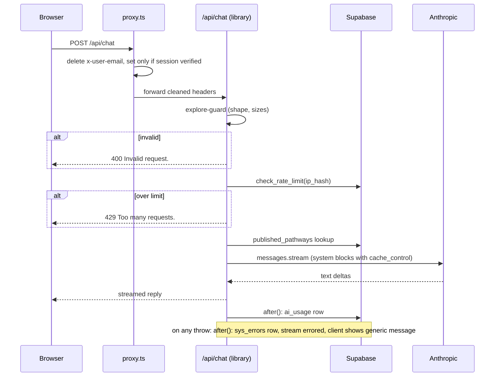

# Plan: System Error Handling, Usage Monitoring and Technical Cleanup

> Status: **Approved 2026-10-19** (architecture-plan). Inputs: [requirement](requirement_monitoring_logging_cleanup.md), [business clarifications](business_clarifications_monitoring_logging_cleanup.md), [architecture clarifications](architecture_clarifications_monitoring_logging_cleanup.md).

The user-facing flow charts are in [`requirement_monitoring_logging_cleanup.md`](requirement_monitoring_logging_cleanup.md) → "Flow charts".

## High-level summary

The approved engineering plan: how the requirement is built inside the existing Next.js + Supabase monolith, with no new vendors. Some details were changed during development; those changes are recorded in the architecture clarifications ("Plan-review decisions").

- **Error path.**
  - `withErrorHandling` wraps every API route.
  - A 4xx passes through and is recorded as expected.
  - A 5xx body is replaced with the generic message and recorded as unexpected.
  - Page errors go through `app/error.tsx`, `global-error.tsx`, `not-found.tsx` and `instrumentation.ts`.
- **Data.** Four migrations, all locked by RLS and reachable from the server only:
  - `0035`: `sys_errors`, plus a purge function
  - `0036`: `ai_usage`
  - `0037`: `rate_limits` and `check_rate_limit()`
  - `0038`: `admin_usage_stats()`
- **Explore and the sign-in header.** `lib/explore-guard.ts` and `lib/rate-limit.ts` run in the library branch, and `proxy.ts` strips `x-user-email`.
- **Cost.** Per-mode content loading, in-memory static files in production, and prompt caching with `cache_control`.
- **Cleanup.** Removes:
  - the pathway-submission routes
  - the two unused chat modes
  - the `<deliverable>` handling
  - the adoption plan's modal mode
  - the library's static corpus
  - the duplicate `parseFrontmatter`
  - the unused `diff` package
  - Google Sheets logging
- **Also in this file:**
  - the error classification
  - a full error catalogue as built (added 2026-10-22), with where it differs from the requirement
  - alternatives considered and key trade-offs
  - non-functional impact and risks
  - a 10-step build sequence

## Summary

Every server route and page goes through one shared error path:
- users see the customer's generic message for unexpected failures, and the existing specific messages for expected ones
- every error is written to a new `sys_errors` table, scrubbed of sensitive data and kept for 30 days

Each Claude call records its token usage in a new `ai_usage` table, and two new admin pages (`/admin/usage`, `/admin/errors`) read both tables. The public Explore chat gets input validation and a per-IP rate limit, enforced in Supabase so it holds across Vercel's serverless instances. The `x-user-email` header is reset on every request. Dead code and Google Sheets logging are removed. Prompts are split so their stable part can be cached, and static content is held in memory.

## Scope

**In scope:**
- **From the customer document:**
  - system error handling and the `sys_errors` table
  - the Usage page
  - the Explore checks and per-IP rate limit
  - the `x-user-email` reset
  - the five dead-code removals, plus two added in review: the duplicate `parseFrontmatter` (TD-10) and the unused `diff` dependency
  - prompt caching and per-mode, in-memory corpus loading
  - Google Sheets removal
- **Clarified in planning:**
  - an `expected | unexpected` kind on every error
  - app-level error and not-found pages
  - mid-stream failure handling
  - cache-token recording
  - saved Explore conversations included in the counts
  - a 30-day purge
  - existing 500 responses moved to the generic message (see "Error classification")

**Out of scope:**
- a reference code in the generic message
- email alerts
- automatic retry on Anthropic calls (TD-05)
- general activity logging
- limits on the Analyse and Contribute chats
- revoking the Google Cloud service-account key and archiving the Sheet
- a wiki refresh (done after this work)
- other known duplicate or dead code, deferred:
  - `ExploreLibrary.tsx`'s separate chat renderer (TD-14)
  - hard-coded brand colours (TD-11)
  - `SHOW_ORG_FILTER` in `app/contribute/ContributeGrid.tsx` (TD-13, a product decision)

## Assumptions

1. **The 30-day purge runs opportunistically** from `logError()`, at most once per server instance per hour, because `pg_cron` availability in the production Supabase project is unknown (architecture Q10). `pg_cron` can call the same function later.
2. **"Total published pathways"** counts distinct slugs across the static grounding corpus (`content/wiki/pathways/`) and `published_pathways`, the same set the library lists.
3. **Explore conversation counts** include only signed-in users' saved chats (`library_conversations`). Anonymous Explore calls appear in AI usage only.
4. **Existing 500 responses with hand-written friendly messages** (e.g. "Could not delete your account.") move to the generic message, following the customer's rule. This is a plan-review decision; it is easy to reverse per route.

## Error classification

The test is whether Cube anticipated the error. An error caused by the request or the user's own state is **expected**. Anything else is **unexpected**.

| Kind | Status | What the user sees | Examples in today's code |
|---|---|---|---|
| Expected: validation | 400 | Existing specific message | "Enter your password.", "sector required", "Unknown mode.", "Invalid request.", new Explore checks |
| Expected: not signed in | 401 | Existing specific message | "Not signed in.", "Unauthorized" |
| Expected: not allowed | 403 | Existing specific message | "The Explorer flow requires the Adopter role.", "Your account is awaiting approval.", "Incorrect password." |
| Expected: not found | 404 | Existing specific message | "Unknown pathway.", "Pathway not found.", "User not found." |
| Expected: conflict | 409 | Existing specific message | "This account already has access — it is no longer a pending signup." |
| Expected: too many requests | 429 | Existing specific message | "Too many attempts…" (account delete); new Explore rate limit |
| Unexpected | 500 | "System encountered an error. Please try sometime later." | Supabase/Anthropic/GitHub/SMTP failure, a code bug, missing config, a page render crash |

Today 11 responses return raw `error.message` or `String(err)` to the browser:
- `admin/roles` (×3)
- `auth/grant-default-role` (×3)
- `pathways` (×2)
- `pathways/[id]/join` (×2)
- `admin/reject` (×1)

These are the main leaks this work closes.

A wrong password at **login** goes from the browser straight to Supabase Auth and never reaches Cube's server, so it is not recorded.

### Error catalogue (as built)

Added 2026-10-22 from the code on `monitoring-logging-cleanup`. It lists every error Cube's server and pages can produce today. If this list and the code disagree, trust the code.

**How the code applies the rules.** All 24 `app/api/**/route.ts` handlers are wrapped in `withErrorHandling` (`lib/errors.ts`):
- A returned 4xx passes through unchanged and is recorded as **expected**.
- A returned 5xx is recorded as **unexpected**, and its body is replaced with the generic message. Several routes still build their 500 from `error.message` (`admin/roles`, `admin/reject`, `admin/pathways/delete`, `auth/grant-default-role`, `pathways`, `pathways/[id]/join`, `pathways/check-similar`, `lib/contributor-registration-server.ts`), but that text never reaches the browser.
- A 429 is passed through and **not recorded**. The rate limiter already counts it (`rate_limits`).

#### Expected errors (specific message kept, recorded as `kind: expected`)

| Status | Message | Where (route → condition) |
|---|---|---|
| 400 | "Unknown mode." | `api/chat`: `mode` not one of the live modes |
| 400 | "Invalid request." | `api/chat` (library): message array fails `lib/explore-guard.ts` (too many turns, message or total too long, bad role or content, last turn not from the user) |
| 400 | "Invalid request." | `admin/roles`, `admin/reject`, `admin/pathways/delete`, `admin/contributor-registrations/approve` and `/reject`: missing or invalid body fields |
| 400 | "You can't reject your own account." | `admin/reject` |
| 400 | "Enter your password." | `account/delete` |
| 400 | "Invalid sharing option." | `account/contact-sharing` |
| 400 | "title required" / "sector required" / "description required" | `pathways` POST |
| 400 | "title and description required" | `pathways/check-similar` |
| 400 | "No contributor registration found. Please complete registration first." | `pathways/[id]/join` |
| 400 | "pathwayId required" / "designId required" | `pathways/assemble`; "pathwayId required" also from `toolkit-assets` POST and `upload-url` (`lib/toolkit-assets-server.ts`) |
| 400 | "This pathway has an invalid slug and cannot be published." | `pathways/assemble` |
| 400 | "No draft found for this workspace. Generate a pathway document first." | `pathways/assemble` |
| 400 | "pathway_id required." | `admin/pathways/publish` |
| 400 | "No assembled document found. The contributor must publish from their workspace first." | `admin/pathways/publish` |
| 400 | "Public-sharing consent is required." / "name required" / "Invalid file." / "Uploaded file not found." / "File is over 25 MB." / "Links must be valid https:// URLs." / "kind must be file or link" | `toolkit-assets` POST |
| 400 | "fileName required" / "This file type can't be shared as a toolkit asset (ZIP isn't supported yet)." / "Toolkit asset files must be under 25 MB." | `toolkit-assets/upload-url` |
| 400 | "Report too large." / "Invalid report." | `errors/client` |
| 400 | "Invalid payload." / "This type of email is not supported." | `auth/send-email` (Supabase Auth hook, `{ error: { http_code, message } }` shape) |
| 401 | "Not signed in." | `account/delete`, `account/contact-sharing` |
| 401 | "Not authenticated." | `auth/grant-default-role` |
| 401 | "Unauthorized" | `organisations`, `pathways` (GET, POST), `pathways/check-similar`, `pathways/[id]/join` (POST, DELETE), `pathways/assemble`, `contributions/[designId]`, `toolkit-assets` contributor routes |
| 401 | "Invalid signature." | `auth/send-email`: webhook signature check failed |
| 403 | "Not authorized." | `admin/roles`, `admin/reject`, `admin/pathways/delete`, `admin/contributor-registrations/approve` and `/reject`: caller isn't admin |
| 403 | "Admin only." | `admin/pathways/publish` |
| 403 | "Your account is awaiting approval." | `api/chat` (every mode except library), `wiki-stats` |
| 403 | "Account not approved" | `pathways/assemble` |
| 403 | "The Contributor flow requires the Contributor role." / "The Explorer flow requires the Adopter role." | `api/chat` (companion) |
| 403 | "Sharing assets requires the Contributor role." | `api/chat` (asset-reuse) |
| 403 | "Contributor role required" | `pathways` POST, `pathways/check-similar`, `pathways/[id]/join`, `pathways/assemble`, `toolkit-assets` contributor routes |
| 403 | "Not a contributor to this pathway" / "Not your workspace for this pathway" | `pathways/assemble`; the first also from `toolkit-assets` contributor routes |
| 403 | "Only approved contributors can change this." | `account/contact-sharing` |
| 403 | "Incorrect password." | `account/delete` |
| 404 | "Unknown pathway." | `api/chat` (library): invalid slug, or no static or published document |
| 404 | "Pathway not found." / "Pathway not found" | `admin/pathways/publish` / `pathways/[id]/join`, `pathways/assemble` |
| 404 | "User not found." | `admin/reject` |
| 404 | "Registration not found." | `admin/contributor-registrations/approve` and `/reject` |
| 404 | "Not found" | `contributions/[designId]`; `toolkit-assets/[id]` and `/download` (also returned on purpose for "not yours", so other people's assets can't be discovered) |
| 404 | "This file is no longer available." | `toolkit-assets/[id]/download` |
| 409 | "This account already has access — it is no longer a pending signup." / "Admin accounts can't be rejected." | `admin/reject` |
| 409 | "This asset is already live and can't be removed." | `toolkit-assets/[id]` DELETE |

**Expected but not recorded:**

| Status / case | Message | Why it isn't in `sys_errors` |
|---|---|---|
| 429 | "Too many requests. Please try again later." | `api/chat` (library) and `errors/client` rate limits. Counted in `rate_limits` instead |
| 429 | "Too many attempts. Please wait a few minutes and try again." | `account/delete`: Supabase's password-check limit |
| 401 | "Unauthorized" | `proxy.ts`: a signed-out call to a non-public `/api/*` path. Answered before any route runs, so the wrapper never sees it |
| Page 404 | Cube's not-found page (`app/not-found.tsx`) | `notFound()` travels as a `NEXT_…` digest, and `instrumentation.ts` skips those on purpose |
| Wrong password at login | Supabase Auth's own message | Browser → Supabase directly; never reaches Cube's server |

#### Unexpected errors (generic message, recorded as `kind: unexpected` with stack)

| Source | What fails | What the user sees | `sys_errors.source` |
|---|---|---|---|
| Any API route: returned 5xx | Supabase query or RPC error, for example in `admin/roles`, `admin/reject`, `admin/pathways/delete`, `auth/grant-default-role`, `pathways`, `pathways/[id]/join`, `contributions/[designId]`, `account/contact-sharing`, registration approve/reject | "System encountered an error. Please try sometime later." (500) | `api/<route>` |
| Any API route: hand-written 500s | "Could not delete your account.", "Could not verify your password. Please try again.", "Could not delete this account.", "Failed to publish pathway.", "Could not save the asset. Try again.", "Could not remove the asset. Try again.", "Could not delete this contribution. Try again.", "Could not remove this contribution. Try again.", "Could not save your choice. Please try again.", "Could not create pathway" | The generic message. The hand-written text is recorded only (plan Assumption 4) | `api/<route>` |
| Any API route: thrown error | Code bug; Anthropic call fails (`asset-reuse`, prompt build); GitHub read/write fails (`lib/github.ts`); SMTP fails or `SMTP_HOST`/`ADMIN_EMAILS` missing (`lib/email.ts`); organisation insert fails (`lib/organisations.ts`); toolkit asset load or signed upload URL fails (`lib/toolkit-assets-server.ts`); missing static corpus file | The generic message (500) | `api/<route>` |
| `auth/send-email` | `SEND_EMAIL_HOOK_SECRET` missing (500), or an email send throws | Supabase receives `{ error: { http_code: 500, message: <generic> } }`; the user sees Supabase's sign-up/reset failure | `api/auth/send-email` |
| `api/chat` stream | The Anthropic stream breaks partway (bad key, overload, network) in any streaming mode | Text already shown, then the generic message; the turn isn't saved (no `<grid_update>`, so no grid write) | `api/chat` (with `mode`, `flow`, `user_id`) |
| `pathways/check-similar` | Anthropic similarity call fails | Nothing: answers `{ matchId: null }` so creating the pathway still works | `api/pathways/check-similar` |
| `lib/rate-limit.ts` | `check_rate_limit()` RPC fails | Nothing: the request is allowed (fail open) | `lib/rate-limit` |
| Server component / server action / proxy throw | Render-time fault, for example `admin_usage_stats()` failing on `/admin/usage` | Cube's error page (`app/error.tsx`) with the generic message | `<routeType>:<routePath>`, from `instrumentation.ts` |
| Browser crash | Client-side render error caught by `app/error.tsx` or `app/global-error.tsx` | Cube's error page with the generic message | `client:<path>`, through `api/errors/client` |
| Chat clients, before the stream | Non-2xx 5xx from `/api/chat` | The generic message (`lib/adoption-conversation.ts`, `ChatPanel`, `ExploreLibrary`). A 4xx shows its own `error` text | Recorded server-side by the route |

**Not recorded anywhere:** a failed `sys_errors` insert (or a failed purge) goes to `console.error` only. If Supabase is down, its own errors can't be stored, so the hosting logs are the only trace.

#### Where this differs from the requirement

- **Page not-found.** Requirement → "How an error is classified" says a not-found page is "Recorded? Yes, as expected". The code doesn't record it (see "Expected but not recorded" above).
- **Proxy 401.** Architecture clarification Q6 says every 4xx/5xx the server produces is recorded. The proxy's 401 for signed-out API calls isn't.
- **429.** The classification table above lists 429 as expected without noting the exception. The requirement and the code both leave 429 unrecorded.

## Affected Areas

| Area | Component(s) | Nature of change |
|---|---|---|
| Data | `supabase/migrations/0035_sys_errors.sql` | New table; indexes on `(created_at)` and `(source, created_at)`; RLS enabled with no client policies; `purge_old_sys_errors(days int default 30)` |
| Data | `supabase/migrations/0036_ai_usage.sql` | New table and index on `(created_at, area)`; RLS enabled with no client policies |
| Data | `supabase/migrations/0037_rate_limits.sql` | `rate_limits` table and atomic `check_rate_limit()` RPC (security definer); execute revoked from anon/authenticated |
| Data | `supabase/migrations/0038_admin_usage_stats.sql` | `admin_usage_stats()` security definer function returning one JSON object; execute revoked from anon/authenticated |
| Domain logic | `lib/errors.ts` (new) | `ValidationError`, `AuthError`, `NotFoundError`; `GENERIC_ERROR_MESSAGE`; `logError()` (scrub, cap, service-role insert inside `after()`, throttled purge); `withErrorHandling(source, handler)` |
| Domain logic | `lib/ai-usage.ts` (new) | `areaFor(mode, flow)`; `recordAiUsage()` (service-role insert inside `after()`) |
| Domain logic | `lib/rate-limit.ts` (new) | Client IP from `x-forwarded-for` (first hop), salted SHA-256 hash, RPC call; fails open and logs |
| Domain logic | `lib/explore-guard.ts` (new) | Message-array validation: turns, per-message and total size, roles, string content, first and last message from the user |
| Routes | All 26 `app/api/**/route.ts` | Exported handlers wrapped in `withErrorHandling`; the 30 inline 500 responses replaced by a throw or the generic message |
| Routes | `app/api/chat/route.ts` | `library` branch: guard → rate limit → pathway lookup → Claude. Both stream loops in try/catch (log, then `controller.error`). `stream.finalMessage()` usage → `ai_usage`. `logConversation` removed. `plan-document`/`pathway-exec-summary` branches and `<deliverable>` comments removed. Per-mode loading. System prompt sent as content blocks with `cache_control` |
| Routes | `app/api/pathways/check-similar/route.ts` | `result.usage` → `ai_usage` (area `contribute`) |
| Routes | `app/api/errors/client/route.ts` (new, public) | Receives browser errors: body size-capped, rate-limited, written as `source: client:<path>` → 204 |
| Middleware | `proxy.ts` | `x-user-email` deleted from a copy of the incoming headers on every request; the cleaned headers forwarded on every branch (signed in, public, redirect-free) |
| Prompts | `lib/system-prompts.ts` | Each builder used by a live mode returns `{ stable, variable }`: framework + corpus (+ resources, toolkit assets) in `stable`, grid/meta/`generatedAt`/version in `variable`. `planDocumentSystemPrompt` and `pathwaySubmissionExecutiveSummarySystemPrompt` deleted |
| Corpus | `lib/wiki-loader.ts`, `lib/wiki-content.ts` | Static file reads memoised at module level when `NODE_ENV === 'production'`; `published_pathways` still queried per request |
| Corpus | `lib/library-wiki-loader.ts` | Reads `published_pathways` only; `readdir`/`readFile` of `content/library-wiki/` removed; comment in `lib/slug.ts` updated |
| Frontend | `app/error.tsx`, `app/global-error.tsx`, `app/not-found.tsx` (new) | Cube-styled generic error page (reports to `/api/errors/client`, "back to home") and a not-found page |
| Frontend | `app/explore/ExploreLibrary.tsx` | Checks `res.ok`; shows a plain message on 400/429 and the generic message on 5xx or a broken stream; doesn't save a failed turn |
| Frontend | `lib/adoption-conversation.ts`, `components/ChatPanel.tsx` | Generic message on 5xx or a broken stream; partial reply not saved as the assistant turn; `<deliverable>` handling removed |
| Frontend | `lib/grid-update.ts` | `DELIVERABLE_START`/`END` and related parsing removed |
| Frontend | `components/AdoptionPlanModal.tsx`, `components/AdoptionWorkspace.tsx` | `mode` prop and modal branch removed; panel layout becomes the only one |
| Frontend | `app/admin/usage/page.tsx`, `app/admin/errors/page.tsx` (new); link from `app/admin/page.tsx` | Server pages gated by `isAdmin`, each with its own `AppShell` (same pattern as `/admin`); read via service role |
| Removal | `app/api/admin/pathway-submissions/review/route.ts`, `app/api/admin/pathway-submissions/publish/route.ts`, `app/api/pathway-submissions/push/route.ts`, `lib/pathway-submission-versions.ts`, `components/PathwaySubmissionsPanel.tsx` | Deleted (they reference tables dropped in migration 0018); stale comments in `lib/system-prompts.ts`, `lib/wiki-content.ts` and `lib/adoption-conversation.ts` cleaned |
| Removal | `lib/logger.ts`, `googleapis` in `package.json`, `GOOGLE_SERVICE_ACCOUNT_JSON`, `GOOGLE_SHEET_ID` | Deleted |
| Removal | `app/api/admin/pathways/publish/route.ts` | Private `parseFrontmatter` (L11) deleted; the route imports `parseFrontmatter` from `lib/strip-frontmatter.ts` (TD-10). The two return shapes differ (`Record<string, string \| string[]>` vs `PathwayFrontmatter \| null`), so the route's field reads around L72 are adapted, and the published row's fields are checked against a pathway published before the change |
| Removal | `diff` in `package.json` | Deleted (no import anywhere in `app/`, `lib/` or `components/`) |
| Removal | `content/library-wiki/` | Deleted only after Program Team sign-off (Sequencing step 9) |
| Config | `APP_ENV`, `EXPLORE_RATE_LIMIT_PER_MIN` (default 20), `EXPLORE_RATE_LIMIT_PER_DAY` (default 200), `RATE_LIMIT_SALT` | New env vars; documented in `docs/wiki/diffusion-cube/architecture/configuration.md` at the wiki refresh |

## Architectural Approach

Everything stays inside the existing Next.js monolith, with Supabase as the only stateful store. That matches the repo's stance of no worker, no queue and no extra vendors. Errors, usage and rate-limit counters are all plain tables written through the existing service-role client (`lib/supabase/admin.ts`).

**Error path.** `withErrorHandling(source, handler)` wraps each route's exported `GET`/`POST`/`DELETE`:

1. If the handler returns a response with status ≥ 400, it is logged as `kind: expected` (status below 500) or `kind: unexpected` (500 and above), and passed through. A 5xx body is replaced with the generic message, so no raw text can escape even if a route forgets.
2. If the handler throws `ValidationError`/`AuthError`/`NotFoundError`, the wrapper returns that class's status and message, logged as expected.
3. Any other throw is logged as unexpected with its stack, and the wrapper returns `{ error: GENERIC_ERROR_MESSAGE }` with a 500.

`logError()` writes inside Next's `after()`, so the response isn't delayed. A failed write goes to `console.error` only and never changes what the user sees. `user_id` comes from the Supabase session the route already resolves; the wrapper passes it through `context` when available.

Pages are covered by `app/error.tsx` (segment errors, server and client) and `app/global-error.tsx` (root layout). Both render the generic message and POST `{ message, stack, path, digest }` to `/api/errors/client`. Server-component errors reach these boundaries only as a digest, so the server side logs them before Next renders the boundary. This works because route-level logging covers data fetching, which is where server components fail in this app.

**Scrubbing.** Before insert, `logError()` applies three steps:
- `context` is filtered to an allow-list: `user_id`, `mode`, `flow`, `pathway_slug`, `design_id`, `path`, `method`, `status`, `kind`
- message is capped at 2,000 and stack at 8,000 characters
- patterns for Anthropic keys (`sk-ant-…`), bearer tokens, JWTs (`eyJ…`) and `password=` are masked

Request bodies and message arrays are never passed to `logError()`.

**Streaming failures.** Both stream loops in `app/api/chat/route.ts` get a try/catch. On failure the error is logged as unexpected and `controller.error()` is called, so the client's `reader.read()` rejects. The three chat clients catch that rejection, show the generic message after any text already rendered, and skip saving the turn. For companion mode the missing `<grid_update>` already means no grid write happens.

**AI usage.** After a stream completes, `await stream.finalMessage()` gives `usage` (`input_tokens`, `output_tokens`, `cache_read_input_tokens`, `cache_creation_input_tokens`). `recordAiUsage()` writes one row inside `after()`. Check-similar records from `result.usage`. Failed calls write `ok: false` with whatever usage is known (often none). `areaFor()` is the single mapping:

| Area | Modes |
|---|---|
| explore | `library` |
| analyse | `companion` with `flow !== 'contributor'`, `analysis-doc`, `executive-summary`, `extract-insights` with `flow !== 'contributor'` |
| contribute | `companion` with `flow === 'contributor'`, `pathway-draft`, `asset-reuse`, `extract-insights` with `flow === 'contributor'`, check-similar |

**Explore guard.** This runs first in the `library` branch, cheapest check first:
1. Shape and size validation (no I/O) → 400 `{ error: "Invalid request." }`.
2. `check_rate_limit(hash, per_min, per_day)` → 429 `{ error: "Too many requests. Please try again later." }`.
3. Only then `isValidSlug`, the pathway lookup and Claude.

The guard applies to both library chats (with or without `pathwayId`). If the RPC errors, the limiter fails open and logs the error, so Explore never goes down because of the limiter.

**Header reset.** At the top of `proxy.ts`, a copy of the request headers is made with `x-user-email` deleted. Every `NextResponse.next()` the proxy returns forwards that copy, and the signed-in branch sets the verified email on it. Redirect branches don't forward headers, so they need no change.

**Prompt caching and corpus loading.**
- The system prompt is sent as `[{ type: 'text', text: stable, cache_control: { type: 'ephemeral' } }, { type: 'text', text: variable }]`.
- A second breakpoint goes on the last message's content block, so long companion conversations reuse their history too.
- The `stable` text depends only on static files and `published_pathways`, so it stays identical across turns until an admin publishes, which naturally starts a new cache entry.
- Sonnet's 1,024-token minimum is exceeded by the ~22K-token corpus and by any single library pathway document. Check-similar's prompt is small and stays uncached.
- Each mode loads only what its builder uses:
  - `extract-insights`: framework only
  - `pathway-draft`: framework + generation prompt
  - analysis and summary modes: wiki + framework
  - explorer companion: wiki + framework + resources + toolkit assets
  - contributor companion: wiki + framework
- Static files are read once per instance in production; development keeps reading from disk, so edits show immediately.

**Usage and errors pages.** `/admin/usage` calls `admin_usage_stats()` once through the service role. It returns:
- **users:** total, new in the last 7 days, active in the last 7 and 30 days. Active means a `user_id` with activity in that window in any of `designs.updated_at`, `pathways.updated_at`, `library_conversations.updated_at` or `ai_usage.created_at`.
- **activity:** published pathways; conversations total and in the last 7 days, per area, from `designs`, `pathways` and `library_conversations`.
- **AI usage:** per area, calls, input/output tokens and cached tokens.
- **errors:** per day and per source for the retained 30 days, split by kind.

`/admin/errors` lists the latest 50 rows, with the stack in a collapsed `<details>`. Both pages follow `/admin`'s server-page pattern (`createClient` → `isAdmin` → redirect).



## Alternatives Considered

- **Per-route try/catch:** rejected. It means 26 hand-written copies that drift apart; one wrapper keeps classification identical everywhere and also catches routes that forget.
- **External error tracker (Sentry or similar):** rejected. The customer specified a Supabase table, and it would add a vendor and a data processor.
- **In-memory rate limiting:** rejected. Vercel serverless instances don't share memory, so the limit would be per instance and easy to exceed.
- **Upstash Redis for rate limiting:** deferred. It's faster, but it adds a vendor and a secret for a pilot of fewer than 100 users. `lib/rate-limit.ts` keeps the interface narrow so it can be swapped in.
- **`pg_cron` or Vercel Cron for the purge:** not chosen. `pg_cron` availability is unknown and Vercel Cron doesn't exist on the Docker/AWS path. The opportunistic purge works on both and can be replaced later.
- **Caching the system prompt as one string:** rejected. Per-turn values (grid, meta, `generatedAt`) sit inside the string, so the cache would miss on every turn.
- **Pre-aggregated usage counters:** rejected. Counting on page load is cheap at pilot scale and never shows stale numbers.
- **Keeping the existing friendly 500 messages:** rejected for consistency with the customer's rule (plan-review decision). Reversible per route.

## Key Tradeoffs

**Tradeoff: rate limit in Postgres**
- Decision made: a Supabase table and atomic RPC.
- What is gained: correct across serverless instances; no new vendor.
- What is given up / deferred: one extra DB round trip (~20–50ms) on each Explore turn, and DB load under attack. Old rows are deleted inside the same RPC to keep the table small.

**Tradeoff: splitting prompt builders into stable and variable parts**
- Decision made: restructure every live builder in `lib/system-prompts.ts`.
- What is gained: prompt caching works (cached input is billed at about a tenth of normal input), and repeat turns get their first token sooner.
- What is given up / deferred: instruction order changes, which could shift Cube's answers. Mitigated by comparing fixed sample questions per mode before and after (requirement → "How we'll know it worked").

**Tradeoff: recording expected errors**
- Decision made: record every 4xx/5xx, tagged by kind.
- What is gained: the complete record the customer asked for.
- What is given up / deferred: more rows (e.g. 401s from expired sessions). The Usage page splits counts by kind so real faults stay visible.

**Tradeoff: opportunistic purge**
- Decision made: purge from `logError()`, throttled.
- What is gained: no scheduler dependency on either deploy path.
- What is given up / deferred: if no errors happen, nothing is purged. That's harmless, since nothing is being added either.

**Tradeoff: limiter fails open**
- Decision made: allow the request if the rate-limit RPC fails.
- What is gained: Explore stays available during a database problem.
- What is given up / deferred: during such a problem the limit isn't enforced. The failure is logged.

**Tradeoff: removing `<deliverable>` handling outright**
- Decision made: delete it, with no fallback.
- What is gained: a simpler client and fewer special cases in `ChatPanel`.
- What is given up / deferred: if a prompt emits the tag again, it shows as raw text. No prompt emits it today.

## Non-Functional Impact

- **Performance/scale:**
  - Fewer disk reads per request (memoised static files) and less work per mode.
  - Prompt caching cuts input cost and the wait for the first token on repeat turns.
  - Error and usage writes run in `after()`, so users don't wait for them.
  - The Explore guard adds one RPC per turn.
  - `admin_usage_stats()` scans small tables at pilot scale. Indexes on `created_at` cover the windowed counts.
- **Availability/failure modes:**
  - If Supabase is unavailable, error and usage writes fail silently (`console.error`), the limiter fails open, and users still get the right message.
  - There's still no retry on Anthropic calls (TD-05). A failure now gives the generic message instead of a raw 500 or a silently stopped stream.
- **Security:**
  - Closes `x-user-email` forging, including the `isAdmin()` check on `/explore`.
  - Closes unbounded anonymous Claude calls through Explore.
  - Ends the 11 raw-error leaks.
  - New attack surface: `/api/errors/client` (public), which is size-capped and rate-limited.
  - `sys_errors`, `ai_usage` and `rate_limits` are unreachable from the browser (RLS with no policies, writes and reads via service role only).
  - IPs are stored only as salted hashes.
  - Conversation content stops flowing to Google Sheets.
- **Consistency/coupling:**
  - Less duplication: one pathway corpus fewer (TD-02 shrinks), one error path, and one mode-to-area map.
  - `withErrorHandling` becomes a new cross-cutting dependency for every route. That's deliberate and the only new coupling.
  - No change to the `<grid_update>` contract or the two-step publish gate.

## Data Model / API Changes

```sql
-- 0035_sys_errors.sql
sys_errors(
  id uuid primary key default gen_random_uuid(),
  created_at timestamptz not null default now(),      -- "timestamp"
  source text not null,                               -- e.g. 'api/chat', 'client:/analyse'
  message text not null,
  stack text,
  context jsonb,                                      -- allow-listed keys only, incl. kind
  user_id uuid references auth.users(id) on delete set null,
  environment text not null check (environment in ('prod','dev'))
)

-- 0036_ai_usage.sql
ai_usage(
  id uuid primary key default gen_random_uuid(),
  created_at timestamptz not null default now(),
  user_id uuid references auth.users(id) on delete set null,
  area text not null check (area in ('explore','analyse','contribute')),
  mode text not null, flow text, model text not null,
  input_tokens int, output_tokens int,
  cache_read_tokens int, cache_creation_tokens int,
  ok boolean not null
)

-- 0037_rate_limits.sql
rate_limits(key text, bucket text, window_start timestamptz, count int, primary key (key, bucket))
check_rate_limit(p_key text, p_per_min int, p_per_day int) returns boolean

-- 0038_admin_usage_stats.sql
admin_usage_stats() returns jsonb
```

- **`/api/chat` (`library`):** new 400 `{ error: "Invalid request." }` and 429 `{ error: "Too many requests. Please try again later." }`. Every mode returns `{ error: "System encountered an error. Please try sometime later." }` on unexpected failure.
- **`/api/chat` (removed modes):** `plan-document` and `pathway-exec-summary` now return 400 "Unknown mode.".
- **`POST /api/errors/client` (new, public):** body `{ message, stack?, path, digest? }`, max 16 KB → 204; 429 when over limit.
- **Removed endpoints:** `POST /api/admin/pathway-submissions/review`, `POST /api/admin/pathway-submissions/publish`, `POST /api/pathway-submissions/push`.
- **Account deletion:** `user_id` uses `on delete set null`, so a deleted account's errors and usage stay anonymised until they age out. The account-deletion flow (`lib/account-deletion-server.ts`) needs no change.

## Risks & Open Items

- **TD-16 (Anthropic account expires 28-Oct-2026, in 9 days).** This work will most likely land after that date. If the account isn't renewed, prompt caching, usage capture and the Explore guard can't be verified against the live API, and every AI feature stops.
- **No automated test suite.** Verification is manual (curl against each route and the requirement's "How we'll know it worked" checklist). Answer stability after caching is a hand comparison of fixed sample questions.
- **Library folder deletion** — *Resolved 2026-10-20: the owner chose grounding corpus + DB as the library source (business Q30–Q33). Data Dhara/CEEW were moved into the corpus and the folder was deleted. See the architecture plan-review decisions.* The original text said it was blocked on the Program Team publishing Data Dhara and CEEW and confirming the five diverged pathways. Until then only the code path changes, and the step-6 check confirms all 8 slugs exist in `published_pathways` before the folder reads are removed.
- **Google Cloud service-account key** behind `GOOGLE_SERVICE_ACCOUNT_JSON` remains valid after the code is removed, until the user revokes it (outside this work).
- **Server-component errors** surface in `error.tsx` only as a digest. Logging relies on route-level and data-fetch logging, so a crash purely inside rendering may be recorded with less detail. *Resolved in development 2026-10-19: `instrumentation.ts` `onRequestError` records these with the original stack (see architecture plan-review decisions).*
- **`after()` on Vercel Hobby** is subject to the function time limit. The inserts are small, so this is low risk.
- **Instruction reordering** may change answers slightly (Key Tradeoffs). Prompt caching ships last for this reason.
- **Wiki drift.** Refresh the wiki (`llm-wiki`) after this work: new tables, the removed modes and routes, and the single library corpus.

## Sequencing

1. **Migrations 0035–0038.** Apply them to the right Supabase project first; `.env.local` points at a different project than the live site.
2. **Error foundation.** `lib/errors.ts`; wrap all 26 routes and remove the raw-message leaks; `app/error.tsx`, `app/global-error.tsx`, `app/not-found.tsx`; `/api/errors/client`.
3. **Header reset and Explore.** The `proxy.ts` reset; `lib/explore-guard.ts`, `lib/rate-limit.ts`; the `res.ok` check and failure handling in `ExploreLibrary.tsx`.
4. **Usage capture and Sheets removal**, in the same release so there's no gap. `lib/ai-usage.ts` in the chat stream and check-similar; delete `lib/logger.ts`, `googleapis` and the env vars. Stream-failure handling in `ChatPanel`/`adoption-conversation`.
5. **Admin pages.** `/admin/usage` and `/admin/errors`, linked from `/admin`.
6. **Dead code.**
   - the dropped-table code
   - the two modes and their builders
   - `<deliverable>` handling
   - `AdoptionPlanModal` modal mode
   - the library static-corpus code, after the 8-slug check
   - the duplicate `parseFrontmatter` in the admin publish route
   - the unused `diff` dependency
7. **Per-mode loading and production memoisation.**
8. **Prompt caching**, after a few days of `ai_usage` baseline data. Run the fixed sample questions per mode before and after.
9. **Delete `content/library-wiki/`** after Program Team sign-off.
10. **Wiki refresh** (`llm-wiki`).
