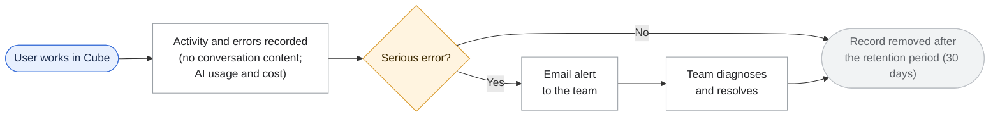
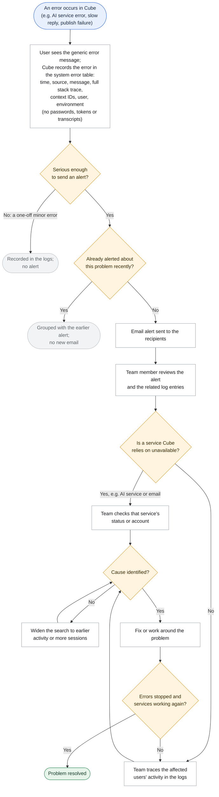
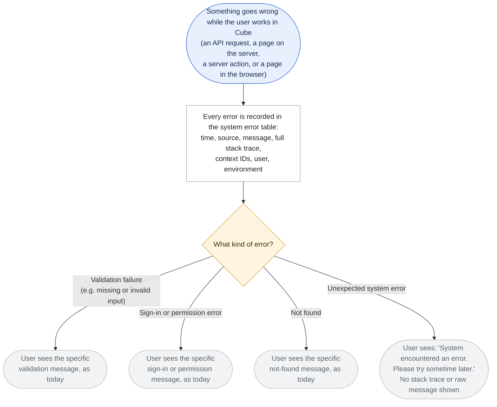
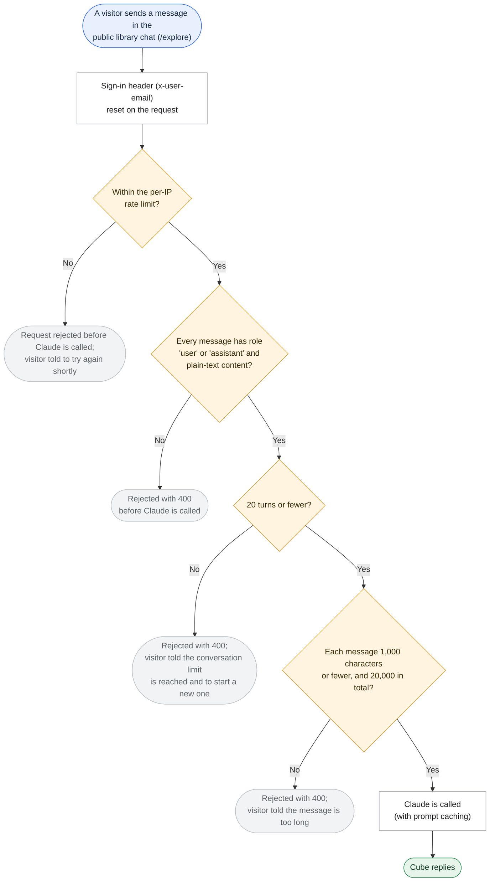
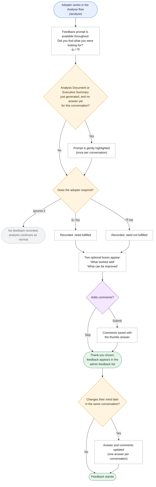
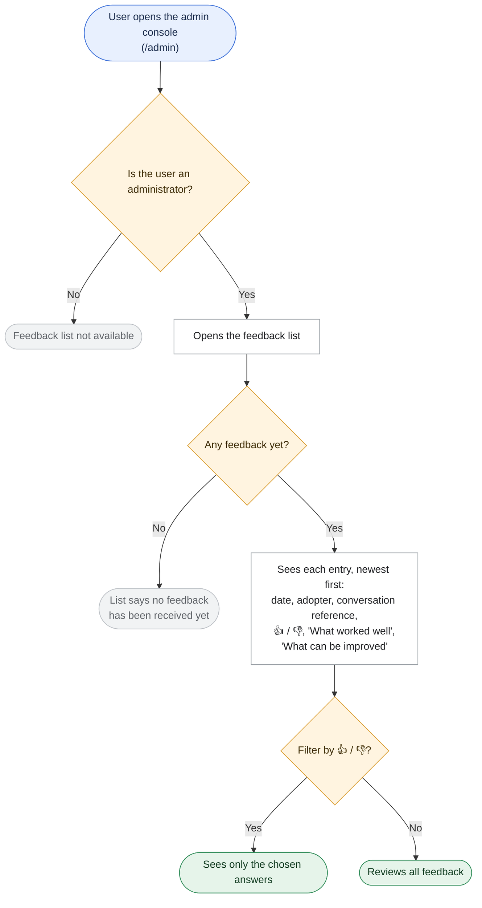
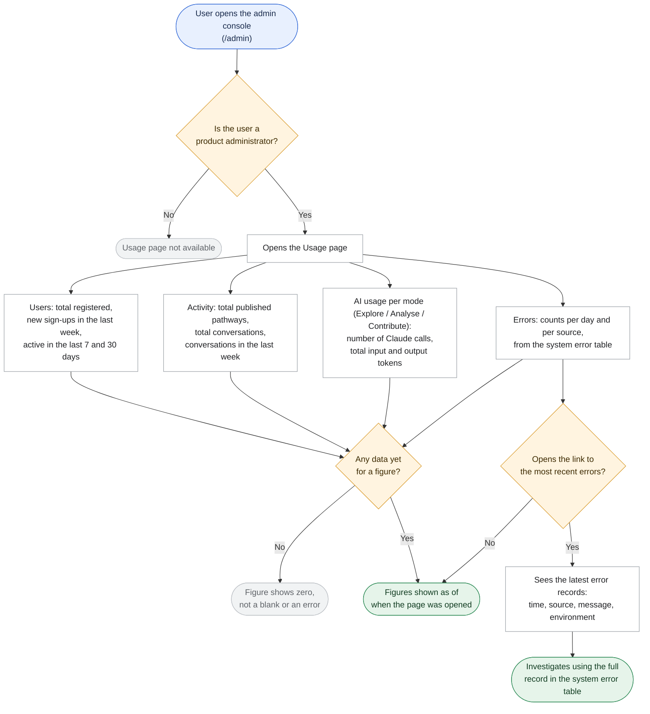

# Requirement: Monitoring, Logging, Adopter Feedback and Technical Cleanup

## The problem today

Cube is about to move into a pilot with real users. Today, if something goes wrong:

- **Problems surface only when a user reports them.** Errors are written to the hosting platform's raw log stream. There are no alerts, no health checks and no error tracking.
- **Reported problems are hard to trace.** Nothing ties an error to a particular user, flow or conversation. Finding the cause relies on searching raw logs by time.
- **The cost of running Cube is not visible.** Every conversation turn calls the AI service, but nothing records how much each call uses or what it costs.
- **The public library chat is open to misuse.** Anyone can send it unlimited and unchecked requests, each of which calls the AI service.
- **Users can see raw technical errors.** When something fails unexpectedly, internal error text can reach the user's screen. In some cases an error message even appears as if it were Cube's reply.
- **There is no view of how Cube is used.** No one can easily see how many users are registered or active, how many conversations take place, how much the AI service is used, or how many errors occur.
- **There is no way to know whether adopters found what they needed.** Adopters using the Analyse flow have no simple way to say whether Cube met their need, or what worked well and what could be better.
- **The code carries leftovers from earlier versions.** Some retired features remain in the code, some logic is repeated in more than one place, and some settings are fixed in several places. All of this slows down diagnosis and fixes.

## What we are proposing

1. **Record every significant event.** Each conversation turn, document generation, pathway publication, sign-in or sign-up step, and error will be logged. Each entry will show:
   - **who**: the user and their role
   - **where**: Explore, Analyse, Contribute or Admin
   - **which** conversation or pathway it concerns
   - **what** happened, or what failed and why
   - **how long** it took
   - **for AI calls**: how much it used and what it cost

   **For privacy, entries will not include the content of conversations or documents.** They leave out what users write or upload and Cube's replies, and they never contain passwords or tokens. Instead, they record facts about the activity: which step ran, how it ended, and any error details. Because usage and cost are recorded for every AI call, these records also feed the Usage page (item 12).
2. **Trace any user's session from start to finish, without going back to the user.** When a user reports a problem, knowing who they are is enough. The logs already hold what they did, when, in which area, which conversation or pathway was involved, how each step ended and what failed. The support team can follow that user's activity step by step to the point of failure without asking the user for more details. The aim is to identify the cause as quickly as possible.
3. **Handle unexpected system errors gracefully.** This applies to every part of Cube: API routes, server components, server actions and client-side rendering (errors raised in the user's browser while a page is drawn).
   - **Unexpected errors:** when something fails that should not, the user sees a generic message: **"System encountered an error. Please try sometime later."**
   - **No technical detail reaches the user.** A stack trace (the technical record of where in the code the error happened) or a raw error message is never sent to the user's browser.
   - **Expected errors keep their specific messages.** Validation failures (for example a missing or invalid input), sign-in and permission errors, and not-found errors keep their current wording. The generic message is used only for unexpected failures.
4. **Record every system error in Cube's database for the system administrator.** All errors, expected and unexpected, are stored in Cube's own database (Supabase), with the full stack trace, in a dedicated system error table (for example `sys_errors`). Each error record holds:

   | Field | What it holds |
   |---|---|
   | id | A unique reference for the error |
   | timestamp | When the error occurred |
   | source | Where it happened: the route or module |
   | message | The error message |
   | stack | The full stack trace |
   | context | Optional details identifying the failing operation, such as the user id, chat mode, pathway and request path |
   | user_id | The user affected, if one was signed in; empty otherwise |
   | environment | Production (prod) or development (dev) |

   **Context is limited to IDs and short metadata.** It never contains passwords, tokens or full chat transcripts.
5. **Send email alerts when something goes wrong.** Serious problems will trigger an email to a configured list of recipients, so the team usually knows before users report anything. Examples are the AI service failing, the application being unavailable, or a run of errors. Repeated alerts for the same problem are grouped, so a burst of errors does not flood inboxes. During the pilot, the team will respond on a best-effort basis.
6. **Keep logs for 30 days by default.** Older entries will be removed automatically. The retention period can be changed without a new release of the application.
7. **Deliver a code-review report with a remediation plan.** A reviewed list of repeated, outdated, unused, inefficient or hard-coded parts of the code. Each item will set out its impact and a proposed plan to remove or fix it. This release delivers the report and the plan, plus the specific fixes in items 13–16. The remaining fixes follow in a later release, once the plan is approved. The initial findings are listed in [Appendix A](#appendix-a-technical-cleanup-findings).
8. **Retire the Google Sheet conversation log.** Google Sheets logging is removed (see item 16).
9. **Ask adopters whether they found what they were looking for.** In the Analyse flow, each conversation offers a single "Did you find what you were looking for?" prompt with a thumbs-up (yes, my need was fulfilled) and a thumbs-down (no, it was not). The adopter can answer at any time. The prompt is gently highlighted once, after an Analysis Document or Executive Summary is generated. It never blocks the conversation, and the adopter can change their answer later in the same conversation.
10. **Let adopters say what worked well and what can be improved.** After choosing thumbs-up or thumbs-down, the adopter sees two optional short text boxes: "What worked well" and "What can be improved". They can fill in either, both or neither.
11. **Give administrators a simple feedback list.** A minimal, read-only list in the admin console shows each piece of feedback: date, adopter, a reference to the conversation, thumbs answer and comments. It can be filtered by thumbs-up or thumbs-down. Only administrators can see it.
12. **Give product administrators a minimal Usage page.** A new, read-only page in the admin console for usage logging and monitoring, visible only to product administrators. It shows:
   - **Users**
     - total registered users
     - number of new sign-ups in the last week
     - active users over the last 7 days and over the last 30 days
   - **Activity**
     - total number of published pathways
     - total number of conversations
     - number of conversations in the last week
   - **AI usage**
     - number of Claude (AI service) calls per mode: Explore, Analyse and Contribute
     - total input tokens and total output tokens per mode (tokens are the units the AI service uses to measure and bill the text it reads and writes)
   - **Errors**
     - error counts per day and per source, read from the system error table (`sys_errors`, item 4)
     - a link to the most recent errors, which opens a simple read-only list of the latest entries in the system error table
13. **Secure the public Explore (library) conversations.** These checks apply to the Explore chat only, and run before Cube calls Claude:
    - **Turn limit:** at most 20 turns in a conversation.
    - **Message size:** at most 1,000 characters per message.
    - **Conversation size:** at most 20,000 characters in total.
    - **Message format:** every message must have the role "user" or "assistant", and its content must be plain text.
    - **Rate limit:** a per-IP rate limit, so no single address can send unlimited requests.
    - **Rejection:** anything else is rejected with a "bad request" (400) response before Claude is called.
    - **Sign-in header:** the internal sign-in header (`x-user-email`) is explicitly reset on every request, so a visitor's browser can never supply its own value.
14. **Remove redundant and dead code.**
    - **Retired tables:** code for the database tables that were dropped (the retired "pathway submissions" feature) is deleted.
    - **Unused chat modes:** the two chat modes nothing calls (`pathway-exec-summary` and `plan-document`) are deleted, along with their prompts.
    - **`<deliverable>` handling:** it is unused, since no prompt emits the tag any more, so it is deleted.
    - **Adoption plan "modal" mode:** the adoption plan view's modal mode is never used (its only caller uses the panel mode), so it is deleted.
    - **Deprecate `content/library-wiki/`:** the library's static pathway folder (`content/library-wiki/`, 8 pathway files at review time) is deprecated and removed, along with the code that reads it (the library's static-corpus branch). The public library is then served from published pathways only. Before removal, every pathway in the folder is confirmed to be available as a published pathway (Assumption 27).
15. **Optimise how Cube prepares each AI call.**
    - **Prompt caching:** Cube reuses the large, unchanging part of its instructions (the pathway collection and the framework) instead of paying for it again on every call. Cube's answers must stay exactly the same.
    - **Load per mode:** each AI mode loads only the content it actually uses.
    - **Keep static files in memory:** static files are loaded once when the server starts, instead of being reloaded on every request.
16. **Remove Google Sheets logging.** The Google Sheet conversation log is switched off and its code removed. Before that, the existing Sheet data is exported and archived, so the history is not lost. The new monitoring logs (item 1) replace it, without conversation content.

## Flow charts

### End-to-end lifecycle

### When something goes wrong (error → record → alert → diagnose → resolve)

#### When an email alert is sent

| Outcome | When | What happens |
|---|---|---|
| Recorded only | A single minor error that does not stop the user | Logged; no email |
| Email alert | The AI service, database or email delivery is failing; the application is unavailable; or errors keep occurring over a short period | One email to the recipients, stating the problem and when it began |
| Grouped | An alert has already been sent for the same problem and it has not yet cleared | No new email; the earlier alert stands until the problem clears |

### What the user sees when an error occurs (expected vs unexpected)

#### Expected and unexpected errors

| Type of error | Example | What the user sees | Recorded in the system error table? |
|---|---|---|---|
| Validation failure | A required field is missing, or a file type is not supported | The specific message, as today | Yes |
| Sign-in or permission error | Not signed in, or the role does not allow the action | The specific message, as today | Yes |
| Not found | A pathway or conversation that does not exist | The specific message, as today | Yes |
| Unexpected system error | The AI service, database or GitHub fails, or the code hits a fault | "System encountered an error. Please try sometime later." | Yes |

### Explore conversations: checks before Claude is called

Each rejection is an expected error (item 3): the visitor sees a specific message, not the generic one, and the rejection is recorded in the system error table.

### Adopter feedback in the Analyse flow (Analyse → Feedback prompt → Thumbs → Optional comments → Admin list)

#### How the feedback prompt behaves

| Situation | What the adopter sees | What happens |
|---|---|---|
| Any time during an Analyse conversation | A small "Did you find what you were looking for?" prompt with 👍 and 👎 | Nothing until they choose; the prompt never blocks the conversation |
| An Analysis Document or Executive Summary has just been generated, and there is no answer yet | The same prompt, gently highlighted | Shown once per conversation; ignoring it changes nothing |
| They choose 👍 or 👎 | Two optional boxes: "What worked well" and "What can be improved" | The thumbs answer is saved immediately; comments are saved only if submitted |
| They change their mind later in the same conversation | Their earlier answer, which they can change | The answer and comments are updated; each conversation keeps one answer |
| They have already answered | Their answer, shown as selected | No further highlighting in that conversation |

### Administrators: viewing adopter feedback

### Product administrators: the Usage page

## Who benefits

- **The system administrator** gets every unexpected error stored in one place with its full technical detail, ready for diagnosis.
- **All users** see a clear, consistent message when something unexpected fails, instead of raw technical text.
- **The support and engineering team** is alerted to problems by email, can trace any reported issue to its cause, can see AI usage and cost in the logs, and receives a code-review report with a clear remediation plan.
- **Adopters (Explorers)** get a quick, optional way to say whether Cube met their need and what could be better.
- **Visitors to the public library** get a chat that is protected against misuse, and Cube's running costs fall for everyone through prompt caching.
- **Product administrators** see, on one page, how many users are registered and active, how much activity and AI usage there is in each area, and how many errors occur and where, with a direct route to the latest errors.
- **Administrators and the Program Team** see directly whether the Analyse flow is meeting adopters' needs, and why, through the feedback list.
- **Contributors and visitors to the public library** see no change on screen. Like everyone else, they benefit because problems are found and fixed sooner.

## Assumptions

The following points were not settled during clarification and are proposed for confirmation:

1. **Access to logs.** Only administrators and the support and engineering team can view log entries. Pilot users cannot view logs.
2. **Deleted accounts.** When a user deletes their account, their log entries are kept until the end of the normal retention period, then removed.
3. **Events that trigger an email alert.** The proposed starting list can be adjusted:
   - the AI service failing
   - the database failing
   - email delivery failing
   - the application being unavailable
   - a run of errors in a short period
   - a pathway publication failing

   A single slow reply or a one-off error does not trigger an alert.
4. **Alert recipients** are a configurable list of email addresses maintained by the support team.
5. **Time to trace an issue.** "As quickly as possible" is treated as an aim for the pilot, not a measured target.
6. **Public library visitors.** Library conversations are logged in the same way. Visitors who are not signed in are recorded as anonymous.
7. **How users are identified in logs.** In keeping with the privacy decision, logs identify a user by an internal account reference, not by name or email address. The support team can look up who a reference belongs to when needed.
8. **Feedback is kept apart from the logs.** Adopter feedback, including the written comments, is stored as feedback linked to the adopter and the conversation. It is not written into the monitoring logs, and the 30-day log retention does not apply to it. Feedback is kept until it is removed.
9. **Feedback is removed with its source.** If an adopter deletes their account, or deletes the conversation, its feedback is deleted too.
10. **Feedback stays with the administrators.** Feedback is not shown to contributors whose pathways featured in the conversation, and not shown to other adopters.
11. **Comment length.** Each comment box takes a short answer, up to about 1,000 characters.
12. **Retention of error records.** The system error table follows the same retention period as the logs: 30 days by default, configurable.
13. **Stack traces are cleaned of user content.** A stack trace or error message can sometimes repeat part of what a user typed. Before an error is stored, any such content is removed, in line with the no-content and no-transcript rules.
14. **Browser errors are recorded too.** Errors in client-side rendering are sent from the user's browser to Cube and stored in the same system error table, with the user id when the user is signed in.
15. **Access to error records.** Only the system administrator, administrators and the support and engineering team can view the system error table.
16. **The generic message is used as worded by the customer**, in every area of Cube, including the public library.
17. **Who counts as a product administrator.** Product administrators are users with Cube's existing administrator role. No new role is created.
18. **How AI modes are grouped.** Cube uses several internal AI modes. On the Usage page they are grouped under the three areas the customer named:
    - **Explore:** the public library chat.
    - **Analyse:** the adopter conversation, insight extraction from uploaded documents, and the Analysis Document and Executive Summary.
    - **Contribute:** the contributor conversation, pathway drafting, and the duplicate-pathway check.
19. **How the figures are counted.**
    - "Last week" means the last 7 days up to when the page is opened.
    - An **active user** is a signed-in user who did at least one thing in Cube in the period.
    - **Conversations** count Analyse and Contribute conversations and public library conversations.
    - **Published pathways** count the pathways currently live in the library.
    - **Registered users** and **new sign-ups** come from Cube's account records, not from the logs, so they are not limited by log retention.
20. **Active users over 30 days and log retention.** With the default 30-day log retention, the 30-day active-user figure has exactly the history it needs. If retention is ever set below 30 days, that figure will cover only the period still held.
21. **Figures are current when the page is opened.** There is no live auto-refresh; reloading the page updates the figures.
22. **Estimated AI cost is recorded in the logs but not shown on the Usage page** in this release, since the customer's list asks for calls and tokens.
23. **The recent-errors list** shows the latest error records (time, source, message, environment) without the stack trace or context on screen. The full record stays in the system error table. Like the Usage page, it is visible only to product administrators.
24. **Rate limit values.** The per-IP limit (the number of requests per period) is a setting chosen during technical design and can be changed without a new release. A visitor over the limit receives a "too many requests" response and a short message to try again shortly.
25. **Explore limits are explained to visitors.** When a visitor reaches the 20-turn limit or writes a message over 1,000 characters, the library chat tells them so in plain words, for example "This conversation has reached its limit. Please start a new one."
26. **The Google Sheet archive** is kept by the support and engineering team in a private location. It is not imported into Cube.
27. **Before `content/library-wiki/` is removed**, each of its 8 pathways is checked against the published pathways:
    - **Two exist only in this folder** (Data Dhara and CEEW Climate Intelligence). They are published first, so the public library does not lose them.
    - **Six also exist as published pathways.** For these, the published version becomes the one the library shows. Five of them currently read differently in the folder, so the Program Team reviews them before the folder is removed (see section H of Appendix A).

    The folder's files are kept in the project's version history, so they can be recovered if needed.

## Not included in this release

- **Automatic retry of failed AI calls.** When an AI call fails, the user sees the generic error message and can try again; Cube does not retry on its own.
- **The remaining code-review fixes.** Apart from items 13–16, this release delivers the report and the remediation plan only.
- **Security limits for the Analyse and Contribute chats.** The turn, size, format and rate checks apply to the public Explore chat only.
- **Changes to pathway content.** The one exception is deprecating `content/library-wiki/` (item 14). It removes a duplicate copy of library pathways but does not rewrite any pathway's text.
- **Feedback in the Explore (public library) and Contribute flows.** Feedback is collected in the Analyse flow only.
- **Feedback on individual Cube replies.** There is one answer per conversation, not a thumbs on every reply.

**Proposed for future releases:**
- **Health page for administrators.** A page in the admin console showing at a glance whether Cube and the services it relies on (the AI service, the database, email delivery and pathway publishing) are working. A simple list of the most recent errors is already part of this release's Usage page.
- **A richer Usage page**, building on this release's minimal page: trends and charts over time, estimated AI cost, per-pathway figures, and exports.
- **AI-assisted incident diagnosis.** An assistant that reviews the logs and suggests the likely cause and fix.
- **Detailed tracing of AI activity across multiple AI agents**, for example with a specialised tool such as Langfuse. This goes beyond the basic usage and cost tracking in this release.
- **Flexibility to switch AI model or provider**, so Cube is not tied to a single model or account.
- **Product usage insights** planned for the "Visibility into Pathway Usage & Reuse" milestone (15-Feb-2027), such as per-pathway likes and dislikes, reuse acknowledgements and feedback trends over time. The Analyse-flow feedback in this release is a first step.
- **Sharing feedback with contributors**, so they can see how their pathways helped adopters ("Incentivize Contributors" milestone, 15-Jan-2027).
- **Feedback in other flows** (Explore and Contribute), and on individual replies.
- **A measured target for time to trace an issue**, once pilot data is available.

## Trade-offs and risks

- **Logs will not show what was said.** Leaving conversation and document content out of the logs protects users' privacy: the logs hold no personal or sensitive material from what users share. The trade-off is that some problems will be harder to diagnose. When the problem lies in what Cube said (an answer that was wrong or unexpected) rather than in a recorded error, the logs alone will not show it. Diagnosing those cases may require looking at the saved conversation itself, under the product's existing access rules.
- **Retiring the Google Sheet log.** Anyone who reads the Sheet today loses that view, and the new logs deliberately leave out conversation content. The Sheet is exported and archived first (Assumption 26).
- **Prompt caching must not change Cube's answers.** The savings are worthwhile only if Cube's replies stay the same. This must be checked before release, and the codebase has no automated tests.
- **Explore limits may cut long conversations short.** Visitors with long questions or long conversations will hit the 1,000- and 20,000-character and 20-turn limits, and will need to start a new conversation.
- **A per-IP rate limit can affect people sharing an address.** Visitors in the same office or on the same mobile network can share one IP address and reach the limit together. The limit should be set with this in mind.
- **Deprecating `content/library-wiki/` changes what the library shows for five pathways.** Their folder copies read differently from the published versions. After the change, visitors see the published text. The Program Team should review these five before the folder is removed. The two folder-only pathways must be published first, or they will disappear from the library.
- **Removing code without automated tests.** The deletions in item 14 and the changes in items 13, 15 and 16 must be checked by hand in every affected area before release.
- **Feedback comments are written by users.** Unlike the logs, feedback stores what adopters choose to write. It is optional, linked to their account, visible only to administrators and deleted with the account or conversation (Assumptions 8–10). The prompt should make clear that comments will be read by the Cube team. This should be reflected in the Terms & Conditions and Privacy Notice.
- **Feedback depends on adopters choosing to give it.** Response rates may be low, and early numbers from a pilot of fewer than 100 users should be read as indications, not statistics. Highlighting the prompt only once per conversation is meant to avoid feedback fatigue.
- **Errors are stored in the same database Cube depends on.** If the database itself is unavailable, the error cannot be written to the system error table. In that case the error still reaches the hosting platform's own logs, and the email alert for a database failure still applies.
- **Stack traces need care.** Full stack traces are valuable for diagnosis, but they must be cleaned of user content before being stored (Assumption 13), and must never be shown to users.
- **A generic message hides the cause from the user.** Users won't know whether to retry at once or wait. This is intended, as technical detail stays with the system administrator, but support may receive more "something went wrong" reports at first.
- **A shorter retention period limits how far back issues can be traced.** With a 30-day default, a problem reported more than 30 days after it occurred cannot be traced from the logs. The period can be extended if this proves too short.
- **There is a small running cost.** Depending on the logging and alerting tools chosen during technical design, there may be a modest running cost and a slight increase in work per request. At pilot scale (under 100 users) this is expected to be negligible. It must not noticeably slow down Cube's responses.
- **Usage figures from a small pilot need careful reading.** With fewer than 100 users, weekly numbers will swing noticeably and should be read as indications, not trends.
- **The Usage page adds work for the database.** Figures are counted when the page is opened. At pilot scale this is negligible, but a larger user base may need pre-calculated figures.
- **AI cost figures are estimates.** Costs recorded in the logs are calculated from usage and a configured price, and may differ slightly from the AI provider's invoice.
- **The AI service account expires on 28-Oct-2026.** Every Cube feature depends on this account, and it must be renewed or replaced independently of this work. Once this work is delivered, an outage of this kind would trigger an alert immediately. Quick switching between AI providers is a future enhancement, so it is not a fallback in this release.
- **The AWS account expires in December 2026.** If Cube moves to AWS, the choice of where logs are kept may need to be revisited before then.

## Appendix A: Technical cleanup findings

An architecture review of the Cube codebase was carried out on 15-Oct-2026. Every finding below was checked against the current code. Together they form the initial code-review report (proposal item 7). The remediation plan for each item will be detailed during technical design. **Only the fixes named in proposal items 13–16 are made in this release.** They are marked *In this release* below.

**How to read this list**
- **Priority:** *High* means a risk to cost, security or correctness that should be fixed first. *Medium* means it slows diagnosis or maintenance noticeably. *Low* means housekeeping.
- **Effort:** *S* is under a day, *M* is one to three days, *L* is more than three days.
- **Status:** most items wait for the remediation plan. Some are covered elsewhere: *In this release* means it is fixed by proposal items 13–16; *Covered by this release* means the logging and error-handling work in this release addresses it; *Future scope* means it is covered by an item under "Proposed for future releases"; *Noted only* means it is recorded but no change is planned.

### Summary

| Area | Findings | High | Medium | Low |
|---|---|---|---|---|
| A. Unused and outdated code | 11 | 1 | 2 | 8 |
| B. Duplicated code | 8 | 0 | 5 | 3 |
| C. AI usage and cost | 6 | 1 | 4 | 1 |
| D. Reliability, errors and logging | 6 | 1 | 4 | 1 |
| E. Security and access | 5 | 2 | 2 | 1 |
| F. Build, deployment and configuration | 4 | 0 | 2 | 2 |
| G. Maintainability and documentation | 3 | 1 | 2 | 0 |
| **Total** | **43** | **6** | **21** | **16** |

Pathway content observations (section H) are listed separately. In line with this requirement, no changes to pathway content are proposed.

### A. Unused and outdated code

| ID | Finding | Why it matters | Proposed fix | Priority | Effort |
|---|---|---|---|---|---|
| A1 | **A retired feature is still deployed.** The earlier "pathway submissions" feature still ships three API routes, a library module and an admin panel (about 580 lines). They read and write database tables that were removed in an earlier release. Where: `app/api/pathway-submissions/`, `app/api/admin/pathway-submissions/`, `lib/pathway-submission-versions.ts`, `components/PathwaySubmissionsPanel.tsx`. | The routes fail if called, are still reachable, and mislead anyone reading the code about how pathways are published today. | Delete all five, plus the comments that refer to them. | High | S · *In this release* (item 14) |
| A2 | **Two AI modes have no caller.** Nothing in the app uses the "plan document" and "pathway executive summary" modes or their prompts (about 130 lines). Where: `app/api/chat/route.ts`, `lib/system-prompts.ts`. | They can still be invoked directly, and each call uses AI capacity. | Remove both modes and their prompts. | Medium | S · *In this release* (item 14) |
| A3 | **Three database tables are unused.** `pathway_cache`, `wiki_cache` and `pending_signups` are never read or written. Two of them allow any signed-in user to write to them. A leftover column, `published_pathways.source_submission_id`, is used only by the dead code in A1. | Clutter, plus a small storage-abuse risk. | Remove them in a cleanup migration. | Medium | S |
| A4 | **One API endpoint is unused.** `/api/wiki-stats` and its helper served a menu that no longer exists. | Dead code. | Delete. | Low | S |
| A5 | **The `/wiki` browse pages are orphaned.** No navigation links to them. Where: `app/(app)/wiki/`. | Unmaintained pages that are still reachable by URL. | Decide whether to remove them or link them deliberately. | Low | S |
| A6 | **Exported functions nobody uses.** Examples: the old admin-approval emails (`sendAdminApprovalEmail`, `sendUserApprovedEmail`), `ghListFiles`, `librarySectors`/`libraryTags`, and several framework constants. | Dead code that looks live. | Delete them, and add an automated dead-code check. | Low | S |
| A7 | **The organisation filter is switched off in code.** A hard-coded flag disables a fully built feature. Where: `app/contribute/ContributeGrid.tsx`. | Unreachable code. | Remove it, or put it behind a proper setting. | Low | S |
| A8 | **Leftovers from testing and old features.** A debug log marked "TEMPORARY… remove after testing" is still in the chat route, and an unused `diff` library is still a dependency. | Housekeeping. | Remove both. | Low | S |
| A9 | **Unused `<deliverable>` handling.** No prompt emits the `<deliverable>` tag any more, but the code that looks for it remains. Where: `lib/adoption-conversation.ts`, `app/api/chat/route.ts`. | Dead code that looks live. | Delete. | Low | S · *In this release* (item 14) |
| A10 | **The adoption plan view's "modal" mode is never used.** Its only caller uses the panel mode. Where: `components/AdoptionPlanModal.tsx`. | Unused display path to maintain. | Delete the modal mode. | Low | S · *In this release* (item 14) |
| A11 | **The `content/library-wiki/` folder and the code that reads it.** The public library still reads static pathway files from `content/library-wiki/` (8 files) alongside published pathways. | Two sources for library content, part of the duplication in B2, with copies that have already diverged (section H). | Deprecate and remove the folder and its static-corpus code, once its pathways are confirmed as published (Assumption 27). | Low | S · *In this release* (item 14) |

### B. Duplicated code

| ID | Finding | Why it matters | Proposed fix | Priority | Effort |
|---|---|---|---|---|---|
| B1 | **Five separate parsers read pathway metadata ("frontmatter").** The copy in the admin publish route already behaves differently: it does not handle Windows line endings. | A pathway saved with Windows line endings could be published with empty card details. | Use one shared parser everywhere. | Medium | S |
| B2 | **Three loaders read the pathway collections, each with its own copies of the same helpers.** Each also makes its own query for published pathways, at different access levels. Where: `lib/wiki-loader.ts`, `lib/wiki-content.ts`, `lib/library-wiki-loader.ts`. | A fix in one loader does not reach the others. | Build one shared corpus module. | Medium | M |
| B3 | **Sign-in and role checks are written out by hand in 19 of the 26 API routes.** Status codes and messages differ between routes, and each role check is a separate database query. | Inconsistent behaviour, and a risk of a missed check in a new route. | Add shared "require user / require role" helpers. | Medium | M |
| B4 | **The code that streams Cube's replies is copied six times in the browser and twice on the server.** | A bug fix has to be repeated in up to eight places. | Use one shared streaming helper on each side. | Medium | M |
| B5 | **At least four separate Markdown and bold-text renderers.** The public library chat also has its own copy of the message box and send button. | Chat surfaces drift apart in look and behaviour. | Use one shared renderer and composer. | Medium | M |
| B6 | **Pathway name-to-URL ("slug") generation is copied three times.** It also queries the database once per attempt. | Duplication and extra queries. | Use one helper that makes a single query. | Low | S |
| B7 | **The same data types are declared in several files.** One of them, the assessment type, is defined twice with different rules about which fields are required. | Data shapes can drift silently. | Keep one definition per type and import it everywhere. | Low | S |
| B8 | **Brand colours are hard-coded in components** instead of using the theme settings. | A theme change needs edits in many files. | Use theme tokens. Email and PDF output are exempt, since they cannot use them. | Low | S |

### C. AI usage and cost

| ID | Finding | Why it matters | Proposed fix | Priority | Effort / status |
|---|---|---|---|---|---|
| C1 | **Every conversation turn re-sends the whole pathway collection and the framework**, about 500 KB or an estimated 120,000+ input tokens, without prompt caching. | This is the largest driver of AI cost. | Use prompt caching. | High | S–M · *In this release* (item 15) |
| C2 | **Every request reloads pathway files from disk and published pathways from the database.** There is no server-side cache. | Slower responses and extra database load. It also stops prompt caching from working reliably. | Cache static files in memory, and refresh the published-pathway cache when a pathway is published or deleted. | Medium | S–M · *In this release* (item 15) |
| C3 | **The pathway collection is loaded even for AI modes that do not use it.** | Wasted work on every such request. | Load content per mode. | Medium | S · *In this release* (item 15) |
| C4 | **The full conversation history, including images, is re-sent on every turn.** | Cost and response time grow with conversation length. | Trim older images and turns. | Medium | M |
| C5 | **AI usage and truncation are never recorded.** When a reply is cut off at its length limit, nobody notices. | No cost visibility, and incomplete answers go unseen. | Record usage and the stop reason for every call. | Medium | S · *Covered by this release* |
| C6 | **The AI model name and length limits are hard-coded in four places, with two separate AI clients.** | Changing the model means editing several files. | Centralise AI settings in one place. This is the first step towards switching model or provider. | Low | S |

### D. Reliability, errors and logging

| ID | Finding | Why it matters | Proposed fix | Priority | Effort / status |
|---|---|---|---|---|---|
| D1 | **AI service errors during a reply are not handled.** The server does not catch or record them. The browser does not check for error responses, so an error message can appear as Cube's reply. When a pathway draft is being generated, it can even be saved as a draft version. | Silent failures and corrupted drafts. | Handle and record errors on the server, and check responses in the browser. | High | M · *Covered by this release* (recording and the generic error message) |
| D2 | **Some errors are silently replaced with defaults.** A missing pathway file leads to an answer without grounding. A failed duplicate-pathway check reports "no duplicate". | Wrong behaviour that nobody can see. | Record these errors and fail safely. | Medium | S |
| D3 | **Error responses are inconsistent and expose internal details**, such as raw database and GitHub error text, to the browser. | Information leakage and inconsistent handling. | Use one error helper: a generic message for the user, technical error detail (without conversation content) in the logs. | Medium | S–M · *Covered by this release* |
| D4 | **Logging is ad hoc.** There are 44 separate log statements in different formats, with no request or user identifiers. | Problems are hard to trace. | Use structured logging. | Medium | M · *Covered by this release* |
| D5 | **The Google Sheet conversation log has weaknesses.** Writes may be lost after the response finishes. It signs in to Google again on every call. It stores the full history, including images, which can exceed the Sheet's cell limit. The public library and duplicate-check calls are not logged at all. | Gaps and failures in the existing log. | For decision. This release keeps the Sheet log unchanged. | Medium | M · *In this release* (item 16: Sheet log removed) |
| D6 | **A badly formed request crashes nine API routes** instead of returning a clear error. | Avoidable server errors. | Handle invalid input gracefully. | Low | S · *Covered by this release* (treated as a validation error with a specific message) |

### E. Security and access

| ID | Finding | Why it matters | Proposed fix | Priority | Effort |
|---|---|---|---|---|---|
| E1 | **The public library chat calls the AI service without sign-in, rate limiting or a request size limit.** | Anyone can run up AI cost. | Add per-visitor and per-user rate limits and size limits. This relates to the Product Charter's Security & Privacy item. | High | M · *In this release* for Explore (item 13) |
| E2 | **Chat requests are not validated.** Conversation history, grid and document text from the browser go straight into AI prompts, with no limits on size or content. | A cost and prompt-manipulation risk. | Validate each AI mode's input, with size caps. | High | M · *In this release* for Explore (item 13) |
| E3 | **Some AI modes are not restricted by role.** Any signed-in user, including an Explorer, can run contributor drafting modes. | Unintended access and cost. | Enforce the correct role per mode. | Medium | S |
| E4 | **The full-access database connection is used in 22 files, including a public page**, and its code comment is out of date. | Database access rules are bypassed more widely than needed. | Review each use and narrow it where possible. | Low | S |
| E5 | **The internal sign-in header (`x-user-email`) is not reset on public pages.** It is set only for signed-in users, so on public pages a value sent by the browser passes through unchanged. Where: `proxy.ts`. | A visitor could supply a false value that later code might trust. | Reset the header explicitly on every request. | Medium | S · *In this release* (item 13) |

### F. Build, deployment and configuration

| ID | Finding | Why it matters | Proposed fix | Priority | Effort |
|---|---|---|---|---|---|
| F1 | **Nothing checks the code before it reaches production.** Every push to the main branch deploys to production without a lint, type check or build check. The lint check currently reports 3 errors and 8 warnings. | Defects can reach production unchecked. | Add a pre-merge check workflow and fix the lint errors. | Medium | S |
| F2 | **The AWS/Docker build leaves out the support-email setting**, so an AWS deployment would show a hard-coded fallback contact address. | The two deployment paths behave differently. | Pass the setting into the Docker build. | Medium | S |
| F3 | **Node.js versions differ** between the Vercel workflow (24), Docker (22) and the type definitions (20). The deployment tool version is not pinned. | Builds may behave differently in each environment. | Align and pin the versions. | Low | S |
| F4 | **Configuration is read directly in 12 files, with no startup check and no committed example settings file.** | Missing settings show up only at runtime. | Validate settings at startup and add an example file. | Low | S |

### G. Maintainability and documentation

| ID | Finding | Why it matters | Proposed fix | Priority | Effort |
|---|---|---|---|---|---|
| G1 | **There are no automated tests.** | Regressions reach users unnoticed. Several fixes in this list need tests to be done safely. | Set up a test framework, starting with the shared modules and API routes. This is a Product Charter item. | High | L |
| G2 | **Several very large files mix many concerns.** `lib/adoption-conversation.ts` has 2,393 lines, most of them a single 1,780-line component hook. Other examples are `lib/system-prompts.ts` (996), `components/AdoptionWorkspace.tsx` (1,092), `components/ChatPanel.tsx` (873) and `app/explore/ExploreLibrary.tsx` (737). | Hard to change safely and slow to diagnose. | Split them by responsibility. | Medium | L |
| G3 | **Project documentation is out of date or contradicts the code.** `README.md` and `AGENTS.md` are still the default template text. `ARCHITECTURE.md` contradicts the current code in places. `conversation_design.md` and the sign-up approval options note are superseded. The internal technical-debt register is also out of date. | New team members form the wrong picture of the system. | Update or archive these documents. | Medium | S |

### H. Pathway content observations (noted only, no changes proposed)

- **Six pathways exist in both pathway collections** (the one Cube reasons over and the public library), and five of them have diverged in content: African Voice AI, Bhili Language Enablement, Blue Dots, MahaVISTAAR, Voice AI Adoption Barriers and Voice AI for Inclusion. *This duplication ends when `content/library-wiki/` is deprecated in this release (item 14). The Program Team confirms that the published version of each should be the one the library shows.*
- **Two pathways exist only in `content/library-wiki/`:** Data Dhara and CEEW Climate Intelligence. They must be published before the folder is removed (Assumption 27).
- **Eleven pathway files are not listed in the collection's index file.** Publishing a pathway does not update that index. Published pathways still reach users through the database, so there is no user impact today.
- **A test pathway, "test-assets-langchat", was committed to the collection** and may also be published.
- **A pathway file name contains a typo:** `unififed-ai-driven-agri-ecosystem`.

These are for the Program Team's attention. Any change needs a content decision.

### Suggested order for the remediation plan

**In this release (proposal items 13–16):** A1, A2, A9, A10, A11, C1, C2, C3, D5, E5, plus E1 and E2 for the Explore chat.

**For the remediation plan:**
1. **Quick, low-risk removals:** A3, A4, A6, A8 and F2.
2. **Abuse protection beyond Explore:** E1 and E2 for the signed-in chats, and E3.
3. **Reliability:** D1, D2, D3 and D6, alongside this release's logging work.
4. **Consolidation:** B1 to B4, C6, F1 and F4.
5. **Larger refactors:** B5, G1 and G2.

## Document information

**Source:** This requirement covers the Product Charter non-functional backlog item "Structured logging: latency, errors, per-user/per-pathway usage" (status: *Not started*). It also addresses the monitoring aspects of two related backlog items, "Error handling and graceful degradation" and "Reliability & serving architecture" (both *Not started*). It was raised in the Solution Team review, which asked for a business-requirement proposal before any build, with monitoring kept minimal for a pilot of fewer than 100 users. Requirements clarified on 14-Oct-2026; scope revised on 15-Oct-2026. Adopter feedback in the Analyse flow was added to the scope on 16-Oct-2026. System error handling and the system error table were added on 16-Oct-2026, as specified by the customer. A minimal Usage page for product administrators was brought back into this release on 16-Oct-2026, with the figures specified by the customer. Explore security fixes, named dead-code removals, prompt caching and corpus loading optimisations, and the removal of Google Sheets logging were added on 16-Oct-2026, as specified by the customer. It is a first step towards the Product Charter milestones "Incentivize Contributors" (users can give feedback) and "Visibility into Pathway Usage & Reuse" (likes and dislikes).

**Status:** Draft for review, 16-Oct-2026 (business scope). Supporting clarifications are recorded in [business_clarifications_monitoring_logging_cleanup.md](business_clarifications_monitoring_logging_cleanup.md).
