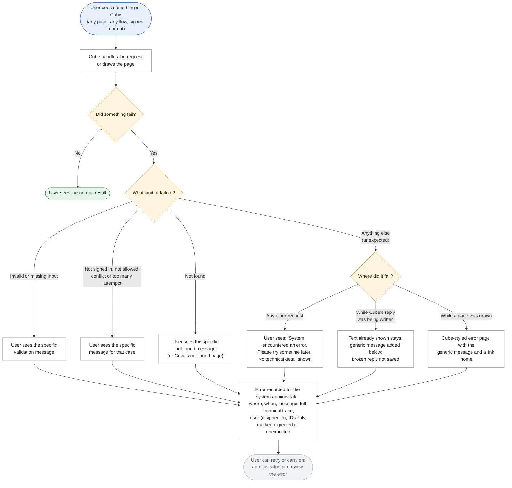
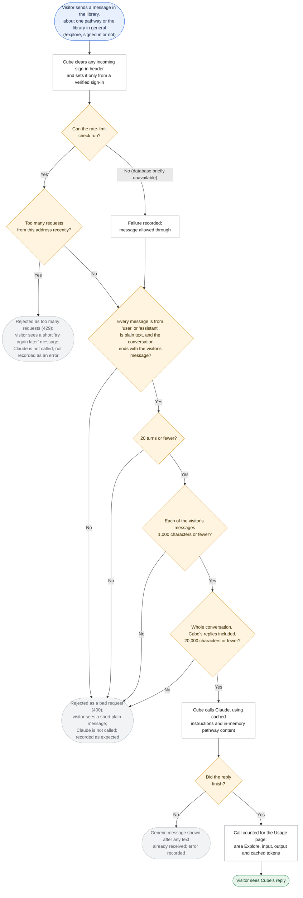
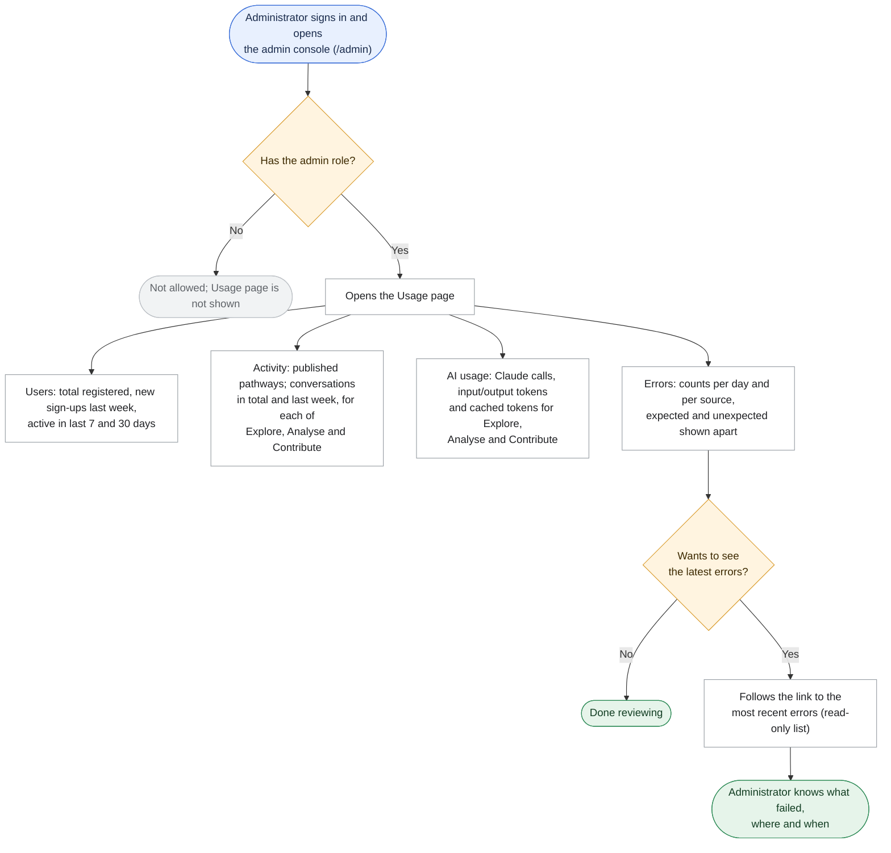
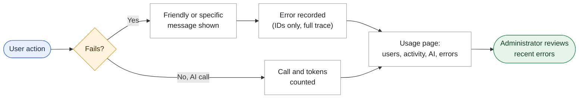

# Requirement: System Error Handling, Usage Monitoring and Technical Cleanup

**Source:** Customer document "Cube - Logging, Monitoring, Tech Cleanup" (Google Doc), received 2026-10-19. It partly covers three Product Charter non-functional backlog items, all *Not started*: "Structured logging (latency, errors, per-user/per-pathway usage)", "Error handling and graceful degradation (failed AI calls, malformed uploads)", and the headline counts of milestone "Visibility into Pathway Usage & Reuse" (15-Feb-27). See `docs/wiki/diffusion-cube/business/business-overview.md` → Roadmap.

> Status: **Final scope, approved 2026-10-19.** Validated 2026-10-19 (business scope) and updated to the approved plan the same day. Business clarifications are in [`business_clarifications_monitoring_logging_cleanup.md`](business_clarifications_monitoring_logging_cleanup.md). Engineering detail is in [`plan_monitoring_logging_cleanup.md`](plan_monitoring_logging_cleanup.md) and [`architecture_clarifications_monitoring_logging_cleanup.md`](architecture_clarifications_monitoring_logging_cleanup.md).

## High-level summary

The approved, PM-readable requirement: what is wrong today, what we build, how we check it, and what is deliberately left out.

- **The problem.** Today:
  - users can see raw errors
  - nobody can see what failed or how Cube is used
  - the public Explore chat is open to misuse
  - the internal sign-in header isn't cleared on each request
  - leftover code slows changes down
  - every message redoes avoidable work
  - a Google Sheet holds a copy of every chat turn
- **A. Error handling.**
  - Unexpected failures show "System encountered an error. Please try sometime later."
  - Expected errors keep their specific wording.
  - Every error is recorded in `sys_errors`: IDs only, no sensitive content, visible to admins only, kept 30 days.
- **B. Usage monitoring.** A read-only admin Usage page shows users, activity, AI usage per area (Explore, Analyse, Contribute) and errors. It is fed by recording the tokens of every Claude call.
- **C. Technical fixes.**
  - **Explore checks:** at most 20 turns, 1,000 characters per user message and 20,000 in total, valid roles, plain-text content, and a per-IP rate limit. Failures get a 400 or 429 before Claude is called.
  - **Header:** `x-user-email` is reset on every request.
  - **Dead code:** removed.
  - **Cost:** prompt caching and in-memory content.
  - **Sheets:** Google Sheets logging is removed.
- **Also in this file:**
  - a manual "How we'll know it worked" checklist
  - four Mermaid flow charts
  - 14 confirmed decisions
  - an out-of-scope list
  - plain-language trade-offs and risks, including the Anthropic account expiry on 28-Oct-2026

## The problem today

Cube is moving into a pilot with real users. Today:

- **Users can see raw technical errors.** When something fails unexpectedly, internal error text can reach the screen. This confuses users and can reveal how the system is built.
- **Nobody can see what failed.** Errors go only to the hosting platform's raw log stream. Nothing is stored where the system administrator can review them, and nothing ties an error to the user, area or pathway involved.
- **Nobody can see how Cube is used.** There is no view of how many people are registered or active, how many conversations take place, how much the AI service is used, or how often things go wrong.
- **The public library chat (Explore) is open to misuse.** Anyone, signed in or not, can send it conversations of any length and shape, as often as they like. Every request calls the AI service, which costs money.
- **The internal sign-in header can be trusted when it shouldn't be.** After sign-in, Cube passes the user's email between its own parts in an internal header (`x-user-email`). It isn't explicitly cleared first, so a request could arrive already carrying a value.
- **The code carries leftovers from earlier versions.** Retired features, unused AI modes and a duplicate copy of library pathways remain in the code, making diagnosis and changes slower.
- **Cube does more work than it needs to on every message.** It re-reads its pathway content from disk on every request, and pays again for the large, unchanging parts of its AI instructions on every turn.
- **A Google Sheet receives a copy of every chat turn**, including what users wrote and Cube's replies. This is an extra place where conversation content lives.

## What we are building

### A. Handling system errors (for the system administrator)

1. **Unexpected errors show a generic message.** This covers every part of Cube: API routes, server components, server actions and client-side rendering (errors raised in the user's browser while a page is drawn). When something fails that should not, the user sees: **"System encountered an error. Please try sometime later."** A stack trace (the technical record of where in the code the error happened) or a raw error message is never sent to the user's browser.
2. **Expected errors keep their specific messages.** These are errors Cube already plans for, caused by the request or by the user's own situation:
   - validation failures (a missing or invalid input)
   - sign-in and permission errors
   - not-found errors
   - conflicts (for example an account that already has access)
   - "too many attempts"

   They keep their current, specific wording. The generic message is only for unexpected failures, meaning anything Cube didn't plan for, such as the database, the AI service, GitHub or email failing, a fault in Cube's own code, or a page crashing.
   - **Raw messages stop leaking.** Some screens today show raw database error text when something fails. These switch to the generic message.
   - **Hand-written messages switch too.** Failures that currently show a friendly message of their own (for example "Could not delete your account.") also switch to the generic message, for consistency.
   - **A reply that fails partway.** If Cube's reply breaks off while it is being written, the user sees the generic message after the text that already arrived. The broken reply is not saved as Cube's answer.
   - **Cube-styled pages.** A page that crashes shows a Cube-styled page with the generic message and a link back home. A page that doesn't exist shows Cube's own "not found" page.
3. **Every error is recorded in Cube's database.** All errors, expected and unexpected, are stored in Supabase with the full stack trace, in a new system error table (for example `sys_errors`). Each record holds:

   | Field | What it holds |
   |---|---|
   | id | A unique reference for the error |
   | timestamp | When the error occurred |
   | source | Where it happened: the route or module |
   | message | The error message |
   | stack | The full stack trace |
   | context | Optional details identifying the failing operation, such as the user id, chat mode, pathway and request path |
   | user_id | The user affected, if one was signed in; empty otherwise |
   | environment | Production (prod) or development (dev) |

4. **No sensitive content in error records.** The context holds IDs and short metadata only. It never contains passwords, tokens or full chat transcripts.
   - **Kept for 30 days.** Error records older than 30 days are removed automatically.
   - **Admins only.** Only administrators can see error records.
   - **Tagged by kind.** Each record is marked as expected or unexpected, so routine errors don't hide real faults.
   - **What isn't recorded.** A wrong password at login is checked directly by the sign-in service, not by Cube's server, so it is not recorded. A wrong password during account deletion is recorded.
   - **Deleted accounts.** If a user deletes their account, their error records stay but no longer point to them.

### B. Usage logging and monitoring (for product administrators)

5. **A read-only Usage page in the admin console**, for product administrators only. It shows four sections:
   - **Users**
     - total registered users
     - new sign-ups in the last week
     - active users over the last 7 days and over the last 30 days
   - **Activity**
     - total number of published pathways
     - total number of conversations, with the number for each of Explore, Analyse and Contribute
     - number of conversations in the last week
   - **AI usage**
     - number of Claude (AI service) calls per mode: Explore, Analyse and Contribute
     - total input tokens and total output tokens per mode. Tokens are the units the AI service uses to measure and bill the text it reads and writes.
     - cached input tokens per mode: the part of the input reused through prompt caching (item 10), which shows the saving
   - **Errors**
     - error counts per day and per source, read from the system error table (item 3), split into expected and unexpected
     - a link to the most recent errors, which opens a simple read-only list of the latest entries
6. **Every AI call is counted.** So that the AI usage figures exist, Cube records each Claude call's area and its input, output and cached tokens. That includes the duplicate-pathway check contributors see. These records hold no conversation content.

### C. Technical fixes

7. **Secure the public Explore conversations.** These checks apply to both Explore (library) chats, the chat about one pathway and the general library chat, and all run before Cube calls Claude:
   - **Turn limit:** at most 20 turns in a conversation.
   - **Message size:** at most 1,000 characters per message the visitor writes. Cube's own replies are sent back as part of the conversation and are often longer, so they aren't held to this limit; they still count towards the conversation size. *(Clarified 2026-10-19 during development.)*
   - **Conversation size:** at most 20,000 characters in total.
   - **Message format:** every message must have the role "user" or "assistant", and its content must be plain text.
   - **Rate limit:** a per-IP rate limit, so no single address can send unlimited requests.
   - **Rejection:** anything else is rejected with a "bad request" (400) response, and Claude is never called. A visitor over the rate limit gets the standard "too many requests" (429) response instead. In both cases the visitor sees a short plain message, never raw error text.
   - **If the limiter itself fails:** if the rate-limit check can't run (for example the database is briefly unavailable), the message is allowed through and the failure is recorded, so Explore never goes down because of it.
8. **Reset the sign-in header on every request.** The internal `x-user-email` header is explicitly cleared on every incoming request, including when nobody is signed in, before Cube sets it from the verified sign-in. A value supplied from outside is never trusted. Today's pages happen to check sign-in themselves before reading the header, so this closes the gap for any future page that doesn't. *(Corrected 2026-10-19: an earlier draft said the gap was open today.)*
9. **Remove redundant and dead code.**
   - **Retired tables:** code that still points at the dropped database tables (the retired "pathway submissions" feature) is deleted.
   - **Unused chat modes:** the two chat modes nothing calls, `pathway-exec-summary` and `plan-document`, are deleted.
   - **`<deliverable>` handling:** no prompt produces this tag any more, so the code that handles it is deleted.
   - **Adoption plan "modal" mode:** the adoption plan view's modal mode is never used (its only caller uses panel mode), so it is deleted.
   - **Library static-corpus branch:** the library's separate copy of pathway documents (`content/library-wiki/`) is removed, together with the code that read it. *(Updated 2026-10-20, owner decisions.)* The customer document says this folder no longer exists, but it did, with 8 pathway files. Instead:
     - **One source.** The library now reads the same pathway documents Analyse uses (`content/wiki/pathways/`), plus published pathways.
     - **Version choice.** Six pathways existed in both places; the Analyse version is the one kept.
     - **Moved pathways.** Data Dhara and CEEW Climate Intelligence existed only in the library copy. They were moved into the Analyse pathways, so they now also inform Analyse answers.
     - **Cards unchanged.** The library's cards stay exactly as they are.
     - **Privacy.** The contributor-only Source Trace section of a pathway is never sent to the public library chat, from either source.
   - **Duplicate pathway-header reading** *(added 2026-10-19)*: the logic that reads a pathway's header details (title, sector and so on) exists twice, once in the admin publish step and once in a shared helper. The admin publish step will use the shared one, so the two can't drift apart.
   - **Unused add-on** *(added 2026-10-19)*: a third-party package (`diff`) that is installed but never used is removed.
10. **Make Cube cheaper and faster per message, without changing its answers.**
    - **Prompt caching:** the large, unchanging parts of Cube's AI instructions are reused between calls instead of paid for again on every turn.
    - **Load content once:** the pathway content each mode needs is loaded per mode and kept in memory, instead of being re-read from disk on every request.
11. **Remove Google Sheets logging.** Cube stops sending chat turns to the Google Sheet, and the code and settings for it are removed in the same release that turns on the new error and usage recording, so there is no gap. The existing Sheet is left where it is in Google Drive; no export or archive step is part of this release.

### How we'll know it worked

Each check is done by hand, because Cube has no automated tests today.

| Area | Check | Passes when |
|---|---|---|
| Error handling | Force an unexpected failure (for example make the AI service unreachable) in each area | The user sees only the generic message; one unexpected error record appears with the source, stack and user, and no conversation text |
| Error handling | Trigger each expected error (bad input, signed out, wrong role, unknown pathway) | The existing specific message is unchanged; an expected error record appears |
| Error handling | Visit a page that doesn't exist; make a page crash | Cube's not-found page; Cube's error page with the generic message and a link home; a browser error record appears |
| Error handling | Interrupt a reply partway | The generic message appears after the partial text; the broken reply is not saved |
| Error handling | Search error records for passwords, tokens or message text | None found |
| Usage page | Open it as an admin and as a non-admin | The admin sees all four sections; a non-admin can't open it |
| Usage page | Compare the figures with a direct database count | They match |
| Explore security | Send turn 21, a 1,001-character message, 20,001 characters in total, a wrong role, non-text content | Each is rejected with 400; no AI call is recorded |
| Explore security | Send messages quickly from one address past the limit | Rejected with 429 and a plain message |
| Sign-in header | Send a request with a made-up `x-user-email` while signed out | Cube ignores it; no page treats the visitor as signed in or as an admin |
| Dead code | Call the two removed modes and the removed pathway-submission addresses | "Unknown mode." / not found; the app builds and every flow still works |
| Duplicate code | An admin publishes a pathway | Its title, sector and other header details appear exactly as before |
| Optimisation | Ask the same fixed sample questions in each mode before and after prompt caching | The answers are equivalent; cached input tokens show above zero on repeat turns |
| Google Sheets | Chat in each area | Nothing is written to the Sheet; the app runs without the Google settings |

## Flow charts

### Any user (Request → Fails? → Expected or unexpected → Message → Recorded)

Updated 2026-10-19: added the "reply breaks off partway" branch and the Cube-styled error page from planning; conflicts and "too many attempts" now count as expected errors.

#### How an error is classified

| Result | When | What the user sees | Recorded? |
|---|---|---|---|
| Validation error | Input is missing, too long, or in the wrong form | The existing specific message | Yes, as expected |
| Sign-in / permission error | Not signed in, the user's role doesn't allow it, or a wrong password during account deletion | The existing specific message | Yes, as expected |
| Not found | The page, pathway or conversation doesn't exist | The existing specific message, or Cube's not-found page | Yes, as expected |
| Conflict / too many attempts | The action clashes with the current state, or was tried too often | The existing specific message | Yes, as expected; except "too many requests" (429) replies, which are counted by the rate limiter instead, so a flood of requests can't flood the error table |
| Unexpected error | Anything else: a fault in Cube, the AI service, the database, GitHub, email, or the browser | "System encountered an error. Please try sometime later." | Yes, as unexpected, with full technical trace |
| Wrong password at login | Checked by the sign-in service directly, not by Cube's server | The sign-in service's message, as today | No |

In every case the record holds only IDs and short metadata as context. It never holds passwords, tokens or full chat transcripts.

### Explore visitor (Library → Message → Checks → Claude or rejection)

Updated 2026-10-19: the chart adds the 429 response, the "limiter can't run" branch, the rule that the conversation ends with the visitor's message, the general library chat, and a reply failing partway, all from planning. **Updated again during development:** the rate limit runs first, so a flood of malformed messages is capped too, and rejected-for-volume (429) requests are not recorded as errors.

#### How an Explore message is checked

All checks run before Cube calls Claude, so a rejected message costs nothing. The rate limit comes first: it is the one check that also caps how many malformed messages one address can send.

| Order | Check | Passes when | If it fails |
|---|---|---|---|
| 1 | Rate limit | This address has sent no more than 20 messages in the last minute and 200 in the last day (adjustable) | Rejected as too many requests (429); short "try again later" message; not recorded as an error |
| — | Rate limit can't run | — | Message allowed through; failure recorded |
| 2 | Message format | Every message's role is "user" or "assistant", its content is plain text, and the conversation ends with the visitor's message. It may start with Cube's opening overview, and an empty conversation is the pathway's opening request. | Rejected as a bad request (400) |
| 3 | Turn limit | 20 messages or fewer | Rejected as a bad request (400) |
| 4 | Message size | Every message the visitor wrote is 1,000 characters or fewer | Rejected as a bad request (400) |
| 5 | Conversation size | 20,000 characters or fewer in total | Rejected as a bad request (400) |

These checks apply to both Explore chats (one pathway, or the library in general), not to the signed-in Analyse or Contribute chats.

### Product administrator (Admin console → Usage page → Recent errors)

Updated 2026-10-19: conversations are now shown per area, including saved Explore chats; AI usage adds cached tokens; errors are split into expected and unexpected.

### End-to-end lifecycle

## Who it's for

- **Every user (Explorers, Contributors, admins, and public library visitors):** a clear message instead of raw technical errors, and a library chat that can't be overloaded by misuse.
- **System administrator:** a single, searchable record of every error, with the full technical trace and enough identifiers to see who was affected, where and when.
- **Product administrators (the existing admin role):** a Usage page showing registrations, activity, AI usage per area and error trends.
- **The Program Team and whoever pays for the AI service:** lower AI cost per conversation and a usage record to measure it against.
- **The Solution Team:** less leftover code to maintain, and one fewer place (the Google Sheet) holding copies of conversations.

## Decisions confirmed

The customer document didn't settle these points. The Product Manager confirmed all of them on 2026-10-19.

1. **Only administrators can see error records** and the recent-errors list. The on-screen list may hide the full technical trace behind a click.
2. **"Product admins" means the existing admin role.** No new role is created.
3. **Error records are kept for 30 days**, then removed automatically. The Usage page's error figures therefore cover at most the last 30 days.
4. **"Last week" means the last 7 days**, not the previous calendar week.
5. **An "active user" is a signed-in user who did something in Cube** (for example sent a message or generated a document) in the period. Simply having an account doesn't count.
6. **A "conversation" is a saved conversation in any area: Explore, Analyse or Contribute.** The Usage page shows the total and the number for each area. Signed-in users' library chats are saved, so they count. Chats by visitors who aren't signed in aren't saved, so they appear only in the AI usage figures. *(Corrected 2026-10-19: the earlier wording said library chats aren't saved, which was wrong.)*
7. **Cube's internal AI modes are grouped into Explore, Analyse and Contribute** on the Usage page. Every AI call is counted in one of the three.
8. **AI usage figures start on release day.** No token record exists before then. The 30-day active-user figure can be calculated from existing activity.
9. **Figures are current when the page is opened.** No auto-refresh, export, charts or date picker.
10. **The rate-limit values are a setting** that can be changed without a code change. They start at 20 messages per minute and 200 per day from one address, and apply to signed-in visitors too.
11. **An Explore visitor who hits a limit sees a short plain-words message**, not a raw error.
12. **The generic message is used word for word**, as written by the customer.
13. **The library folder** *(superseded 2026-10-20 by the owner's decisions)*: rather than publishing pathways first, the library reads the Analyse pathway documents. Data Dhara and CEEW were moved into them, and the Analyse version wins for the six duplicates. No Program Team publishing step is needed.
14. **Recording errors never slows down or blocks the user.** If recording fails, the user still gets the right message.

## Deliberately not included in this release

- **Email alerts** when something breaks. The administrator reviews errors on the Usage page instead.
- **General activity logs** (every chat turn, sign-in or publication, with timing) and a retention rule for them. Only errors and AI calls are recorded.
- **Automatic retry** when the AI service fails.
- **Adopter feedback** (thumbs-up/down and comments in Analyse).
- **A code-review report** of all technical debt. Only the dead and duplicate code listed in item 9 is removed.
- **Other duplicate or dead code found during planning** (future cleanup):
  - the library chat's separate message display and input box, which duplicate the main chat's
  - brand colours written directly into several screens
  - the organisation filter on the Contribute page, which is fully built but always switched off. Whether to remove it or turn it on is a product decision.
- **Estimated AI cost in currency.** The page shows tokens, not cost.
- **Per-pathway usage, reuse, likes and dislikes**, which remain under the charter milestones "Incentivize Contributors" (15-Jan-27) and "Visibility into Pathway Usage & Reuse" (15-Feb-27).
- **A service-health page** (status of the AI service, database, email and GitHub).
- **Limits on the signed-in Analyse and Contribute chats.** Item 7 covers Explore only.
- **Exporting or archiving the existing Google Sheet.** It stays in Google Drive as it is.
- **Changing any pathway text,** beyond removing the duplicate library folder.

**Future enhancements** raised along the way: email alerts, estimated cost on the Usage page, a health page, and charts and date ranges on the Usage page.

## Trade-offs and risks, in plain terms

- **Recording all errors adds routine entries.** Invalid inputs and expired sessions will be stored next to real faults. Each record is marked expected or unexpected, and the Usage page shows the two apart.
- **Some hand-written messages are lost.** A few failures today show a friendly message of their own (for example "Could not delete your account."). These become the generic message, for consistency with the customer's rule. Each can be restored individually if the customer prefers.
- **Errors older than 30 days are gone.** A problem reported more than 30 days after it happened can't be traced from the error table (Decision 3).
- **Browser errors can come from anyone,** including visitors who aren't signed in. To stop anyone flooding the table, each report is size-limited and shares the per-address rate limit.
- **The rate limit can briefly lapse.** If the database is unavailable, the limit isn't enforced for that time, so Explore stays up. The failure is recorded.
- **A generic message hides detail from users.** Someone reporting a problem can't quote a specific error. The administrator relies on the error record (user, time, area) to find it.
- **The Explore limits may cut off a genuine long conversation.** A visitor who reaches 20 turns or 20,000 characters has to start a new chat. This is accepted in return for protection against misuse and runaway cost.
- **Visitors behind a shared network** (an office or campus) share one address, so the rate limit may slow them down together. The configurable limit (Decision 10) is the safeguard.
- **Prompt caching and in-memory content must not change Cube's answers.** Answers are compared before and after. Published pathways that change without a redeploy must still appear straight away.
- **Removing the library folder** depends on the Program Team publishing two pathways and confirming five others first (Decision 13). Until then, removing the folder would drop those pathways from the library.
- **Removing Sheets logging without an archive** means the existing Sheet becomes the only copy of past chat turns. Nothing in Cube will write to it or read it any more. The Google access key Cube used stays valid until someone revokes it, which is not part of this release.
- **AI usage figures have no history.** They start on release day, so early weeks give a partial picture.
- **External date:** the Anthropic account behind every Cube feature expires on **28-Oct-2026**. If it isn't renewed, all AI features stop, and the AI usage figures, prompt caching and the Explore checks can't be verified against the live service. Renewing it is a procurement action, not part of this build. The AWS account expires in **December 2026**, which affects the Docker/AWS deployment path.
