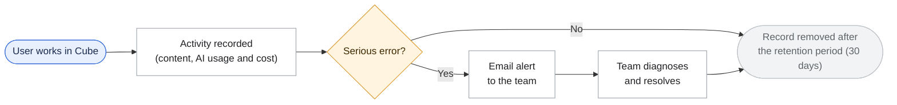
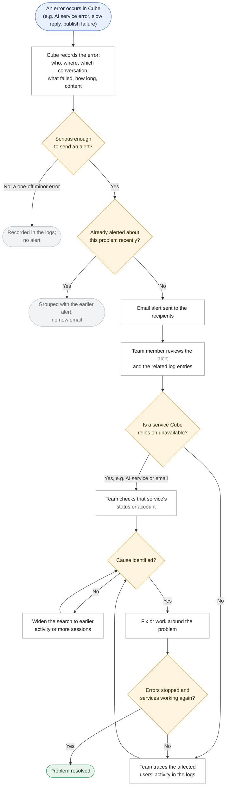

# Requirement: Monitoring, Logging and Technical Cleanup

## The problem today

Cube is about to move into a pilot with real users. Today, if something goes wrong:

- **Problems surface only when a user reports them.** Errors are written to the hosting platform's raw log stream. There are no alerts, no health checks and no error tracking.
- **Reported problems are hard to trace.** Nothing ties an error to a particular user, flow or conversation. Finding the cause relies on searching raw logs by time.
- **The cost of running Cube is not visible.** Every conversation turn calls the AI service, but nothing records how much each call uses or what it costs.
- **The code carries leftovers from earlier versions.** Some retired features remain in the code, some logic is repeated in more than one place, and some settings are fixed in several places. All of this slows down diagnosis and fixes.

## What we are proposing

1. **Record every significant event.** Each conversation turn, document generation, pathway publication, sign-in or sign-up step, and error will be logged. Each entry will show:
   - **who**: the user and their role
   - **where**: Explore, Analyse, Contribute or Admin
   - **which** conversation or pathway it concerns
   - **what** happened, or what failed and why
   - **how long** it took
   - **for AI calls**: how much it used and what it cost

   Entries will include the content involved (what the user wrote or uploaded, and Cube's reply), so the team sees a reported problem exactly as the user experienced it. Because usage and cost are recorded for every AI call, the team can produce daily or weekly usage and cost figures from the logs when needed.
2. **Trace any user's session from start to finish, without going back to the user.** When a user reports a problem, knowing who they are is enough. The logs already hold what they did, when, in which area, what they sent, how Cube replied and what failed. The support team can follow that user's activity step by step to the point of failure without asking the user for more details. The aim is to identify the cause as quickly as possible.
3. **Send email alerts when something goes wrong.** Serious problems will trigger an email to a configured list of recipients, so the team usually knows before users report anything. Examples are the AI service failing, the application being unavailable, or a run of errors. Repeated alerts for the same problem are grouped, so a burst of errors does not flood inboxes. During the pilot, the team will respond on a best-effort basis.
4. **Keep logs for 30 days by default.** Older entries will be removed automatically. The retention period can be changed without a new release of the application.
5. **Deliver a code-review report with a remediation plan.** A reviewed list of repeated, outdated, unused, inefficient or hard-coded parts of the code. Each item will set out its impact and a proposed plan to remove or fix it. This release delivers the report and the plan; the fixes follow in a later release, once the plan is approved.
6. **Keep the existing Google Sheet conversation log unchanged.**

## Flow charts

### End-to-end lifecycle

### When something goes wrong (error → record → alert → diagnose → resolve)

#### When an email alert is sent

| Outcome | When | What happens |
|---|---|---|
| Recorded only | A single minor error that does not stop the user | Logged; no email |
| Email alert | The AI service, database or email delivery is failing; the application is unavailable; or errors keep occurring over a short period | One email to the recipients, stating the problem and when it began |
| Grouped | An alert has already been sent for the same problem and it has not yet cleared | No new email; the earlier alert stands until the problem clears |

## Who benefits

- **The support and engineering team** is alerted to problems by email, can trace any reported issue to its cause, can see AI usage and cost in the logs, and receives a code-review report with a clear remediation plan.
- **Explorers, Contributors and visitors to the public library** see no change on screen. They benefit because problems are found and fixed sooner.

## Assumptions

The following points were not settled during clarification and are proposed for confirmation:

1. **Access to logs.** Only administrators and the support and engineering team can view log entries and their content. Pilot users cannot view logs.
2. **Deleted accounts.** When a user deletes their account, their log entries are kept until the end of the normal retention period, then removed.
3. **Events that trigger an email alert.** The proposed starting list can be adjusted:
   - the AI service failing
   - the database failing
   - email delivery failing
   - the application being unavailable
   - a run of errors in a short period
   - a pathway publication failing

   A single slow reply or a one-off error does not trigger an alert.
4. **Alert recipients** are a configurable list of email addresses maintained by the support team.
5. **Time to trace an issue.** "As quickly as possible" is treated as an aim for the pilot, not a measured target.
6. **Public library visitors.** Library conversations are logged in the same way. Visitors who are not signed in are recorded as anonymous.

## Not included in this release

- **Changes to what users see when the AI service fails.** There will be no new "temporarily unavailable" message and no automatic retry. Failures will be recorded and alerted on, but the user experience stays as it is today.
- **Implementing the code-review fixes.** This release delivers the report and the remediation plan only.
- **Changes to pathway content.**
- **Changes to the Google Sheet conversation log.**

**Proposed for future releases:**
- **Health page for administrators.** A page in the admin console showing at a glance whether Cube and the services it relies on (the AI service, the database, email delivery and pathway publishing) are working, along with recent errors.
- **Usage page for administrators.** A page in the admin console showing, by day and by week, active users, conversations by area (Explore, Analyse, Contribute), AI calls and the amount of AI processing used, estimated AI cost, and error counts. The usage and cost data recorded in this release will feed this page.
- **Lower AI cost without changing Cube's answers.** Today Cube re-sends the same large, unchanging instructions on every AI call. Reusing them instead of paying for them again each time (a technique known as "prompt caching") would reduce AI cost while keeping Cube's answers exactly the same. The usage and cost data recorded in this release will provide the baseline for measuring the savings.
- **AI-assisted incident diagnosis.** An assistant that reviews the logs and suggests the likely cause and fix.
- **Detailed tracing of AI activity across multiple AI agents**, for example with a specialised tool such as Langfuse. This goes beyond the basic usage and cost tracking in this release.
- **Flexibility to switch AI model or provider**, so Cube is not tied to a single model or account.
- **Product usage insights** planned for the "Visibility into Pathway Usage & Reuse" milestone (15-Feb-2027), such as likes and dislikes, reuse acknowledgements and per-pathway insights.
- **A measured target for time to trace an issue**, once pilot data is available.

## Trade-offs and risks

- **Logs will contain users' own words and documents.** This makes problems much faster to diagnose, but personal and potentially sensitive material will be held for the retention period (30 days by default). Access must be tightly controlled (see Assumption 1). This should also align with the Terms & Conditions and Disclaimers currently being prepared. Pilot users may need to be informed that conversations are logged for support purposes.
- **Conversation content will be stored in two places.** The Google Sheet log continues unchanged and has no retention limit, so conversation content will be held both there and in the new logs.
- **A shorter retention period limits how far back issues can be traced.** With a 30-day default, a problem reported more than 30 days after it occurred cannot be traced from the logs. The period can be extended if this proves too short.
- **There is a small running cost.** Depending on the logging and alerting tools chosen during technical design, there may be a modest running cost and a slight increase in work per request. At pilot scale (under 100 users) this is expected to be negligible. It must not noticeably slow down Cube's responses.
- **Usage and cost figures require manual effort until the Usage page is built.** Daily or weekly figures will be available, but they must be pulled from the logs by the support team rather than viewed on a page.
- **AI cost figures are estimates.** Costs recorded in the logs are calculated from usage and a configured price, and may differ slightly from the AI provider's invoice.
- **The AI service account expires on 28-Oct-2026.** Every Cube feature depends on this account, and it must be renewed or replaced independently of this work. Once this work is delivered, an outage of this kind would trigger an alert immediately. Quick switching between AI providers is a future enhancement, so it is not a fallback in this release.
- **The AWS account expires in December 2026.** If Cube moves to AWS, the choice of where logs are kept may need to be revisited before then.

## Document information

**Source:** This requirement covers the Product Charter non-functional backlog item "Structured logging: latency, errors, per-user/per-pathway usage" (status: *Not started*). It also addresses the monitoring aspects of two related backlog items, "Error handling and graceful degradation" and "Reliability & serving architecture" (both *Not started*). It was raised in the Solution Team review, which asked for a business-requirement proposal before any build, with monitoring kept minimal for a pilot of fewer than 100 users. Requirements clarified on 14-Oct-2026; scope revised on 15-Oct-2026.

**Status:** Draft for review, 15-Oct-2026 (business scope). Supporting clarifications are recorded in [business_clarifications_monitoring_logging_cleanup.md](business_clarifications_monitoring_logging_cleanup.md).
