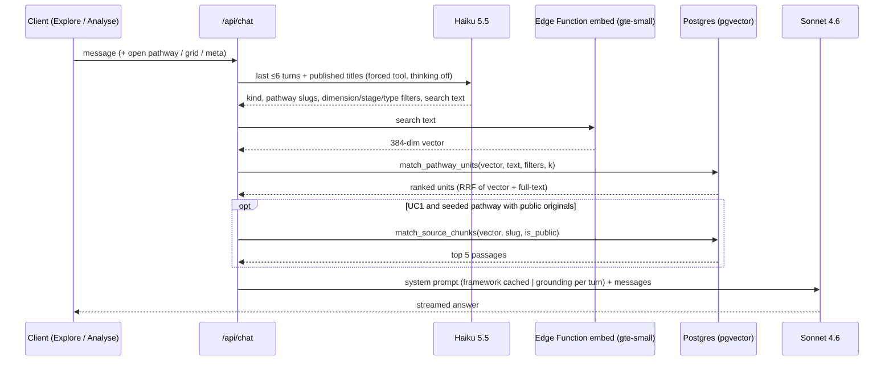

# Plan: Pathway Storage in the App Database

> Status: **Approved 2026-11-04** (architecture-plan) by Anurag Goutam. Inputs: [requirement](requirement_pathway_storage.md), [business clarifications](business_clarifications_pathway_storage.md), [architecture clarifications](architecture_clarifications_pathway_storage.md). Branch `feature/pathway-storage` from `upstream/cube-dev` at `0189677`.

The flow charts for this feature are in [`requirement_pathway_storage.md`](requirement_pathway_storage.md) → "Flow charts". The engineering diagram below is the per-message retrieval path only.

## Summary

Pathways move out of GitHub and the shipped files, into Supabase:
- **Pathway documents** are stored as versions.
- **Micro-innovation units** become searchable rows: labels, a full-text index, and a 384-dimension `gte-small` embedding in pgvector.
- **Seeded pathways' original documents** are kept as text chunks.

Explore and Analyse stop sending the whole corpus to the model. Instead:
1. a **Claude Haiku 5.5** call works out what kind of question it is;
2. one SQL **hybrid search** (vector + keyword + label filters) picks the units;
3. **Claude Sonnet 4.6** answers from that grounding only.

The contribute and admin flows are unchanged, except that Send for review saves a version instead of committing to GitHub, and Publish indexes the units.

## Scope

**In scope:**
- **Migration `0042`:**
  - pgvector;
  - new columns on `pathways`;
  - `pathway_versions`, `pathway_units`, `pathway_sources`, `pathway_source_chunks`;
  - the hybrid-search RPCs;
  - `published_pathways` turned into a view.
- **Supabase Edge Function `embed`** (`gte-small`).
- **Unit parser** and the generation-prompt fields (`Sub-category`, `Condition — fails when`).
- **Send for review and publish:** versioned Send for review (no GitHub), indexed Publish, cascade delete.
- **`lib/retrieval.ts`:** the Haiku classifier, hybrid search, UC3 grouping, UC1 source passages.
- **Grounding in every corpus-loading chat mode:** companion (both flows), analysis-doc, executive-summary, library per-pathway, library overview.
- **Readers moved to one store:** `/explore`, `/wiki`, the wiki APIs, the heatmap, admin usage, slug reservation.
- **Retired:** the static corpus, `lib/library-pathways.ts`, `lib/github.ts`, `GITHUB_*` and `WIKI_PATH`.
- **Seed script and manifest**, run per environment.
- **Vitest updates and new tests; the ~20-question test set.**

**Out of scope** (see the requirement's "Deliberately not included"):
- Cube-Brain;
- admin history / compare / rollback screens;
- claim tracing;
- disclosure editing;
- the fidelity check;
- keeping contributor uploads;
- batch regeneration;
- reviewed pattern syntheses;
- a public read API;
- the Sonnet 4.6 → 5.5 upgrade;
- removing `content_cache`;
- non-English.

## Assumptions

- **Tests** (architecture Q15, not answered): Vitest tests are written for the new modules and the changed routes. The test set from `main` (`docs/features/cube-brain-knowledge-source/test_set_cube_brain_knowledge_source.md`) is copied and adapted to the seed corpus.
- **Batch regeneration** (business Q12, not answered): out of this release.

## Affected Areas

| Area | Component(s) | Nature of change |
|------|--------------|-------------------|
| Data | `supabase/migrations/0042_pathway_storage.sql` (new) | `create extension vector`. `pathways` + `status`, `published_version_id`, `is_seed`, `stage`, `location`, `tags`, `organisation`. New `pathway_versions`, `pathway_units`, `pathway_sources`, `pathway_source_chunks`. RPCs `match_pathway_units`, `match_source_chunks`. `drop table published_pathways` → `create view published_pathways`. Existing `pathways` rows reset to `draft` / `in_review`. |
| Edge Function | `supabase/functions/embed/index.ts` (new) | `gte-small` through `Supabase.ai.Session`; `POST {texts: string[]}` → `number[][]` (384-dim, normalised); requires the service-role bearer. |
| Domain logic | `lib/pathway-units.ts` (new) | Pure parser for Section 3 units → `ParsedUnit[]`, plus validation errors. Vocabulary from `lib/dimensions.ts`; intents from Section 6; `source_ids` from the Source Trace (seed only). |
| | `lib/embeddings.ts` (new) | `embedTexts(texts)` → Edge Function, batched (≤ 32 per call); throws on failure so callers can degrade. |
| | `lib/pathway-store.ts` (new) | `saveVersion`, `publishVersion`, `listPublished`, `getPublishedDocument(slug)`, `buildOverview()`, `isSlugTaken`. Admin client only. |
| | `lib/retrieval.ts` (new) | `classifyQuery` (Haiku), `hybridSearch`, `groupPatterns`, `sourcePassages`, `buildGrounding({surface, messages, openSlug?, grid?, meta?})` → prompt text + slugs used. |
| | `lib/wiki-loader.ts`, `lib/library-documents.ts`, `lib/wiki-content.ts` | Static-file reads removed. Framework, generation-prompt and resources loaders kept. `datedLine` kept. Readers delegate to `pathway-store`. |
| | `lib/library-pathways.ts`, `lib/github.ts` | Deleted. |
| Routes/API | `app/api/pathways/assemble/route.ts` | `ghReadFile` / `ghWriteFile` → `saveVersion`; reserved-slug check → `isSlugTaken`. |
| | `app/api/admin/pathways/publish/route.ts` | Upsert → `publishVersion`; response adds `skippedUnits`. Assets and email unchanged. |
| | `app/api/admin/pathways/delete/route.ts` | The `published_pathways` delete is removed (it's a view); the cascade covers the rest. |
| | `app/api/chat/route.ts` | `loadWikiContext()` → `buildGrounding(...)` for companion, analysis-doc and executive-summary; library mode reads from `pathway-store` plus grounding. No new mode. |
| | `app/api/pathways/route.ts`, `app/api/pathways/check-similar/route.ts`, `app/api/wiki-pathways/route.ts`, `app/api/wiki-stats/route.ts` | Read through the view or `pathway-store`. |
| External / config | Anthropic (`lib/retrieval.ts`: new Haiku call site); Supabase Edge Functions (new runtime); Supabase Storage bucket `pathway-sources` (new, private) | `.env.example`: drop `GITHUB_TOKEN` / `GITHUB_REPO` / `GITHUB_BRANCH` / `WIKI_PATH`. The Edge Function URL is derived from `NEXT_PUBLIC_SUPABASE_URL`. |
| Prompts | `lib/system-prompts.ts`, `content/pathway-generation-prompt.md` | Grounding rules (source-document label, 2+ pathway pattern rule, fails-when); retrieved grounding after `PROMPT_CACHE_BREAK`. Two new unit fields. |
| Frontend | `app/explore/page.tsx`, `app/explore/ExploreLibrary.tsx`, `app/(app)/wiki/page.tsx`, `app/(app)/wiki/[slug]/page.tsx`, `components/HeatmapGrid.tsx`, `app/admin/usage/page.tsx`, `components/AdminPathwayRowCard.tsx` | Card data from the store only (no static merge); the admin card shows the skipped-units warning after publish. |
| Content | `content/wiki/pathways/*.md` (incl. `index.md`) | Deleted. |
| Seed | `scripts/seed-pathways.ts`, `scripts/seed-manifest.example.json` (new); `package.json` script `seed:pathways` | Node extraction (pdfjs-dist, mammoth, xlsx, jszip) → Storage + `pathway_sources` + chunks → Sonnet draft → `saveVersion` + `publishVersion`. Idempotent by slug. |
| Tests | ~20 Vitest files touching GitHub, `published_pathways` or the static corpus (e.g. `tests/api/pathways/assemble.test.ts`, `tests/api/admin/pathways-publish.test.ts`, `tests/unit/lib/library-pathways.test.ts`, `tests/unit/server/github.test.ts`, `tests/helpers/server-corpus.ts`) | Update or delete; new tests for the parser, retrieval, store and seed manifest validation. |

## Architectural Approach

**Boundaries.** Everything stays inside the Next.js monolith with Supabase as the only stateful store, and `/api/chat` remains the single model surface. Retrieval is a grounding step inside existing modes, not a ninth mode. The one deliberate exception is the **Supabase Edge Function**: the repo's first non-Next.js runtime. It was chosen so the open-source embedding model runs with no new vendor or server. It is kept to a single stateless function.

**Per-message retrieval:**

**Grounding by kind** (starting limits; tuned with the test set):

| Kind | Grounding |
|---|---|
| UC1 (a named or open pathway) | That pathway's published write-up (Source Trace stripped), plus up to 5 public source passages for seeded pathways |
| Situation (Analyse default) | Units filtered to the design's sector; ≤ 3 pathways, the top 2 as whole write-ups |
| UC2 (across pathways) | Top 30 units from ≤ 8 pathways, each tagged with its pathway |
| UC3 (patterns) | Top 40 units, grouped by (dimension, sub-category, stage, type) and semantic proximity. A group is a pattern only if `count(distinct pathway_id) ≥ 2`, computed in code and stated in the grounding. |

**Classifier.**
- **Call:** `claude-haiku-5-5` with forced tool use, following the `check-similar` pattern. Haiku 5.5 thinks by default and forced tool use needs thinking off, so it sends `thinking: {type: "disabled"}` and `output_config.effort: "low"`. `max_tokens` is ~300.
- **Logging:** usage is recorded through `recordAiUsage` with mode `retrieval-classify`.
- **Fallback:** on any error or refusal it uses a per-surface default kind (open pathway → UC1; Analyse → situation; overview → UC2) and plain hybrid search.

**Writes.**
- **Send for review:** inserts a `pathway_versions` row (`source='contributor'`, linked to the `design_documents` draft) and still sets `content_cache` and `review_requested`.
- **Publish:** points `published_version_id` at the version and sets `status='published'`. It then replaces that pathway's `pathway_units` with the parsed units, embeds them, and stores the vectors.
  - **Ordering:** if embedding fails, the units are saved with a null embedding and the failure is recorded in `sys_errors`. Search falls back to full-text for them, and a later publish re-embeds them.
  - **Invalid units** are skipped and returned to the admin.

**Invariants kept:**
- the model never writes to Supabase;
- Send for review ≠ live;
- Source Trace is stripped from all adopter grounding;
- originals and chunks are service-role only, and code filters `is_public`;
- no retry is added to Anthropic calls (TD-05).

## Alternatives Considered

- **Keep Git (Cube-Brain, as on `main`):** rejected by the business decision. It needs a commit and a pull request per publish, and has no index for UC2/UC3.
- **A dedicated vector database:** a second system of record to keep in sync; pgvector covers ~4,000 units with room to spare.
- **Keep the whole corpus in the prompt:** 100 pathways (0.5–1M tokens) do not fit.
- **Embeddings in-app with transformers.js:** risks the Vercel bundle size and cold starts. **Self-host on AWS:** that account expires in Dec 2026.
- **Swanand's YAML unit block:** changes the contributor's draft; rejected for today's bullet tags plus two fields (architecture Q1).
- **A `get_source_text` tool with a streaming tool loop:** a new streaming pattern at up to ~35K tokens per call; rejected for chunk retrieval (Q10).
- **`pathway_grid_cells` / `pathway_gaps` tables:** the grid is a `group by` over units, and gaps have no reader.
- **A legacy switch:** declined (Q14).
- **No classifier, or rules first:** cheaper, but weaker on UC1/UC3 filters (Q6).

## Key Tradeoffs

**Tradeoff: `published_pathways` becomes a view**
- Decision made: drop the table and create a view of the same name and columns over published versions.
- What is gained: about 10 readers keep working with no code change.
- What is given up: the view runs with its owner's rights (security definer), so anonymous `/explore` can read it, the same exposure as today's `using (true)` table. Supabase's linter will flag it. It is filtered to `status='published'`, and writes must go through `pathway-store`.

**Tradeoff: a Haiku call per message**
- Decision made: classify before searching.
- What is gained: accurate UC1 targeting and UC3 filters.
- What is given up: ~0.5–1.5s and a small cost per message, and anonymous Explore can now trigger it (bounded by the existing per-IP rate limit). Grounding prompts shrink from the whole corpus to ~30–40 units, so Sonnet time-to-first-token and cost likely fall overall.

**Tradeoff: no legacy switch**
- Decision made: hybrid search only.
- What is gained: one code path; no dual maintenance.
- What is given up: rollback is a revert and redeploy, not a flag. Mitigation: prod deploys only after the test set passes on dev.

**Tradeoff: Supabase Edge Function for embeddings**
- Decision made: `gte-small` inside Supabase.
- What is gained: open source, no vendor, no new server or bill.
- What is given up: a new deploy step per project (`supabase functions deploy embed`), English-only, and a 512-token input limit (units fit; source chunks are cut to ~400 tokens). If it is down, search degrades to full-text plus labels.

**Tradeoff: the seed publishes without review**
- Decision made: automatic publish (business Q3/Q20).
- What is given up: labelling or generation mistakes reach the public library until noticed.

**Tradeoff: `content_cache` kept this release**
- Decision made: keep writing it next to the version.
- What is gained: toolkit assets and contributor reopen keep working untouched.
- What is given up: a temporary second copy of the latest version; removal is a follow-up.

## Non-Functional Impact

- **Performance/scale:**
  - per message: Haiku (~0.5–1.5s), one embedding (~0.1–0.3s), one RPC (~50ms, HNSW + GIN on ~4,000 rows);
  - the prompt drops from the whole corpus to bounded grounding;
  - publish embeds about 8 units (~1s);
  - the seed is offline.
  - **N+1:** `buildGrounding` fetches write-ups in one `in (...)` query, not per slug.
  - The `knowledge` portion of prompt caching is lost (it varies per turn); framework caching is kept.
- **Availability/failure modes:**
  - classifier failure → default kind;
  - embedding failure → full-text + labels;
  - RPC failure → the error goes through `withErrorHandling` (the generic message plus `sys_errors`), as today;
  - publish embedding failure → units saved without vectors and recorded; publish still succeeds.
  - Anthropic outage: unchanged; everything AI stops.
- **Security:**
  - `pathway_units` are public-read (published content only);
  - `pathway_versions` can be read by admins and the pathway's members;
  - `pathway_sources` and `pathway_source_chunks` have RLS with no policies;
  - the Storage bucket is private;
  - the Edge Function rejects calls without the service-role key;
  - no new user-controlled input reaches SQL beyond parameterised RPC arguments.
- **Consistency/coupling:**
  - removes the GitHub dependency and the static-plus-DB merge;
  - three corpus readers become one store;
  - adds a dependency on Supabase Edge Functions;
  - `lib/dimensions.ts` becomes the single vocabulary for both generation and parsing.

## Data Model / API Changes

- **`pathways` (+):**
  - `status text not null default 'draft' check (status in ('draft','in_review','published','retired'))`
  - `published_version_id uuid references pathway_versions(id)`
  - `is_seed boolean not null default false`
  - `stage text`, `location text`, `tags text[] default '{}'`, `organisation text`
- **`pathway_versions`:**
  - `id uuid pk`, `pathway_id uuid fk cascade`, `version_number int`
  - `content text`, `source text check (source in ('contributor','seed'))`
  - `design_document_id uuid null`, `created_by uuid null`, `change_note text default ''`, `created_at`
  - `unique (pathway_id, version_number)`
- **`pathway_units`:**
  - `id text pk` (`<slug>-uNN`), `pathway_id uuid fk cascade`, `version_id uuid fk`, `unit_number int`
  - `title`, `unit_type`, `dimension`, `sub_category`, `stage`, `also_relevant_at text[]`
  - `applies_when`, `fails_when`, `body text`, `adopter_intents text[]`, `source_ids text[]`
  - `fts tsvector generated`, `embedding vector(384) null`
  - indexes: GIN(`fts`), HNSW(`embedding vector_cosine_ops`), btree(`pathway_id`), btree(`dimension, stage`)
- **`pathway_sources`:**
  - `id uuid pk`, `pathway_id fk cascade`, `source_key text` (`src-01`), `file_name`, `storage_path`, `mime`
  - `extracted_text text`, `is_public boolean default false`, `created_at`
- **`pathway_source_chunks`:**
  - `id uuid pk`, `source_id fk cascade`, `pathway_id fk cascade`, `chunk_index int`, `text`
  - `embedding vector(384)`; HNSW index
- **RPCs:**
  - `match_pathway_units(query_embedding vector(384), query_text text, filter_slugs text[], filter_dimension text, filter_stage text, filter_types text[], match_count int)`: reciprocal-rank fusion of cosine and `ts_rank_cd`, published pathways only.
  - `match_source_chunks(query_embedding, pathway_slug text, match_count int)`: public sources only.
- **View `published_pathways`:** `slug, title, description, category, content, sector, location, tags, stage, contributor_org, published_by, created_at`, over `pathways` join published `pathway_versions`, `where status='published'`.
- **Routes:**
  - `POST /api/admin/pathways/publish` response adds `skippedUnits: {unit: number, reason: string}[]`;
  - other request and response shapes are unchanged;
  - no new public endpoint.

## Risks & Open Items

- **TD-16 / Haiku access:** the Anthropic account was due to expire on 28-Oct-2026 and its renewal is unconfirmed. Confirm that `claude-haiku-5-5` is enabled for the key in dev and prod.
- **SDK:** `@anthropic-ai/sdk ^0.106` with `claude-haiku-5-5` and `thinking: {type: "disabled"}`. Smoke-test first; a minor SDK bump may be needed.
- **Data loss by design:** dropping `published_pathways` removes HealthBot, Naya Sathi, A4Kiosk, Doora and others from the live library (business Q21, confirmed).
- **Seed blocked** on the requester's document list (development is not).
- **Edge Functions are new to this repo:** document the deploy step in `operations/deployment.md` after the wiki refresh.
- **Security-definer view:** acceptable for published content; note it so the Supabase linter warning isn't "fixed" into breaking `/explore`.
- **Stale wiki:** predates the Vitest suite and won't cover this feature. Refresh it after merge (`llm-wiki`).
- **Not fixed here:** TD-05 (no retries); the Sonnet 4.6 → 5.5 upgrade.

## Sequencing

1. **Foundation:** migration `0042`, Edge Function `embed`, `lib/embeddings.ts`. Deploy both to dev.
2. **Parsing:** `lib/pathway-units.ts`, the generation-prompt fields, and parser tests.
3. **Store and writes:** `lib/pathway-store.ts`, then the assemble, publish and delete routes, and the view.
4. **Retrieval:** `lib/retrieval.ts` (classifier, hybrid search, UC3 grouping, source passages), with tests.
5. **Chat wiring:** `app/api/chat/route.ts` and `lib/system-prompts.ts` (Analyse, contributor, documents, Explore).
6. **Readers and retirement:** move `/explore`, `/wiki` and the APIs to the store; delete the static corpus, `lib/library-pathways.ts` and `lib/github.ts`; clean the env vars.
7. **Seed:** `scripts/seed-pathways.ts` and the manifest; run on dev once the list arrives.
8. **Validate and ship:** the Vitest suite green; the test set on dev (UC2 ≥ 85–90%); then prod (migration, function, seed, deploy).
