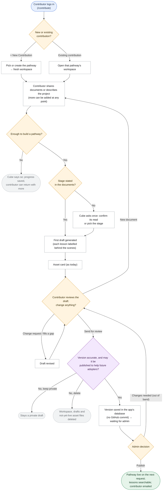
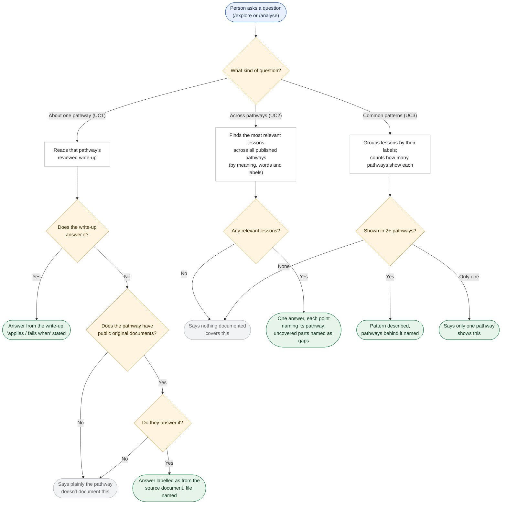
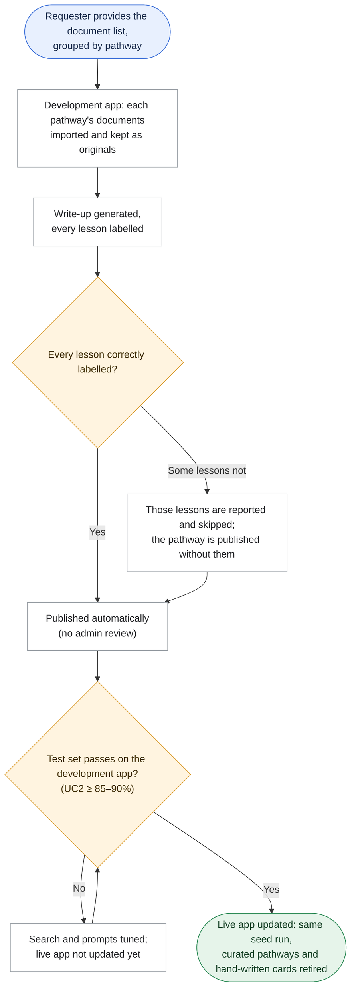
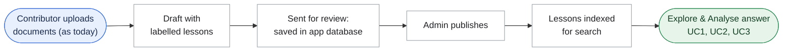

# Requirement: Pathway Storage in the App Database

**Source:** The Claude Doc *"Diffusion Cube — Pathway Storage Architecture"* (Swanand Kulkarni, 2026-11-03). Requested by Anurag Goutam for implementation, 2026-11-03; scope narrowed 2026-11-04. Partly covers the Product Charter backlog items "Enhance the Framework and Pathway schema" and "Corpus synthesis process (LLM Wiki approach)" (both Functional, *Not started*). Built on Swanand's `cube-dev`; separate from, and unrelated to, the Cube-Brain knowledge source on `main`.

> Status: **Validated 2026-11-04** (business scope). **Final scope 2026-11-04** after the architecture plan, see
> [`plan_pathway_storage.md`](plan_pathway_storage.md). Business clarifications are in
> [`business_clarifications_pathway_storage.md`](business_clarifications_pathway_storage.md);
> technical ones in [`architecture_clarifications_pathway_storage.md`](architecture_clarifications_pathway_storage.md).
>
> Updated 2026-11-04 (final scope): there is no switch back to the old way of answering. The new search goes live once the test set passes on the development app.
>
> Updated 2026-11-04: the contribute flow stays exactly as it is today, including how uploaded documents are handled. The only change on that side is that a pathway sent for review is saved in the app's database instead of being committed to GitHub. The new behaviour is in Explore and Analyse. Original documents exist only for seeded pathways.

## The problem today

The assistant can only be as good as the pathway knowledge it can find, and today that knowledge is hard to find and easy to lose.

- **Pathways live in three places that drift apart:**
  - the write-ups that ship with the app, with hand-written library cards;
  - a copy committed to GitHub when a contributor sends a pathway for review;
  - a second copy an admin publishes into the app's database.

  Adding or fixing a shipped pathway needs a code change and a redeploy.
- **Source documents can't be consulted.** Only the write-up reaches adopters, so a follow-up question the write-up doesn't cover can never be answered from the source.
- **Each pathway is one long block of prose.** To answer "how have teams handled data sharing with government?" or "what usually goes wrong at Pilot?", the assistant has to read and interpret every pathway on every question. That is slow and costly, and the answer changes from one try to the next. A lesson worded differently from the question ("MoU" rather than "data sharing") is easily missed.

## What we are building

1. **One home for every pathway: the app's own database.** When a contributor sends a pathway for review, it is saved in the app's database instead of being committed to GitHub. When an admin publishes it, it is live on the next request, with no redeploy. Nothing is read from GitHub or from files shipped with the app. The two pathway collections (the one the assistant reasons over and the public library) become one.
2. **The contribute flow does not change.** Contributors see exactly the same steps, cards and messages as today: upload, stage, draft, asset card, consent, send for review. Uploaded documents are handled exactly as today: their text is read into the conversation and the file itself is not kept. (Toolkit asset files shared through the asset card are stored as today.) Behind the scenes, two things are added:
   - **Each lesson in the draft is labelled.** Each micro-innovation carries a fixed set of labels: its dimension and sub-category, stage and kind of lesson; **when it applies** and **when it fails**; and the questions an adopter would ask that it answers. (For seeded pathways, it also records which original documents it came from.) The write-up reads the same to the contributor.
   - **Every version sent for review is kept.** Earlier versions are no longer overwritten.
3. **The admin flow does not change either.** Admins review, publish and delete pathways from the same panel as today. On publish, the pathway's lessons are stored separately, so they can be filtered, counted and searched. The grid of what a pathway covers is worked out from its lessons.
4. **Search by meaning, not only by words.** In Explore and Analyse, the assistant first works out what kind of question it is: about one pathway, across pathways, common patterns, or the person's own situation. A small, fast AI model (Claude Haiku) does this step. It then finds lessons that mean the same thing as the question, even when the words differ, and combines this with keyword search and the lessons' labels. The meaning search uses an open-source model (gte-small) that runs inside the app's own database service, with no paid vendor. The answer itself is written by the same AI model as today, from only what was found, instead of reading every pathway on every question.
5. **The three kinds of question are answered from the right material (Explore and Analyse):**
   - **UC1, a specific pathway** ("Would MahaVISTAAR's three-vendor approach work for our small NGO?"): answered from that pathway's reviewed write-up. Its "applies when" and "fails when" labels say whether the lesson transfers.
   - **UC2, across pathways** ("How did deployments get departments to share their data?"): answered from the most relevant lessons across every published pathway, with each point naming its pathway.
   - **UC3, common patterns** ("What usually goes wrong at Pilot on the institutional side?"): lessons are grouped by their labels. A pattern is one that appears in two or more pathways, counted rather than guessed, and the answer says plainly when only one pathway shows it. Patterns are worked out live on each question.
6. **Follow-up questions can reach the original documents (Explore and Analyse).** When a question about one pathway is something its write-up doesn't cover ("Which telephony vendor did MahaVISTAAR choose?"), the assistant checks that pathway's **public** original documents before saying it isn't covered. It answers from them and says so, naming the file. Only seeded pathways have original documents, and only those the seed list marks public are used. Contributor pathways have none, so for them the assistant says the pathway doesn't document it.
7. **The live library is rebuilt from a provided document set.** The requester supplies a list of documents, grouped by pathway. Each group is turned into a labelled pathway and published automatically. The curated pathways that ship with the app and the hand-written library cards are retired. On switch day, the library and the assistant contain exactly the seeded pathways plus any contributor pathways published from then on.
8. **Go live after the test set passes.** There is no switch back to the old way of answering. The development app gets the new store first. The live app is updated only after the ~20-question test set shows answers as good or better there, and answers across pathways (UC2) reach 85–90% or better. Going back would mean undoing the release, not flipping a setting.

## How the assistant behaves

These rules apply in Explore and Analyse. They add to the existing ones (matching, suggestions-not-recommendations, absence framing) and don't replace them. The contributor's conversation is unchanged.

- **The reviewed write-up comes first.** Every answer is built from published write-ups and their lessons. Original documents are only a fallback for a follow-up about one pathway that the write-up doesn't cover.
- **Answers from an original are labelled.** For example: *"This isn't in the MahaVISTAAR pathway write-up, but its source document (Vendor-Evaluation.pdf) says…"*.
- **Only public originals reach adopters.** If the only source is contributor-only, or there are no originals, the assistant says the pathway doesn't document it. It doesn't guess or fill in from general knowledge.
- **Every point names its pathway.** In answers across pathways and in patterns, each point is credited to the pathway it came from. Parts of the question no pathway covers are named as gaps.
- **A pattern needs two pathways.** The assistant calls something a common pattern only when two or more pathways show it. Otherwise it says that only one pathway shows it.
- **Transferability is stated.** When a lesson's "fails when" condition matches the adopter's situation, the assistant says so. If "fails when" isn't documented, it says that too.
- **Matching keeps its meaning.** A pathway is presented as matching the person's *own situation* only if it is the same sector and the same kind of problem. Lessons reached through a broad or pattern question can come from other sectors; the assistant says so in the same breath.

## Flow charts

### Contributor side (unchanged; only where it is saved)

Updated 2026-11-04: this is today's flow. The only differences are behind the scenes: each lesson in the draft is labelled, and Send for review saves a version in the app's database instead of committing to GitHub. Uploaded documents are handled as today.

### Adopter side: Explore and Analyse (Question → Kind of question → Write-up and lessons → Original documents → Answer)

#### When original documents are used

In this release, original documents reach adopters in one situation only, and never to build answers across pathways (UC2) or patterns (UC3).

| Result | When | What happens |
|---|---|---|
| **Answered from the source** | A question about one pathway that its write-up doesn't cover, and a public original answers it | The answer is labelled as from the source document, with the file named. |
| **Not documented** | No public original (including every contributor pathway), or none answers it | The assistant says plainly that the pathway doesn't document this. |

Seeded pathways' originals are kept in full, so a fidelity check, claim tracing and regeneration after a framework change can be added for them later (see "Deliberately not included").

### One-time seed (Provided documents → Pathways → Live)

Updated 2026-11-04: no switch to stay on the old behaviour. The seed runs on the development app first, and the live app is updated only once the test set passes there.

### End-to-end lifecycle

## Who it's for

- **Explorers and public visitors:** more precise answers on all three kinds of question, each point credited to its pathway. For seeded pathways, follow-ups that the write-up doesn't cover can be answered from public source documents.
- **Contributors:** nothing new to learn and nothing new shared. Their pathway's lessons become findable across the whole library once it is published.
- **Admins / Program Team:** same panel, but a published pathway is live with no code change, GitHub commit or redeploy, and every version sent for review is kept.

## Decisions confirmed at review

- **Seeded pathways are published without admin review** (Q3, Q20). A lesson whose labels aren't valid is skipped and reported; the rest of the pathway is published. The same applies when an admin publishes a contributor pathway: the admin sees which lessons were skipped.
- **Retiring the curated pathways removes them from the library and from answers** (Q10, Q21). That includes any pathway live today that isn't on the seed list, including community-published ones such as HealthBot, Naya Sathi, A4Kiosk and Doora. The seed list must name every pathway that should stay live.
- **Seeded documents are contributor-only unless the seed list marks them public** (Q22).
- **Contributors' uploaded documents are handled exactly as today** (Q23): text into the conversation, file not kept, never used for adopters.

## Assumptions

- **Batch regeneration after a framework change is out of this release** (Q12 not answered).
- **The ~20-question test set** is the one written for the earlier retrieval work. It is reused, with its UC2 questions scored for recall.

## Deliberately not included in this release

- **Any change to the contribute flow's steps, cards or messages, or to how uploads are handled.** Keeping contributors' uploaded files, the disclosure question per file, and the fidelity check after drafting, all proposed in the source doc, are left out to keep the flow as it is.
- **Admin screens beyond today's.** Version history, comparing versions, rollback, claim tracing to source documents, and changing a document's disclosure are all left out. Versions (and seeded pathways' originals) are kept so these can be added later.
- Anything to do with Cube-Brain: no reading from it, writing to it or syncing with it.
- Editing pathway text outside the contributor's conversation (an admin editor, Google Docs).
- Importing the curated pathways' original documents from Google Drive.
- Batch regeneration of pathways after a framework or prompt change.
- Admin-reviewed pattern write-ups. Patterns are worked out live; reviewed syntheses at 20+ pathways are a future roadmap item.
- An open API for other tools or agents (for example a Claude Chat channel) to read pathways. Today's GitHub copy would have given this for free. It is a roadmap item tied to the 15-Dec-26 "EkStep Contribution via Claude" milestone.
- Languages other than English.

## Trade-offs and risks, in plain terms

- **Pathways not on the seed list disappear on switch day.** This is intended, but it is the biggest visible change. The seed list needs checking against what is live before the switch.
- **Seeded pathways skip review.** Their write-ups are generated by the assistant and go straight to the public library. A labelling mistake reaches users until someone notices. A quick human read before the switch is advisable even though it isn't required.
- **Contributor pathways get no help from source documents.** Follow-ups from source documents work only for seeded pathways whose documents are marked public. As new contributor pathways are published, a growing share of the library is answerable from the write-up alone.
- **Public originals are answerable by anyone.** A seeded document marked public can be quoted to anyone on `/explore` without signing in. It should be checked against the Terms of Use before launch.
- **Leaving GitHub loses its free extras.** GitHub gives line-by-line history, comparison and files any tool can read. Versions are still kept, but there is no screen to compare them in this release. Other tools can no longer read pathways directly.
- **An open-source meaning model is cheaper but has to be run somewhere.** The choice affects cost and speed, and it is settled in the architecture plan. If it isn't available, answers fall back to keyword and label search: less precise, but never a false "nothing matches".
- **No quick way back.** Without a switch, going back to the old way of answering means undoing the release. That is why the live app waits for the test set to pass on the development app.
- **One extra quick step per question.** Working out the kind of question adds about a second before the answer starts. The answer itself should start sooner than today, because the assistant reads far less.
- **Labelling adds a little time to drafting.** Labelling each lesson is done as part of generating the draft. The contributor sees no new step, but the draft may take slightly longer to appear.
- **The behaviour rules are AI instructions, not hard guarantees.** Checking the originals before saying "not covered", labelling those answers and the two-pathway pattern rule need testing with real conversations. Pattern *counts* and the public/contributor-only filter are built into the app and always hold.
- **The AI account was due to expire on 28-Oct-2026,** and its renewal isn't confirmed. Without it, drafting, labelling and every answer stop. The library cards and stored data keep working.
- **No deadline was set,** so the switch waits for the test set to pass rather than for a date.
