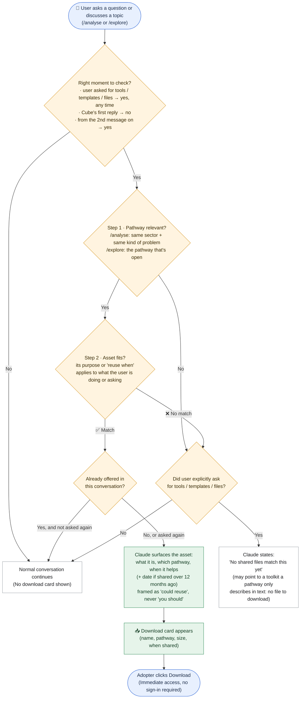
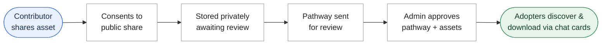

# Requirement: Store Toolkit Asset Files and Surface Them in Conversation

**Source:** Product Charter backlog item "Store toolkit-asset files, surface them in conversation" (Functional, status *In Progress* per the charter; see `docs/wiki/diffusion-cube/business/business-overview.md` → Roadmap). Requested by Anurag Goutam, 2026-09-29; scope revised 2026-09-30.

> Status: **Final scope, approved 2026-09-30. Behaviour rules added 2026-10-05** (see "How the assistant behaves" and "Flow charts"). Engineering detail and the full scenario list are in [`plan_toolkit_asset_files.md`](plan_toolkit_asset_files.md) → Appendix: Behaviour Specification; build tasks are in [`task_list_toolkit_asset_files.md`](task_list_toolkit_asset_files.md).

## The problem today

Every pathway in 100 Pathways describes "toolkit assets": ready-made things another team can reuse, such as a cost model, a checklist, an architecture note or a glossary. Today these are only **described in words** inside the pathway write-up. The real files never reach the app, so someone who wants the asset has to hunt for it themselves.

## What we are building

1. **Contributors attach the real asset.** While working on their pathway in the Contribute area, a contributor can upload the actual file (PDF, Word, PowerPoint, Excel, CSV/text, or image, up to 25 MB) or paste a link, for example a GitHub repository. ZIP files are not supported yet.
2. **The pathway names the assets; the contributor shares them (updated 2026-10-12).** The assets the contributor is asked for are the ones the draft's Section 4 (Toolkits and playbooks) lists. For each, they upload the file or add a link; a note says that anything shared is public once an admin approves the pathway, and to share only what they have the right to. Nothing is stored until they confirm.
3. **Assets are approved together with the pathway.** Each shared asset's name in Section 4 links to it (a file through the app's download route, a link to its own address), and it is sent for review with the pathway. The admin reviews the assets as part of the pathway, with a preview of each file. When the admin approves the pathway, its assets go live with it; there is no separate approval step for assets. An asset added after the pathway was sent for review goes live the next time the pathway is reviewed and approved.
4. **The assistant offers the assets in conversation.** Assets are not shown as a fixed list on screen. The assistant brings them up when they're relevant, and a download card appears under its reply:
   - **Explore (public library):** after a bit of conversation about a pathway, or as soon as someone asks about tools, templates or how to reuse it, the assistant says something like "these are the assets associated with this pathway".
   - **Analyse:** when someone's own project matches a pathway (same sector and same kind of problem), the assistant suggests that pathway's assets.
5. **Anyone can download.** Approved assets can be viewed and downloaded by anyone, with no sign-in needed.

## How the assistant behaves (added 2026-10-05)

### Contributor side

**Not every upload is a toolkit asset.** Most of what a contributor shares is background material that describes the deployment. Only something another team could pick up and use as-is counts as an asset. Being a PDF, being long, or being well written doesn't make a file an asset.

| Counts as a toolkit asset | Doesn't count (background material) |
|---|---|
| Checklists, templates, cost models, test sets, data schemas, glossaries | Interview transcripts, reports, case studies, meeting notes |
| A training deck another team could run as-is | A deck that describes the deployment (pitch, results, updates) |
| The contributor's own tool or code repository | A document explaining a design decision |
| An open-source tool or platform the deployment actually built on | A tool only mentioned in passing, or evaluated and not used |

Other rules:
- Files the assistant can't read (old Word or PowerPoint formats, scanned PDFs) are judged from the file name and what the contributor says. The assistant asks at most one short question, and only if nothing says what the file is.
- Links must be https and exactly as the contributor typed them. The assistant never builds or "corrects" a link.
- If the contributor insists on something that is background material, the assistant says so plainly and neutrally, without judging its quality.
- The assistant never comments on whether a file is good. It never asks about sharing in its own words; the resource review card does that.
- A file or link is only ever asked about once.

**Draft first, then the asset card (updated 2026-10-12).** Many contributors won't think to attach the actual files, so:
- Once the uploaded material is enough to build a pathway, the assistant settles the stage. If the documents state it, it doesn't ask. If they don't, it asks once: confirm its read, or pick from the four stages. A "yes" confirms its read, and the stage is never asked again. Then it drafts the pathway straight away.
- The assistant never asks open questions about the journey. Whatever the material doesn't establish is listed as a gap under the draft; the contributor can fill one in if they want, and the draft is revised.
- Right under the first draft, an **asset card** lists the reusable assets in the draft's **Section 4 (Toolkits and playbooks)**. Section 4 holds only Toolkit Asset and Playbook units, never Strategic Decision or Failure and Fix rows.
- For each asset the contributor can **upload the file** or **add a link**. When a file they uploaded earlier looks like that asset, the card offers **"Use the file you already uploaded"**. There is no Don't share option: an asset left without a file or link just stays unlinked. A file goes straight onto its row, with no check by the assistant in between.
- They can also add other assets (several files at once, or links). Each new one is named after its file, and they can rename it.
- At the end the card says **"Please confirm once you have shared all the reusable assets."** On **Confirm**, everything chosen is shared, and the app (not the model) **links each asset's name in Section 4, column 1**: a file to the app's download route, a link to its own address. An added asset gets its own row. Then the assistant asks whether to change the draft or send it for review.
- **When Section 4 lists no assets**, the card asks instead: **"Do you have any reusable assets that can be shared with others? If yes, please upload them and confirm."** Confirm with nothing added simply moves on.
- After Confirm, **Add more assets** reopens the card. A shared asset can be **removed** until the pathway is approved; its link leaves Section 4.
- If a later revision adds new assets to Section 4, a new card asks about just those. Nothing is asked about twice.
- Download links work for the contributor and admins straight away, and for everyone once the pathway is approved.
- There is no separate list of files at the bottom of the document.
- Before the pathway is sent for review, the contributor confirms the version is accurate and that it may be published to help future adopters. If not, they can keep it as a private draft, or delete the contribution (the workspace, drafts, and asset files not yet live).
- Asking is never a condition for publishing, and the assistant never says sharing would make the pathway "better" or "more complete".

### Adopter side

**When assets come up.**
- Never in the assistant's first reply, unless the person's very first message asks for tools, templates, files or downloads.
- From the second message onward, once the conversation is about a relevant pathway that has assets.
- Straight away whenever the person asks about tools, templates, resources, files, downloads, or how to implement or reuse something.
- Each asset is offered once, unless the person asks again.

**How well an asset fits.** Each asset is judged on its own:

| Fit | When | What the assistant says |
|---|---|---|
| **Match** | Matches the person's situation, question, or pathway, and its "reuse when" condition applies | Suggests the asset and explains what it is and how it can help them in this pathway, based on its purpose and "reuse when". Framed as something they *could* reuse, never "you should use this". |
| **No match** | Doesn't fit what the user is doing or asking about | Nothing about assets. If the person asked outright for templates or tools, it says plainly: *"No shared toolkit files match this yet."* It may then point to a toolkit a pathway only describes in its text, saying there's no file to download. |

The assistant only knows an asset's name, purpose, reuse condition and when it was shared. It never describes what's inside a file. When assets come from several pathways, it says which pathway each comes from; when two assets serve the same need, it offers both and doesn't pick one.

**How evidence is handled (Analyse, and dates in Explore).** These rules apply to everything the assistant says, not just assets:
- **Evidence spread across pathways:** it brings the pieces together into one explanation, with each point credited to the pathway and contributor it came from. Any part of the question no pathway covers is named as a gap.
- **No evidence:** it says plainly that nothing documented covers this. It never invents an answer or presents general advice as documented experience.
- **Conflicting evidence:** when adopters took different approaches or got different results, it shows each one with the circumstances it happened in, and doesn't pick a winner. If the pathways don't explain the difference, it says so.
- **Old evidence:** when it cites a cost, a vendor or model choice, a policy, or a measured result, it says when that's from. If it's more than 12 months old, it adds that technology, prices or policy may have changed since. If no date is documented, it says so. Download cards show when each asset was shared.

## Flow charts

### Contributor side (Login → Material → Stage → Draft → Asset card → Consent → Review → Publish)

Updated 2026-10-12: the stage is asked at most once, and only when the documents don't state it. The draft comes next, then the resource review. There are no journey questions. Admin change requests stay out of band (no in-app request or rejection, no reminders), and assets stay all-or-nothing with the pathway.

```mermaid
flowchart TD
    S(["Contributor logs in<br/>(/contribute)"]) --> T{"New or existing<br/>contribution?"}
    T -->|"+ New Contribution"| U0["Pick or create the pathway<br/>→ fresh workspace"]
    T -->|"Existing contribution"| V0["Open that pathway's<br/>existing workspace"]
    U0 --> A
    V0 --> A
    A(["Contributor opens the workspace"]) --> C["Opening notice: how material is used,<br/>nothing public without consent + admin approval,<br/>progress saved"]
    C --> E["Contributor shares documents / describes the project<br/>(more can be added at any point)"]
    E --> G["Cube reads the material<br/>(flags reusable files and links, and resources<br/>the material names but didn't attach)"]
    G --> P{"Enough to build a pathway?"}
    P -->|"No"| X1(["Cube says so; progress saved,<br/>contributor can return with more"])
    P -->|"Yes"| ST{"Stage stated<br/>in the documents?"}
    ST -->|"Yes"| D["First draft generated"]
    ST -->|"No"| S1["Cube asks once: confirm its read<br/>or pick the stage (a yes confirms)"]
    S1 --> D
    D --> SEC{"Section 4 lists<br/>reusable assets?"}
    SEC -->|"Yes"| R["Asset card: each Section 4 asset<br/>(no Don't share)"]
    SEC -->|"No"| R0["Asset card: 'Do you have any reusable assets<br/>that can be shared with others?'"]
    R --> U["Contributor uploads a file or adds a link per asset<br/>('Use the file you already uploaded' where one matches),<br/>and can add other assets"]
    R0 --> U
    U --> W{"'Please confirm once you have<br/>shared all the reusable assets'"}
    W -->|"Confirm"| XX["Shared (public once approved);<br/>app links each name in Section 4, column 1"]
    XX --> AM
    AM{"Contributor reviews the draft:<br/>change anything?"}
    AM -->|"Change request / fills a gap /<br/>corrects the stage"| RV["Draft revised"]
    RV --> AM
    AM -->|"New document"| G
    AM -->|"Send for review"| AR{"Version accurate, and may it be<br/>published to help future adopters?"}
    AR -->|"No, keep private"| KP(["Stays a private draft"])
    AR -->|"No, delete"| DEL(["Workspace, drafts and not-yet-live<br/>asset files deleted"])
    AR -->|"Yes"| AU["Sent for admin review<br/>(shared assets linked in Section 4)"]
    AU --> AV{"Admin decision"}
    AV -->|"Changes needed (out of band;<br/>contributor can Remove an asset)"| AM
    AV -->|"Publish"| PUB(["Pathway and its listed assets go live;<br/>contributor emailed"])

    classDef start fill:#E8F0FE,stroke:#3B6FD8,color:#1A2B4C
    classDef decision fill:#FFF4E0,stroke:#D99A2B,color:#3D2A00
    classDef consent fill:#F3E8FD,stroke:#8E44AD,color:#3B1A4F
    classDef step fill:#FFFFFF,stroke:#9AA0A6,color:#202124
    classDef done fill:#E6F4EA,stroke:#2E8B57,color:#123D22
    classDef stop fill:#F1F3F4,stroke:#BDC1C6,color:#5F6368

    class S,A start
    class T,P,ST,SEC,W,AM,AV decision
    class AR consent
    class U0,V0,C,E,G,S1,D,R,R0,U,XX,RV,AU step
    class PUB done
    class X1,KP,DEL stop
```

### Adopter side (Relevance & Download)

Updated 2026-10-09: the match check is split into its two steps, with the timing and "offered once" rules shown. This is the behaviour the `/analyse` and `/explore` prompts already follow.

#### How a match is decided

Cube only ever considers **published** assets, meaning those whose pathway an admin has approved. For each one it knows only the name, purpose, "reuse when" condition, source pathway and the date it was shared. It never knows what's inside the file.

**When Cube checks**
- **Never in its first reply**, unless the user's own message asks for tools, templates, resources, files or downloads.
- **From the user's second message on**, once the conversation is about a relevant pathway that has assets.
- **Straight away, at any point**, when the user asks about tools, templates, resources, files, downloads, or how to implement or reuse something.

**Step 1: Is the pathway relevant?**
- **`/analyse`:** the asset's pathway must match the user's situation on **the same sector AND the same kind of problem**. "Kind of problem" means the problem being solved, not the technology used. For a narrow, specific question, a close match on the problem alone is enough, and the sector doesn't need to match.
- **`/explore`:** the pathway the user has open. Only that pathway's assets are considered.

**Step 2: Does this asset fit?** Each asset is judged on its own, never a pathway's assets as a bundle.

| Result | When | What Cube does |
|---|---|---|
| **Match** | The asset's purpose or "reuse when" applies to what the user is working on or asking about | Mentions it once: what it is, which pathway it comes from, and when it helps, framed as something they *could* reuse, never "you should". A download card appears under the reply. |
| **No match** | It doesn't apply, even if the pathway does | Says nothing about it. Stretching an asset to fit is worse than leaving it out. |

**Also**
- **Explicit ask, nothing fits:** Cube says *"No shared files match this yet"*. It may point to a toolkit a pathway only describes in its text, saying there's no file to download.
- **Assets from several pathways:** Cube says which pathway each one is from. If two serve the same need, it offers both and picks neither.
- **Already offered:** not offered again unless the user asks again.
- **Older than 12 months:** where its purpose depends on things that change (prices, models, vendors, policy), Cube mentions when it was shared.
- **What the user sees on the card:** the app shows a card only for a real published asset. An asset ID the AI makes up shows nothing, and in `/explore` only the open pathway's assets can appear.

### End-to-end lifecycle

## Who it's for

- **Anyone exploring or analysing:** gets concrete, reusable material in the flow of the conversation.
- **Contributors:** their reusable work actually gets reused. This is groundwork for the charter's later "Incentivize Contributors" milestone (15-Jan-27).
- **Admins / Program Team:** review assets in the same step as the pathway, with no extra queue.

## Deliberately not included in this release

- ZIP files, a licence field, and admin uploads.
- Approving or rejecting individual assets. It's all or nothing with the pathway; to drop an asset, the admin asks the contributor to revise before approving.
- Withdrawing an asset once it's live.
- A fixed on-screen list of assets. Assets appear only through the conversation.
- Assets on the built-in curated pathways (MahaVISTAAR, Blue Dots and others) until they exist as contributor pathways, and backfilling the assets already described in existing write-ups.
- Enhancements (a toolkit catalogue, "adapt this template for me", download counts and feedback, versioning) are listed as a future roadmap in `plan_toolkit_asset_files.md`.

## Trade-offs and risks, in plain terms

- **Assets become public.** Once a pathway is approved, its files can be downloaded by anyone on the internet. The permission question says so plainly. It should be checked against the Terms of Use before launch.
- **There are no download limits yet**, so heavy or automated downloading could raise storage bandwidth costs. Adding limits is recommended; it ties in with the security review.
- **Files aren't scanned** for viruses or personal data. The admin's review of the pathway is the only check.
- **Discovery depends on the conversation.** Someone who never chats beyond the first overview won't be offered the assets. A fixed list is a possible fallback later.
- **The behaviour rules are AI instructions, not hard guarantees.** Matching, asking about named items, and evidence handling depend on the AI following its instructions, so they need testing with real conversations before launch. The general "Is there any asset…" question and the dates are built into the app and always happen.
- **The AI account expires 28-Oct-2026.** If it isn't renewed, the "is this an asset?" check and the in-conversation suggestions stop working. Uploading, approving and downloading keep working.
