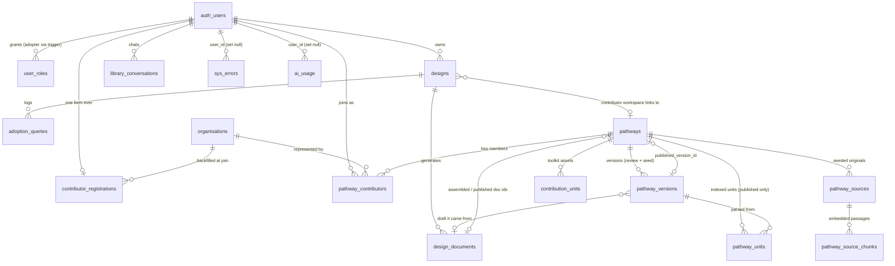

# Database

> Last verified against code: 2026-11-06 (HEAD `0a1ca00`). Schema after all 42 migrations.

The database is Postgres via Supabase, with no ORM: raw `.from('table')` and `.rpc()` calls throughout `lib/` and `app/api/`. The schema of record is 42 sequential files under [`supabase/migrations/`](../../../../supabase/migrations/). This page describes the schema **after all 42 migrations are applied**. See [`../architecture/repository-conventions.md`](../architecture/repository-conventions.md) for the migration-numbering convention.

Extensions: `pgvector` (`vector`, in the `extensions` schema, enabled in `0042`). Storage buckets (both private):

- **`toolkit-assets`** (`0034`): 25 MB, MIME allow-list.
- **`pathway-sources`** (`0042`): 50 MB.

Neither bucket has `storage.objects` policies, so only the service role can read or write them.

## ERD

`published_pathways` is a **view** (not shown as an entity): it is `pathways` joined to the published `pathway_versions` row, where `status = 'published'`. `rate_limits` has no foreign keys, because its `key` is a salted hash, not a user id.

## Live tables

| Table | Key columns | Relationships | RLS |
|---|---|---|---|
| `designs` | `id`, `user_id`, `meta` jsonb, `grid_state` jsonb, `messages` jsonb, `pathway_id` | `user_id`→`auth.users` cascade; `pathway_id`→`pathways` set null | Owner-only full CRUD |
| `design_documents` | `id`, `design_id`, `user_id`, `doc_type` (`analysis`\|`plan`\|`draft`), `version_number`, `content_hash`, `content` | `design_id`→`designs` cascade | Owner select/insert |
| `user_roles` | `(user_id, role)` PK; `role` ∈ {`adopter`,`pathway_contributor`,`admin`} (`general_user` rows and value dropped in `0039`) | `user_id`→`auth.users` cascade | Select-own only. Writes go through the service role or the `0039` trigger |
| `adoption_queries` | `id`, `design_id`, `user_id`, `content`, `pathway_slugs[]` | `design_id`→`designs` cascade | Insert-own only. **No select policy for any client role** |
| `contributor_registrations` | `id`, `user_id` unique, `organisation_name`, `pathway_role`, `pathway_description`, `poc_name`, `poc_email`, `public_links` (legacy name; holds the org website), `org_id`, `access_status` (`pending`\|`approved`\|`rejected`), `declaration_accepted`, `mou_accepted`, `terms_accepted_at`, `consent_name/logo/quote/blog`, `share_name`, `share_contact`, `contact_info` | `user_id`→`auth.users` cascade; `org_id`→`organisations` set null | Owner select/insert; admin select-all. No user UPDATE policy: the sharing columns change only through `POST /api/account/contact-sharing` |
| `organisations` | `id`, `name` unique, `url` (set once, never overwritten), `canonical_role` | none | Signed-in select. Writes go through the service role only |
| `pathways` | `id`, `slug` unique, `title`, `sector`, `description`, `created_by`, **`status`** (`draft`\|`in_review`\|`published`\|`retired`, default `draft`), **`published_version_id`**, **`is_seed`**, **`stage`**, **`location`**, **`tags[]`**, **`organisation`**, **`published_by`**, **`first_published_at`**, `content_cache`, `review_requested`, `assembled_design_doc_id`, `published_design_doc_id` | `created_by`/`published_by`→`auth.users` set null; `published_version_id`→`pathway_versions` set null; `*_design_doc_id`→`design_documents` | **Select only for the pathway's own contributors, or an `admin` role row** (`0040`; `ADMIN_EMAILS` admins are invisible to RLS, so admin routes use the service role). Insert requires the `pathway_contributor` role (`0020` `exists` policy). No update/delete policy |
| `pathway_versions` (`0042`) | `id`, `pathway_id`, `version_number`, `content`, `source` (`contributor`\|`seed`), `design_document_id`, `created_by`, `change_note`, unique `(pathway_id, version_number)` | `pathway_id`→`pathways` cascade; `design_document_id`→`design_documents` set null | Same audience as `pathways`: contributors of that pathway, plus admins. Writes go through the service role (`lib/pathway-store.ts`) |
| `pathway_units` (`0042`) | `id` text (`<slug>-uNN`), `pathway_id`, `version_id`, `unit_number`, `title`, `unit_type`, `dimension`, `sub_category`, `stage`, `also_relevant_at[]`, `applies_when`, `fails_when`, `body`, `adopter_intents[]`, `source_ids[]`, `fts` tsvector (trigger-maintained, weighted A/B/C), `embedding vector(384)` | `pathway_id`→`pathways` cascade; `version_id`→`pathway_versions` cascade | **Public select (`using (true)`)**. Writes go through the service role. Only published units exist: they are replaced on every publish. Indexes: GIN on `fts`, HNSW cosine on `embedding`, btree on `pathway_id` and `(dimension, stage)` |
| `pathway_sources` (`0042`) | `id`, `pathway_id`, `source_key` (`src-01`…), `file_name`, `storage_path` (in `pathway-sources`), `mime_type`, `extracted_text`, `is_public`, unique `(pathway_id, source_key)` | `pathway_id`→`pathways` cascade | RLS on, **no policies** (service role only). Seeded pathways only |
| `pathway_source_chunks` (`0042`) | `id`, `source_id`, `pathway_id`, `chunk_index`, `text`, `embedding vector(384)`, unique `(source_id, chunk_index)` | `source_id`→`pathway_sources` cascade; `pathway_id`→`pathways` cascade | RLS on, **no policies**. HNSW cosine index on `embedding` |
| `pathway_contributors` | `id`, `pathway_id`, `user_id`, `org_id`, `role`, unique `(pathway_id,user_id)` | `pathway_id`→`pathways` cascade; `user_id`→`auth.users` cascade; `org_id`→`organisations` set null | Signed-in select-all; insert-own row only. No delete policy (leaving goes through the service role) |
| `contribution_units` | `unit_internal_id`, `pathway_id`, `design_id`, `user_id`, `section`, `unit_type`, `dimension`, `stage`, `published_at`, `content`. Toolkit-asset columns from `0034`: `asset_kind` (`file`\|`link`), `asset_name`, `purpose`, `reuse_condition`, `storage_path`, `file_name`, `mime_type`, `size_bytes`, `link_url` (`https://` only), `share_consent`, `share_consented_at`. Unique `(pathway_id, unit_internal_id)` | `pathway_id`→`pathways` cascade; `design_id`→`designs` set null | Select: own rows plus anyone's published rows (signed-in). **No client write policies** since `0034`. Every write goes through service-role routes. A `contribution_units_toolkit_asset_shape` check enforces the shape of a toolkit-asset row |
| `library_conversations` | `id`, `user_id`, `pathway_slug`, `pathway_title`, `messages` jsonb | `user_id`→`auth.users` cascade | Full owner CRUD |

### The `published_pathways` view (`0042`)

The old `published_pathways` **table was dropped**, together with its rows (business decision Q21: the live library is rebuilt from the seed). It was recreated as a view that keeps the same column names, so existing readers keep working:

- `id`, `slug`, `title`, `description`
- `category`: the first two tags joined with ` · `, or `Community`
- `content`: from the published version
- `sector`, `location`, `tags`, `stage`
- `contributor_org`: `pathways.organisation`, or null
- `published_by`
- `created_at`: `first_published_at`, or the version's `created_at`

It reads `pathways` ⋈ `pathway_versions` on `published_version_id`, `where status = 'published'`. The view runs with its **owner's rights** (not `security_invoker`) and is granted `select` to `anon`/`authenticated`, so the public `/explore` page can read it without a session. Supabase's linter flags this. The choice is intentional (`plan_pathway_storage.md`).

`source_submission_id` and `commit_message` no longer exist.

## Server-only tables (monitoring and rate limiting, migrations `0035`–`0037`)

All three use the same pattern: **RLS enabled with no policies at all**, so no browser client (anon or authenticated) can read or write them. Every write and every admin-page read goes through the service-role client (`lib/supabase/admin.ts`). See [`../operations/monitoring.md`](../operations/monitoring.md).

| Table | Key columns | Written by | Read by |
|---|---|---|---|
| `sys_errors` | `id`, `created_at`, `source` (e.g. `api/chat`, `client:/explore`, `render:/analyse`), `message` (≤2,000 chars, scrubbed), `stack` (≤8,000 chars, scrubbed), `context` jsonb (allow-listed IDs/metadata only; `context->>'kind'` = `expected`\|`unexpected`), `user_id`→`auth.users` **set null**, `environment` ∈ {`prod`,`dev`} | `lib/errors.ts` (`logError`, `withErrorHandling`, `recordServerError`) | `/admin/errors`, `admin_usage_stats()` |
| `ai_usage` | `id`, `created_at`, `user_id`→`auth.users` **set null** (null for signed-out Explore), `area` ∈ {`explore`,`analyse`,`contribute`}, `mode` (including `retrieval-classify` and `check-similar`), `flow`, `model`, `input_tokens`, `output_tokens`, `cache_read_tokens`, `cache_creation_tokens`, `ok` | `lib/ai-usage.ts` (`recordAiUsage`), one row per Claude call. Counts only, never text | `admin_usage_stats()` |
| `rate_limits` | `(key, bucket)` PK. `key` = salted SHA-256 of `RATE_LIMIT_SALT:scope:subject`, where subject is the IP or, for `chat-user`, the user id (no raw IP stored). `bucket` ∈ {`minute`,`day`}, `window_start`, `count` | `check_rate_limit()` only | none |

## Database functions

Postgres functions are PUBLIC-executable by default. Each function below therefore explicitly `revoke`s execute from `public`/`anon`/`authenticated` and grants it to `service_role` only. The exceptions are the two trigger functions, which nobody calls directly.

| Function | Migration | Purpose |
|---|---|---|
| `purge_old_sys_errors(days default 30)` | `0035` | Deletes `sys_errors` rows older than `days`. `lib/errors.ts` calls it opportunistically, at most once per server instance per hour (no `pg_cron`) |
| `check_rate_limit(p_key, p_per_min, p_per_day)` | `0037` | Two atomic upserts (fixed minute and day windows), and returns whether both limits hold. A rejected request still counts. About 1% of calls delete keys idle for more than 2 days. Runs with invoker rights |
| `admin_usage_stats()` | `0038`, redefined in `0041` | One JSON object for `/admin/usage`: user totals/new/active, conversations per area, `ai_usage` per area, `sys_errors` per day (**grouped by IST / Asia/Kolkata days since `0041`**) and per source split by kind. `security definer` (it reads `auth.users`) with a fixed `search_path` |
| `grant_default_adopter_role()` + trigger `on_auth_user_created_grant_adopter` | `0039` | `after insert on auth.users`: inserts `(new.id, 'adopter')` with `on conflict do nothing`. `security definer`, `search_path = ''`. The migration also backfilled `adopter` for every existing user |
| `pathway_units_set_fts()` + trigger `pathway_units_fts` | `0042` | Keeps `pathway_units.fts` up to date on insert/update. Title is weighted A; adopter intents and conditions B; body C |
| `match_pathway_units(query_embedding, query_text, filter_slugs, filter_dimension, filter_stage, filter_types, match_count default 30, rrf_k default 50)` | `0042` | Hybrid search over **published** units. It combines cosine-similarity rank and full-text rank (`ts_rank_cd` over an OR'd `plainto_tsquery`) by reciprocal-rank fusion. Null filters are ignored. The stage filter also matches `also_relevant_at`. A null embedding means full-text only; neither vector nor text means filtered units in document order. Called by `lib/retrieval.ts` |
| `match_source_chunks(query_embedding, pathway_slug, match_count default 5)` | `0042` | The nearest passages from a published seeded pathway's **public** (`is_public`) source documents, with their similarity |

## Inert tables (created, never read or written by current code)

| Table | Why it's inert |
|---|---|
| `pathway_cache` | Migration `0002`. An AI-output cache keyed by slug; no code references it |
| `wiki_cache` | Migration `0004`. A GitHub-raw fetch cache from before the corpus moved in-repo; no code references it |
| `pending_signups` | Migration `0005`. A pre-auth signup queue with an approval token, superseded by OTP self-serve signup. RLS enabled with zero policies |

`contribution_units` is **no longer inert**. Since `0034`, the toolkit-assets feature writes it (`app/api/toolkit-assets/*`, `app/api/admin/pathways/publish`, `app/api/contributions/[designId]`), and the admin page and the contributor's document pane read it. See [`../knowledge/technical-debt.md#td-04`](../knowledge/technical-debt.md#td-04).

## Dropped tables

- **`pathway_submissions`, `pathway_submission_versions`, `pathway_submission_exec_summaries`**: dropped in `0018_drop_retired_tables.sql`. The dead code that queried them was deleted (MLC-12). See [`../knowledge/technical-debt.md#td-01`](../knowledge/technical-debt.md#td-01).
- **The `published_pathways` table**: dropped in `0042`, with all its rows, and replaced by the view of the same name (see above).

## Notable column semantics

- **`designs.pathway_id` is contributor-only.** It is always `null` for an Explorer adoption.
- **The pathway lifecycle lives on `pathways.status`.**
  1. A new row is `draft`.
  2. The first Send for Review (`saveVersion`, source `contributor`) moves `draft` → `in_review`.
  3. Admin publish sets `published` and points `published_version_id` at the latest version.

  A live pathway stays `published` while a newer version waits, and `review_requested` marks the waiting version. `0042` reset every existing row to `draft` or `in_review` (from `review_requested`), so nothing was published right after the migration. **No current code writes `retired`.**
- **`pathways.content_cache` / `review_requested` / `assembled_design_doc_id` remain.** `assemble` still writes them, and the admin panel's status badge is still derived from `review_requested` plus presence in the view. The canonical document history is now `pathway_versions`. `/api/admin/pathways/document` serves the latest version first, then falls back to `content_cache`.
- **The card fields on `pathways`** (`title`, `description`, `sector`, `stage`, `location`, `tags`, `organisation`) are **overwritten from the version's frontmatter on publish** (`publishVersion`). `first_published_at` is set once and never rewritten.
- **`is_seed`** marks pathways loaded by `scripts/seed-pathways.ts`. Only seeded pathways have `pathway_sources`/`pathway_source_chunks`, and they have versions but no `content_cache`.
- **`design_documents` is append-only, but only the latest row per `(design_id, doc_type)` is read back for `analysis`/`plan`.** `draft` is the one type where every version stays browsable (the version picker in `PathwayDocumentPane.tsx`).
- **`designs.document_review_turns_left` / `designs.typed_intro_turns_left`** (migration `0001`) are confirmed dead columns.

## Migration history (all 42, one line each)

| # | File | Purpose |
|---|---|---|
| 0001 | `designs.sql` | Base table: `meta`/`cube_state`/`messages` jsonb, owner-only RLS |
| 0002 | `pathway_cache.sql` | AI-output cache keyed by slug (now inert) |
| 0003 | `design_documents.sql` | Versioned Analysis/Plan doc storage (`doc_type` originally `analysis`\|`plan` only) |
| 0004 | `wiki_cache.sql` | GitHub-raw fetch cache (now inert) |
| 0005 | `pending_signups.sql` | Pre-auth signup queue (now inert) |
| 0006 | `user_roles.sql` | `(user_id, role)`, roles constrained to `general_user`\|`adopter`\|`pathway_contributor` |
| 0007 | `admin_role.sql` | Widens the role check to add `admin`; seeds two admins by email if already present |
| 0008 | `grid_revamp.sql` | **Destructive**: deletes old 7-dimension test rows; renames `cube_state`→`grid_state` |
| 0009 | `pathway_submissions.sql` | Contributor draft table (**dropped in 0018**) |
| 0010 | `adoption_queries.sql` | Insert-only log of companion user messages |
| 0011 | `adoption_queries_pathway_tags.sql` | Adds `pathway_slugs text[]` |
| 0012 | `published_pathways.sql` | Public pathway store, RLS public-read (**table dropped in 0042**) |
| 0013 | `pathway_submission_versions.sql` | Version history (**dropped in 0018**) |
| 0014 | `published_pathways_sector.sql` | Adds nullable `sector` |
| 0015 | `pathway_submission_exec_summaries.sql` | Internal-only exec summary table (**dropped in 0018**) |
| 0016 | `contributor_registrations.sql` | One-time `/contribute` intake gate |
| 0017 | `published_pathways_contributor.sql` | Adds `contributor_org text` |
| 0018 | `drop_retired_tables.sql` | **Drops** the three `pathway_submission*` tables in FK-safe order |
| 0019 | `organisations.sql` | Org registry, unique `name` |
| 0020 | `pathways.sql` | Canonical pathway entity, `content_cache`, RLS-enforced insert role check |
| 0021 | `pathway_contributors.sql` | Join table |
| 0022 | `contribution_units.sql` | Individually tagged content atoms |
| 0023 | `contributor_registrations_extend.sql` | `org_id` FK, `access_status`, sharing/consent fields |
| 0024 | `designs_pathway_fk.sql` | `designs.pathway_id`→`pathways`, set null |
| 0025 | `contribution_units_content.sql` | Adds `content`, drops `git_commit_sha` |
| 0026 | `schema_cleanup.sql` | Drops unused columns; renames `pathway_name`→`pathway_description`, `poc_role`→`pathway_role`, `org_role`→`role` |
| 0027 | `design_documents_draft_type.sql` | Widens the `doc_type` check to add `draft`. **Fixes a real bug**: every earlier Contributor draft insert had been silently failing this constraint |
| 0028 | `pathways_description.sql` | Adds `pathways.description` |
| 0029 | `library_conversations.sql` | Saved `/explore` chats |
| 0030 | `published_pathways_explore_fields.sql` | Adds `location`, `tags[]`, `stage` |
| 0031 | `pathways_review_requested.sql` | Adds `pathways.review_requested` |
| 0032 | `pathways_design_doc_ids.sql` | Adds `assembled_design_doc_id`/`published_design_doc_id` FKs |
| 0033 | `account_deletion.sql` | Relaxes FKs so self-serve account deletion keeps published content |
| 0034 | `contribution_units_toolkit_assets.sql` | Toolkit-asset columns and shape check on `contribution_units`, plus the private `toolkit-assets` bucket. **Drops** the client insert/update policies (not purely additive) |
| 0035 | `sys_errors.sql` | `sys_errors` table, two indexes, RLS with no policies, `purge_old_sys_errors()` |
| 0036 | `ai_usage.sql` | `ai_usage` table, index on `(created_at desc, area)`, RLS with no policies |
| 0037 | `rate_limits.sql` | `rate_limits` table, RLS with no policies, `check_rate_limit()` |
| 0038 | `admin_usage_stats.sql` | `admin_usage_stats()` (`security definer`, service role only) |
| 0039 | `default_adopter_role.sql` | Trigger grants `adopter` on every new `auth.users` row; backfills existing users; deletes `general_user` rows and drops the value from the role check |
| 0040 | `pathways_member_rls.sql` | Replaces "signed-in users can view pathways" with **contributors-of-that-pathway or `admin` role only**. Code that needs every pathway reads listing columns with the service role |
| 0041 | `admin_usage_stats_ist.sql` | Redefines `admin_usage_stats()` to group errors per day by IST. Additive |
| 0042 | `pathway_storage.sql` | **Destructive.** `pgvector`. New `pathways` lifecycle and card columns. New tables `pathway_versions`, `pathway_units`, `pathway_sources`, `pathway_source_chunks`. Functions `match_pathway_units`, `match_source_chunks`. **Drops the `published_pathways` table and recreates it as a view.** Adds the `pathway-sources` bucket |

## Source files

`supabase/migrations/0001` through `0042`; `lib/pathway-store.ts` (every pathway read/write); `supabase/functions/embed` (the embedding endpoint the vectors come from). `ARCHITECTURE.md` §4 predates `0034`–`0042`.
