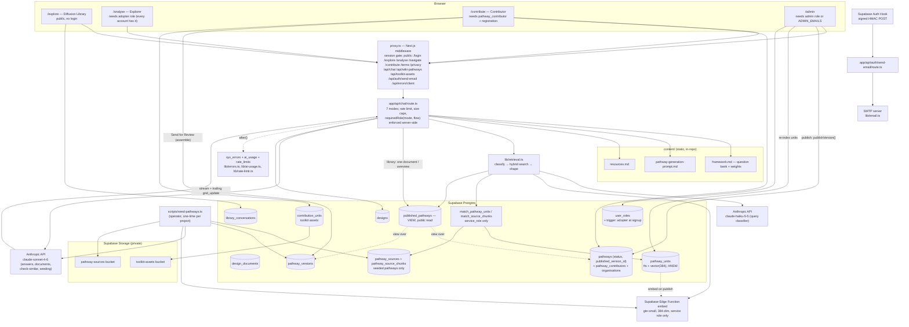
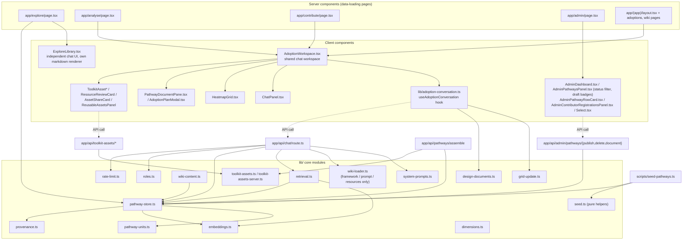
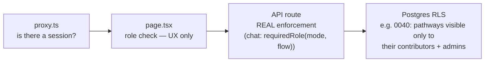

# Component Diagram

> **Updated 2026-11-06.** Pathways now live only in Supabase (migration `0042`); `content/` holds just the framework, the generation prompt, resources and legal text. GitHub is no longer a runtime dependency (`lib/github.ts` removed). Grounding is retrieved per message through a Haiku classifier, the `embed` Edge Function and `match_pathway_units`.

## System context

`DESIGNS`/`DOCS` writes after a model turn are made by the browser's client hook, not by the route — see [`coding-patterns.md`](coding-patterns.md#the-model-never-writes-to-the-database). The chat route itself writes only `adoption_queries`, `ai_usage` and `sys_errors`.

## Internal components (application layer)

**Notes on this diagram:**
- `lib/pathway-store.ts` is the single place pathways are saved (`saveVersion`), published (`publishVersion`) and read (`listPublished`, `getPublishedDocument(s)`, `buildOverview`, `adopterDocument`). It runs with the service role; callers check who may call. `lib/library-documents.ts`, `lib/library-pathways.ts` and `lib/github.ts` were removed.
- `AppShell.tsx` (Sidebar + content column) is the shared chrome for `/explore`, `/analyse`, `/contribute`, and the `(app)` route group — each builds its own instance rather than there being one central authenticated layout. `SiteHeader.tsx` survives only as the header on the zero-roles guard screen in `app/(app)/layout.tsx` (no longer reachable in normal use, since every account gets `adopter` at signup).
- `ExploreLibrary.tsx` deliberately does not reuse `ChatPanel.tsx` — it has its own markdown renderer, its own textarea, its own send button (the Library was ported from a separate standalone app; see [`knowledge/technical-debt.md`](../knowledge/technical-debt.md)).

## Three-deep enforcement (not a diagram duplicate — this is the access-control shape, cross-linked from business pages)

See [`business/users-and-personas.md`](../business/users-and-personas.md) for the full access-tier walkthrough this diagram supports.
