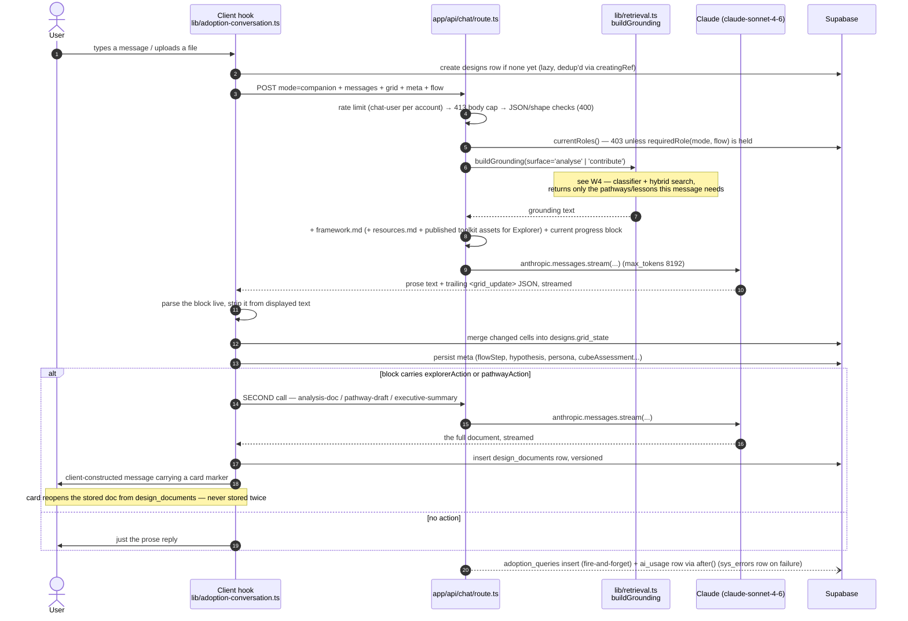
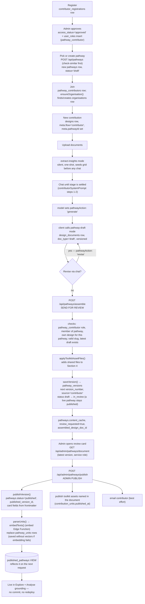
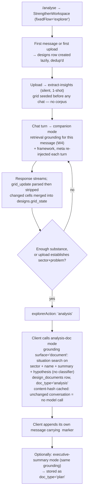
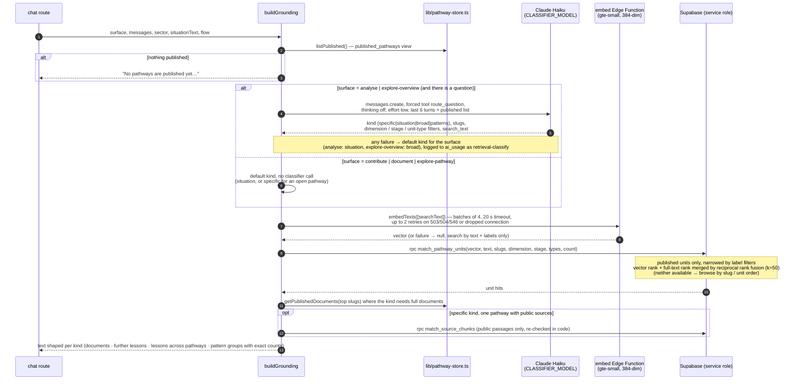
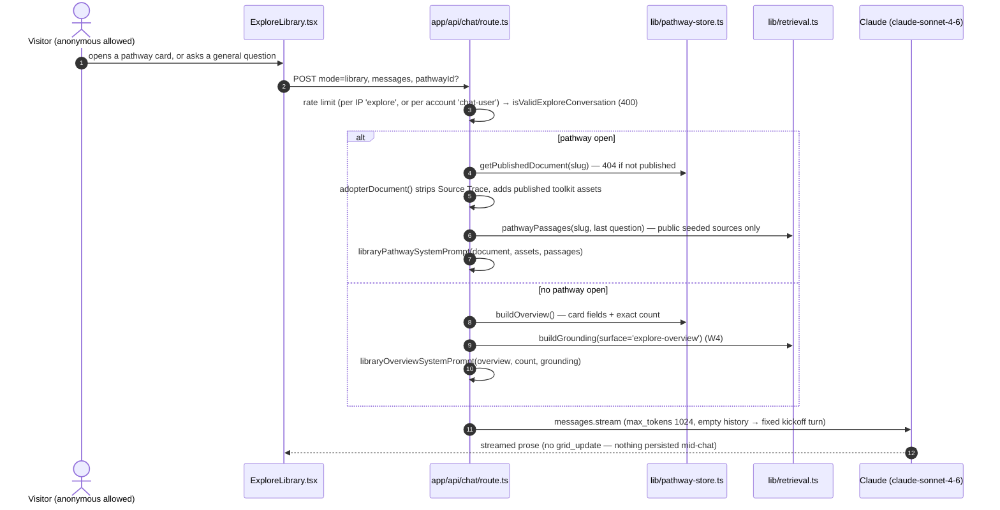
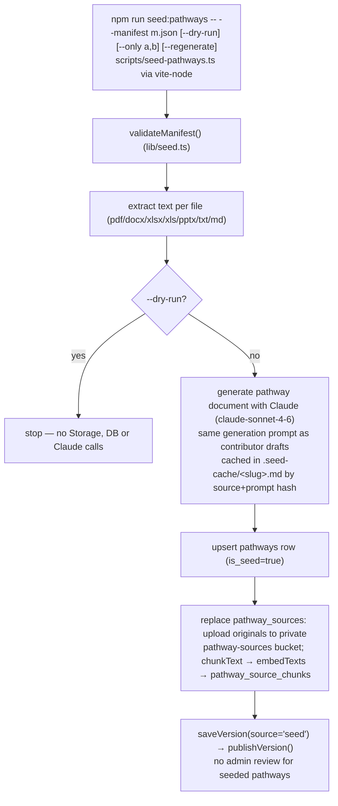
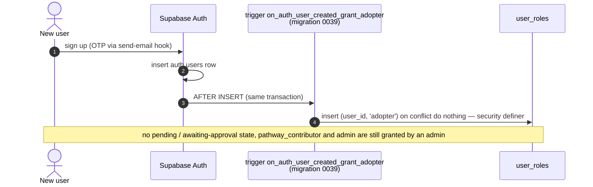

# Sequence & Workflow Diagrams

> Canonical file for both interaction sequences and business-workflow flowcharts. `business/workflows.md` links here rather than duplicating these diagrams.
>
> **Updated 2026-11-06** for the pathway-storage feature (`docs/features/pathway-storage/`, migration `0042`): pathways now live only in Supabase, every answer is grounded by per-message retrieval instead of the whole corpus, and contributor "assemble" no longer commits to GitHub.

<a id="w1"></a>

## W1 — Companion chat turn (`mode: 'companion'`)

Referenced by [`business/workflows.md#w1`](../business/workflows.md#w1-companion-chat-turn).



<a id="w2"></a>

## W2 — Contributor publishes a pathway (two-step: Send for Review → admin Publish)

Referenced by [`business/workflows.md#w2`](../business/workflows.md#w2-contributor-publish).



**What changed:** step `PUB1` used to commit the document to GitHub through `lib/github.ts` (and could fire a Vercel deploy on `main`). That module and the `GITHUB_*` env vars are gone; Send for Review now only appends a `pathway_versions` row. Nothing a contributor does is visible to any adopter until an admin publishes (`PUB2`). Skipped units (invalid labels) are returned to the admin panel as `skippedUnits`; the rest of the pathway still publishes.

**Delete = unpublish.** `POST /api/admin/pathways/delete` removes toolkit-asset files and seeded source files from storage, then deletes the `pathways` row; versions, units, sources, contributors and contribution units cascade, and the view drops the pathway in the same statement.

<a id="w3"></a>

## W3 — Explorer produces an Analysis Document

Referenced by [`business/workflows.md#w3`](../business/workflows.md#w3-explorer-analysis-document).



Only the latest row per `(design_id, doc_type)` is ever read back for `analysis`/`plan` — a regeneration supersedes rather than branching a version the user must choose between. `draft` (pathway documents) is the one `doc_type` where every version stays browsable via the version picker in `PathwayDocumentPane.tsx`.

<a id="w4"></a>

## W4 — Retrieval grounding (per message / per document)

Used by W1, W3 and the Library chat (W5). Source: [`lib/retrieval.ts`](../../../../lib/retrieval.ts), [`lib/embeddings.ts`](../../../../lib/embeddings.ts), `supabase/functions/embed/index.ts`, `match_pathway_units` in `supabase/migrations/0042_pathway_storage.sql`.



`LIMITS` (in `lib/retrieval.ts`) cap what each kind sends: `specific` 2 documents / 5 passages; `situation` 3 pathways, 2 full documents, 30 units; `broad` 8 pathways, 30 units; `patterns` 40 units. Pattern counts are computed in code (`groupPatterns`) and stated as exact, never left to the model. A database error throws (answered by `withErrorHandling`); classifier and embedding failures degrade silently.

<a id="w5"></a>

## W5 — Library chat (`mode: 'library'`, `/explore`, no login)



<a id="w6"></a>

## W6 — Seeding the pathway store (one-time, per Supabase project)



Re-running for a slug adds a new version and replaces its sources; nothing is duplicated. Only files marked `"public": true` in the manifest can ever reach an adopter as passages.

<a id="w7"></a>

## W7 — Default adopter role at signup



The old client call to `/api/auth/grant-default-role` and the admin "reject signup" route were removed. `hasAnyRole()` survives only as a guard on signed-in pages (`app/(app)/layout.tsx`) and some routes.

## The `<grid_update>` JSON contract (referenced by W1 and W3)

```json
{
  "cells": { "persona:Explore": { "density": 2, "note": "..." } },
  "meta":  { "name": "...", "sector": "...", "flowStep": 3, "hypothesis": "...", "persona": {"...": "..."}, "cubeAssessment": {"...": "..."} },
  "pathwaysReferenced": ["mahavistaar"],
  "flowStep": 3,
  "explorerAction": { "type": "analysis" },
  "pathwayAction":  { "type": "generate" }
}
```

Only one of `explorerAction` (Explorer/Analyse flow) or `pathwayAction` (Contributor flow) is ever present on a given contract, matching which system prompt built it (`lib/system-prompts.ts`). `pathwaysReferenced` is recorded into `adoption_queries.pathway_slugs` by the route. Full field reference: [`../integrations/ai-llm.md`](../integrations/ai-llm.md).
