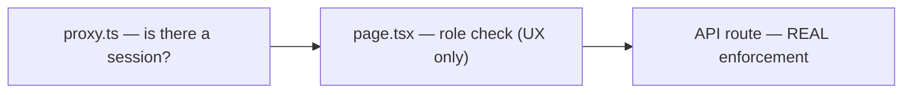

# Users and Personas

## Product personas (from framework/product intent)

- **Explorer (`adopter` role)** — someone analysing their own AI deployment against the documented pathways. Granted to every account by a database trigger at signup (migration `0039`), so every signed-in user is an Explorer. There is no pending/awaiting-approval state for new signups.
- **Contributor (`pathway_contributor` role)** — someone with a real deployment write-up who wants it turned into a new corpus pathway. Requires an admin-approved registration in addition to the role.
- **Admin** — role/registration/pathway management, including reviewing, publishing and deleting pathways. Granted via the `admin` role row or a permanent `ADMIN_EMAILS` environment allow-list.
- **Anonymous visitor** — no signup at all: full access to `/explore` (the public pathway library and its chat, rate-limited per IP), and can download any published toolkit asset linked from an answer.
- **General user (`general_user`)** — *removed.* Migration `0039` deleted any `general_user` rows and dropped the value from the `user_roles` check constraint; the `Role` type in `lib/roles.ts` is now `adopter | pathway_contributor | admin`.

## Operational roles inferred from code

| Role | Granted by | Gates |
|---|---|---|
| `adopter` | Every account, automatically, by the `on_auth_user_created_grant_adopter` trigger on `auth.users` (migration `0039_default_adopter_role.sql`, which also backfilled existing accounts). Not grantable or removable from the admin console (`app/api/admin/roles/route.ts` accepts only `pathway_contributor` and `admin`) | `/analyse`; Explorer work in `/api/chat` (`companion`/`extract-insights` with any flow other than `contributor`, `analysis-doc`, `executive-summary`) |
| `pathway_contributor` | Admin only, via `POST /api/admin/contributor-registrations/approve` (which also flips the registration's `access_status`) or `POST /api/admin/roles` (which keeps the registration's status in step on add and remove) | `/contribute` (combined with a registration row); Contributor work in `/api/chat` (`companion`/`extract-insights` with `flow: 'contributor'`, `pathway-draft`, `asset-reuse`); `POST /api/pathways`, `/api/pathways/[id]/join`, `/api/pathways/assemble`, `/api/pathways/check-similar`; toolkit-asset upload/register/remove |
| `admin` | Admin role row **or** email match against `ADMIN_EMAILS` | `/admin`, every `app/api/admin/*` route (roles, registrations, pathway document/publish/delete), preview of unpublished toolkit assets |
| *(no role)* | Now only reachable by direct database edits (e.g. a deleted `user_roles` row) | Pages show an "account awaiting approval" screen and `/api/chat` answers 403 "Your account doesn't have access yet. Please contact an administrator." (`hasAnyRole` checks remain in `app/(app)/layout.tsx`, `app/analyse/page.tsx`, `app/contribute/page.tsx`, `app/api/chat/route.ts`) |

## Access permissions

Enforcement is layered three deep, and only the last layer is the real gate:

- `proxy.ts` only checks for a signed-in session; it treats `/analyse` and `/contribute` as publicly reachable at the middleware layer, deliberately, so each page can render its own tiered anonymous / no-role / wrong-role / approved view rather than being redirected away entirely.
- `app/api/chat/route.ts` decides the role each call needs from its `mode` and `flow` (`requiredRole`) and checks it against the caller's database roles, regardless of what the UI showed. A missing `flow` runs the Explorer prompt and therefore needs `adopter`. Before any of that, the route rate-limits the caller (signed-in: per account, scope `chat-user`, default 30/min and 300/day via `CHAT_USER_RATE_LIMIT_PER_MIN`/`_PER_DAY`; anonymous: per IP, scope `explore`, 20/min and 200/day), then rejects oversized bodies, too many messages or over-long text with 413 and malformed JSON with 400 (`lib/rate-limit.ts`).
- **Pathway visibility (migration `0040_pathways_member_rls.sql`)**: a signed-in session can read only the `pathways` rows it contributes to (via `pathway_contributors`), plus every row for an `admin` role. Unpublished drafts are therefore not readable by other users through the REST API. Routes that need every pathway (the contributor's pathway selector `GET /api/pathways`, `check-similar`, the join route's existence check, `/api/admin/pathways/document`) read listing columns with the service role. Published content is public through the `published_pathways` view (migration `0042`), which shows only `status = 'published'` pathways.
- `app/api/pathways/route.ts` (POST) enforces `pathway_contributor` at the database RLS layer too (an `exists (select ... from user_roles)` policy on `pathways` insert), not only in application code — one of the few places enforcement exists at both layers independently.

## Toolkit asset access

| Who | Can |
|---|---|
| Contributor on the pathway | Upload a file or register an https link for an asset (after answering Yes to public sharing), see their own assets in any status plus other contributors' published ones, remove their own unpublished assets |
| Admin | Preview an unpublished asset while reviewing a pathway; publishing the pathway publishes exactly the assets listed in the reviewed document |
| Anyone (signed in or not) | Download a **published** asset via `GET /api/toolkit-assets/[id]/download` (listed in `proxy.ts` `PUBLIC_PATHS`); unpublished or unknown ids return 404 |

Source: `app/api/toolkit-assets/*`, `app/api/admin/pathways/publish/route.ts`, migration `0034`. Workflow: [W5](workflows.md#w5--toolkit-asset-sharing-and-reuse).

## Two independent gates on `/contribute` (contributor-specific)

1. A `contributor_registrations` row (organisation, point of contact, consents, MoU acceptance) — the one-time intake form.
2. The `pathway_contributor` role itself, granted by an admin.

Approving a registration (`app/api/admin/contributor-registrations/approve/route.ts`) does both in one action: it flips `access_status` to `approved` **and** upserts the `pathway_contributor` role — a contributor whose registration is approved does not need a second, separate role-grant step.

## Reconciliation with product vision

`CLAUDE.md` describes per-persona access as flowing from an explicit "intent" the Explorer picks from a four-card menu at the start of every session. That menu no longer exists in code — every `adopter` gets the same single 5-step `ANALYSE_FLOW` (`lib/explorer-intents.ts`), regardless of what job they came to do. The persona distinctions (initiative partner vs. funder vs. government official, etc., from `CLAUDE.md`'s `browse` intent) are not enforced or asked about anywhere in current code — they were product framing for the old menu, not a live access-control or personalization concept today.

## Planned vs. current Adopter/Contributor relationship

`docs/raw_documents/AI DIffusion Cube - Product Charter.docx` describes two persona-relevant capabilities not yet built, worth knowing before extending the role model:

- **"Adopter-to-Contributor Transition"** — the charter's stated intent is a *smooth* path where a user who starts out exploring or analysing can become a contributor over time, with the option to contribute surfaced "at the right moment" as their own adoption experience matures — explicitly **not** a hard switch between separate modes. Today's implementation is the opposite of smooth: the Explorer/Contributor choice is a one-time fork made by which entry point (`/analyse` vs `/contribute`) a user's *adoption* started from, permanently stored as `designs.meta.flow` and never revisited. A user can hold both `adopter` and `pathway_contributor` roles simultaneously today (nothing prevents it), but each individual adoption is locked to one flow for its lifetime — there is no in-conversation upgrade path.
- **Any user with an ongoing or planned adoption, "whether a new Adopter or an existing Contributor," can analyze it** — the charter's scope for "Analyze Own Adoption" does not gate this capability to the `adopter` role alone. This is now effectively met: Explorer work still requires `adopter`, but since migration `0039` every account (contributors included) holds `adopter` from signup and an admin cannot remove it, so a contributor can always analyse their own adoption at `/analyse`.
- **Connecting with the contributors/adopters behind a pathway, with consent, where relevant** — named in the charter's "Analyze Own Adoption" scope. No such connection mechanism (consent capture, contact surfacing, messaging) exists anywhere in this codebase; `contributor_registrations.share_name`/`share_contact`/`contact_info` control what's shown *about* a pathway's contributor in principle, but nothing in current code actually surfaces that to another user in the product.

## Source files

`lib/roles.ts`, `proxy.ts`, `app/api/chat/route.ts` (`requiredRole`), `lib/rate-limit.ts`, `app/api/admin/roles/route.ts`, `app/api/toolkit-assets/*`, `supabase/migrations/0034_contribution_units_toolkit_assets.sql`, `0039_default_adopter_role.sql`, `0040_pathways_member_rls.sql`, `0042_pathway_storage.sql`, `app/api/admin/contributor-registrations/approve/route.ts`, `supabase/migrations/0016_contributor_registrations.sql`, `supabase/migrations/0023_contributor_registrations_extend.sql`, `lib/explorer-intents.ts`, `docs/raw_documents/AI DIffusion Cube - Product Charter.docx`.
