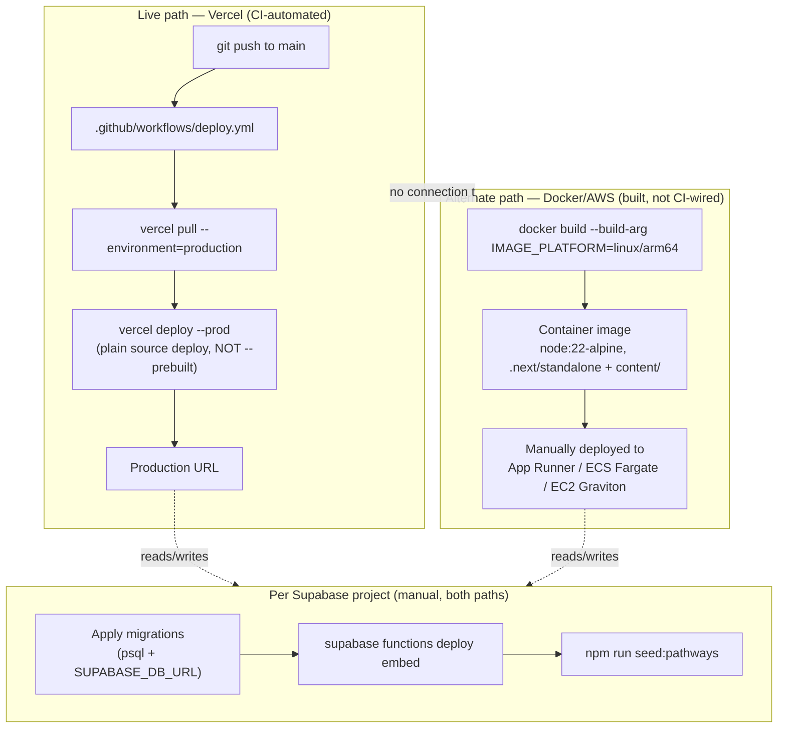

# Deployment

## Deployment topology



**The two app paths are genuinely independent** — no GitHub Actions job builds or pushes the Docker image anywhere, and the Vercel workflow never touches the Dockerfile. Whichever one is actually serving production traffic at any given time is an operational fact this repository cannot answer on its own; both are real, buildable paths. The **Supabase side (migrations, the `embed` Edge Function, seeding) is manual for both** — nothing in CI touches Supabase.

## The Vercel workflow, in detail

[`.github/workflows/deploy.yml`](../../../../.github/workflows/deploy.yml) (43 lines, the only workflow in `.github/workflows/`):

- Triggers on push to `main`, or manual `workflow_dispatch`.
- Node 24; installs `vercel@latest`, runs `vercel pull --environment=production`, then `vercel deploy --prod` — a **plain source deploy**, not `vercel build` + `vercel deploy --prebuilt`.
- Authenticated via `VERCEL_TOKEN`/`VERCEL_ORG_ID`/`VERCEL_PROJECT_ID` GitHub Actions secrets.
- **No test, lint or typecheck step.** A Vitest suite exists (`npm test`, ~105 test files under `tests/`), but CI does not run it — run it locally before merging to `main`. See [`../architecture/testing.md`](../architecture/testing.md) and [`../knowledge/technical-debt.md#td-03`](../knowledge/technical-debt.md#td-03).

**Why a plain source deploy, specifically** (documented in the workflow's own inline comment): Vercel's Hobby plan blocks deploys triggered by commits from a non-team-member author, with no way to add team members on that plan. A token-based deploy works around this — but Vercel's prebuilt/CI-flagged deploy path is *also* blocked under the same restriction even with a valid token, which is why this workflow deliberately uses the slower plain-source path instead of the normally-preferred build-then-deploy split.

## The Docker/AWS path, in detail

See [`infrastructure.md`](infrastructure.md#docker--aws-path) for the Dockerfile's structure. To build and run locally:

```bash
docker build --build-arg IMAGE_PLATFORM=linux/arm64 \
  --build-arg NEXT_PUBLIC_SUPABASE_URL=... \
  --build-arg NEXT_PUBLIC_SUPABASE_ANON_KEY=... \
  -t diffusion-cube .
docker run -p 3000:3000 --env-file .env.production diffusion-cube
```

Remember: `NEXT_PUBLIC_*` values must be passed as `--build-arg`, not just in the `--env-file` at run time — see the Dockerfile's own header comment and [`../architecture/configuration.md`](../architecture/configuration.md#build-time-vs-runtime-variables). Set `APP_ENV=prod` on this path (only Vercel production is auto-detected as `prod` in `sys_errors`).

> **Note:** No automated deployment pipeline exists for the Docker/AWS path in this repository — it is built and deployed manually using the steps documented here and in the Dockerfile's own comments. There is no rollback tooling, blue/green deploy script, or health-check gate defined in-repo for this path.

## Environment variables

`.env.example` at the repo root lists every variable the app reads, with defaults — copy it to `.env.local` locally, and set the same names in Vercel or the Docker env file. Full reference: [`../architecture/configuration.md`](../architecture/configuration.md).

- **No longer needed:** `GITHUB_TOKEN`, `GITHUB_REPO`, `GITHUB_BRANCH` (pathways no longer commit to GitHub) and `WIKI_PATH` (no pathway files on disk). Remove them from existing environments; nothing reads them.
- **New since the pathway-storage work:** none for the app itself — the `embed` function is reached with the existing `NEXT_PUBLIC_SUPABASE_URL` + `SUPABASE_SERVICE_ROLE_KEY`. Per-account chat limits `CHAT_USER_RATE_LIMIT_PER_MIN` / `_PER_DAY` (defaults 30 / 300) are optional.
- `SUPABASE_DB_URL` is not read by the app — it is the connection string used to apply migrations with `psql`.

## Supabase project setup (per environment)

Dev and prod are separate Supabase projects; each needs every item below. Migrations are plain SQL files applied in number order, e.g. `psql "$SUPABASE_DB_URL" -f supabase/migrations/0039_default_adopter_role.sql`.

| Item | Command / action | Notes |
|---|---|---|
| `0039_default_adopter_role.sql` | `psql` as above | Adds an `auth.users` trigger granting `adopter` at signup (replacing the deleted `/api/auth/grant-default-role` call); backfills every existing account; deletes any `general_user` rows and drops that value from the role check. Safe any time. |
| `0040_pathways_member_rls.sql` | `psql` | Restricts `pathways` SELECT to a pathway's own contributors + admins. **Deploy app code that lists pathways through the service role first** (`GET /api/pathways`, `check-similar`, the join route, `/api/admin/pathways/document`) — older code listed through the session client and would see only the caller's own (the migration's header comment). |
| `0041_admin_usage_stats_ist.sql` | `psql` | Additive: `/admin/usage` errors-per-day grouped by IST. Safe any time. |
| `embed` Edge Function | `supabase functions deploy embed --project-ref <ref>` | Keep default JWT verification — **never `--no-verify-jwt`** (the function's own comment). If it is missing, search still runs on full text + labels, but no unit or passage gets a vector. |
| `0042_pathway_storage.sql` | `psql` | **DESTRUCTIVE — see warning below.** Enables `pgvector`; creates `pathway_versions`, `pathway_units`, `pathway_sources`, `pathway_source_chunks`, the `match_pathway_units` / `match_source_chunks` search functions (service role only) and the private `pathway-sources` bucket; drops and recreates `published_pathways` as a view. |
| Seed the library | `npm run seed:pathways -- --manifest path/to/manifest.json [--dry-run] [--only slug1,slug2] [--regenerate]` | Needs `0042` and the `embed` function first. Reads `.env.local` (or the environment): `NEXT_PUBLIC_SUPABASE_URL`, `SUPABASE_SERVICE_ROLE_KEY`, `ANTHROPIC_API_KEY`. Manifest format: `scripts/seed-manifest.example.json`. |

**Ordering constraints** (from the migration headers and `plan_pathway_storage.md` → Sequencing, which ships prod as "migration, function, seed, deploy"):

- Current app code needs `0042`: Explore/Analyse grounding calls `match_pathway_units`, and assemble/publish write `pathway_versions`. Between deploying current code and applying `0042`, those requests fail with a 500 (`/admin/errors` shows the missing relation/function).
- Between applying `0042` and finishing the seed, the library is empty (see the warning below). Keep that window short, or seed dev first and rehearse.
- `0040` only after the service-role listing code is live (any build from the commit that introduced `0040` onward does this).
- There is no feature flag or legacy switch — rollback is a revert and redeploy (plan → "no legacy switch"), and the dropped `published_pathways` rows only come back from a database backup.

> **Warning — migration `0042` is destructive.** It drops the `published_pathways` **table and every row in it** (business decision Q21 — the live library is rebuilt from the seed) and recreates `published_pathways` as a VIEW over `pathways` + `pathway_versions` with the same columns, so existing readers keep working. **Every existing `pathways` row loses its published state** (status becomes `in_review` or `draft`). Until step 7 runs, `/explore`, `/wiki` and Analyse grounding have **no published pathways at all**. Take a backup (or export `published_pathways`) before running it on a project whose current rows matter — see [`disaster-recovery.md`](disaster-recovery.md).

> **Note:** The recreated `published_pathways` view runs with its owner's rights (not `security_invoker`) so the public `/explore` page can read it without a session. Supabase's database linter flags this; the migration's own comment says it is intentional and **must not be "fixed"** — doing so would break the public library.

### What the seed script does

`scripts/seed-pathways.ts` (+ helpers in `lib/seed.ts`), per pathway in the manifest: extracts text from each file (`pdf`, `docx`, `xlsx`/`xls`, `pptx`, `txt`, `md`) → generates the pathway document with Claude (`claude-sonnet-4-6`, the same generation prompt contributors' drafts use) → only then writes the `pathways` row, uploads the original files to the private `pathway-sources` bucket, stores their text and embedded passages, creates a version and **publishes it with no admin review** (business decisions Q3/Q20). Files are contributor-only unless marked `"public": true` in the manifest (Q22). Re-running for a slug adds a new version and replaces its sources — nothing is duplicated. Each generated document is cached at `<manifest folder>/.seed-cache/<slug>.md` (keyed by a hash of the sources, framework and prompt) so a re-run after a failure doesn't pay for generation again; `--regenerate` ignores it. `--dry-run` validates and extracts only (no Storage, database or Claude calls). Claude calls are recorded in `ai_usage` as mode `seed-pathway`.

> **Note:** The seed's source documents (the manifest and its files) are not in this repository — whoever runs the seed keeps them. After seeding, the originals also live in the `pathway-sources` bucket. See [`disaster-recovery.md`](disaster-recovery.md).

## Operational dependency risk (from the Product Charter)

> **Note:** This is an operational fact, not a code finding — recorded here because nothing else in the repository would surface it. Per `docs/raw_documents/AI DIffusion Cube - Product Charter.docx`'s "Dependencies" section (Execution Approach, §4):
>
> - **Anthropic/Claude API access** was a **free account with an expiry date of 28-Oct-2026**; the charter said a new account/license needed to be planned before that date. **That date has now passed** (this page was refreshed 2026-11-06). Whether the account was renewed or replaced cannot be determined from the repository — check with whoever holds the Anthropic account relationship. Every AI-backed feature (`/api/chat`, the retrieval classifier in `lib/retrieval.ts`, `/api/pathways/check-similar`, and `npm run seed:pathways` — see [`ai-llm.md`](../integrations/ai-llm.md)) depends on `ANTHROPIC_API_KEY` resolving to a working account. A lapsed key would show up as `unexpected` errors in `/admin/errors` and `ok:false` rows in `ai_usage` (the retrieval classifier fails soft, the chat itself does not).
> - **AWS account** is a **free account expiring December 2026**. The charter says a new account needs to be planned for by November 2026 to allow time to migrate. This affects the Docker/AWS deployment path described above (currently "prepared groundwork," per the Product Charter's own "Deployment in AWS environment" requirement status of "Not started" — see [`../business/business-overview.md#roadmap-planned-not-yet-implemented`](../business/business-overview.md#roadmap-planned-not-yet-implemented)), not the live Vercel path.
>
> Neither expiry date nor its resolution is tracked anywhere in application code or CI config. See [`../knowledge/technical-debt.md#td-16`](../knowledge/technical-debt.md#td-16).

## Publishing a pathway no longer deploys anything

Before the pathway-storage work, a contributor's assemble committed a file to GitHub (and could trigger this Vercel workflow if the target branch was `main`). That is gone: assemble now saves a `pathway_versions` row, and admin publish points the pathway at that version and indexes its units — **both are database writes that take effect on the next request, with no commit and no redeploy**. The `publish pathway: <slug>` commits in older history are from the retired GitHub flow. See [`../business/workflows.md#w2--contributor-publish`](../business/workflows.md#w2--contributor-publish).

## Source files

`.github/workflows/deploy.yml`, `Dockerfile`, `.dockerignore`, `next.config.ts`, `.env.example`, `package.json` (scripts), `supabase/migrations/0039_default_adopter_role.sql`–`0042_pathway_storage.sql`, `supabase/functions/embed/index.ts`, `scripts/seed-pathways.ts`, `scripts/seed-manifest.example.json`, `scripts/vite-node.config.mts`, `lib/seed.ts`, `docs/features/pathway-storage/plan_pathway_storage.md`, `docs/raw_documents/AI DIffusion Cube - Product Charter.docx`.
